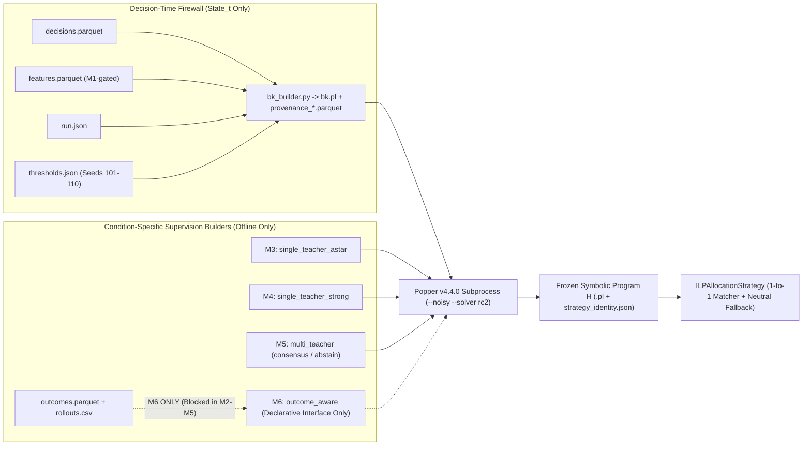

# M2: ILP Data-Layer Design Specification

Status: needs-triage

> [!IMPORTANT]
> **PRELIMINARY DESIGN — Awaiting M1 Acceptance & Supervision Freeze**
>
> This document specifies the complete data-layer, relational hypothesis language, Popper v4.4.0 integration contract, supervision isolation architecture, and execution-time matching semantics for **Milestone M2 (`ILP Data Layer`)** through **M6 (`Outcome-Aware ILP`)**.
> - **No production ILP code** has been written in `src/`, `docs/`, `runs/`, or GUI.
> - **No outcome-label generation** has been implemented; M6 supervision appears strictly as a declarative interface contract awaiting researcher sign-off on M1 parameters $(H, \lambda, \delta, J)$, fleet-density regime selection, and congestion-feature partial-association screening.
> - All Popper v4.4.0 (`860cd0de`) syntax and solver claims in this specification were verified directly against the installed source in `.pixi/envs/default/lib/python3.12/site-packages/popper/` and a `<2 s` 10-fact synthetic syntax check in `.scratch/m2-ilp-data-layer/popper_syntax_check/` (zero simulator runs, zero real seeds touched).

---

## 1. Scope, Scientific Boundary, and Package Architecture

### 1.1 Scientific Invariants Enforced by M2
Per `AGENTS.md`, `docs/DECISIONS.md`, `docs/ROADMAP.md`, and `docs/EXPERIMENT_PROTOCOL.md`:
1. **Fixed Infrastructure Invariance**: Learned ILP strategies implement the exact `BatchAllocationStrategy` interface (`src/task_management/task_management/allocation_strategy.py:86–105`) and execute through unchanged directed A* routing, one-way traffic control, robot kinematics, service durations, and Battery V1 charging/preemption/holding logic.
2. **Causal Firewall ($\text{State}_t \to \text{Decision}_t \to \text{Outcome}$)**: Background knowledge (`bk.pl`) and online rule evaluation are pure deterministic functions of $\text{State}_t$. Realized waiting, actual completion duration, realized energy drain, charging events, and counterfactual rollout deltas belong exclusively to offline post-decision supervision and outcome auditing.
3. **Hard Eligibility Gate**: Only feasible pairs (`eligible == True`, i.e., `route_reachable and battery_eligible` using decision-time SOC and deterministic travel + service + charger + 10% reserve) enter `bk.pl` candidate predicates, `exs.pl` examples, or online rule matching.
4. **Controlled Supervision Ablation**: M3 (`single_teacher_astar`), M4 (`single_teacher_strong`), M5 (`multi_teacher`), and M6 (`outcome_aware`) share the **exact same** `bk.pl` builder, frozen `thresholds.json`, `bias.pl` hypothesis space, Popper solver wrapper, and online 1-to-1 matching resolver, differing **solely** in how `exs.pl` (`pos`/`neg` supervision) is constructed.

### 1.2 Target Module Layout (Planned for M2 Implementation — Not Yet Created)
To keep the `State_t` firewall mechanically enforceable via static import checks and unit tests, M2 implementation will live in an isolated pure-Python ROS-independent package `src/ilp_learning/` (wired into `src/task_management/` only via a lightweight `BatchAllocationStrategy` subclass):

```text
src/ilp_learning/
  ilp_learning/
    atoms.py                  # Run- & decision-scoped SHA-256 Prolog atom encoder + provenance tables
    thresholds.py             # Training-only (seeds 101-110) threshold fitter + frozen JSON digest
    bk_builder.py             # PURE State_t -> ground Datalog bk.pl (ZERO outcome/rollout imports)
    bias_templates.py         # Validated Popper v4.4.0 bias.pl generator (Tier A core + M1-gated Tier B)
    sampler.py                # Deterministic stratified decision & hard/uniform negative sampler
    popper_runner.py          # Isolated 1-call-per-subprocess Popper v4.4.0 driver (PYTHONHASHSEED=0)
    rule_compiler.py          # Parses learned Prolog clauses -> AST + StrategyIdentity + M7 trace hooks
    matcher.py                # Online 1-to-1 batch matching + work-conserving fallback + tie-breaker
    supervision/
      common.py               # SupervisionSet dataclass, E+ ∩ E- == ∅ invariant, exs.pl writer
      single_teacher.py       # M3 (nearest_astar) & M4 (strong baseline) supervision builders
      multi_teacher.py        # M5 offline BatchAllocationStrategy.assign() portfolio + consensus rules
      outcome_contract.py     # M6 DECLARATIVE-ONLY protocol (implemented only in M6 after M1 freeze)
```



---

## 2. Run-Scoped Identifiers, Bijective Provenance, and Identifier Non-Leakage (Requirement 1)

### 2.1 Multi-Run Collision & Bias Failure Modes in Raw `dataset_export.py`
The existing single-run helper `src/simulation_env/simulation_env/dataset_export.py:55–125` emits raw atoms `d0, d1, ...`, `robot_000`, and `o0001`. Across a multi-run corpus (sweeping seeds `101–110`, multiple fleet sizes, or multiple dispatch quanta), raw naming causes three fatal defects:
1. **Cross-run atom collision**: `decision_id` restarts at `0` in every run (`d0` merges facts from distinct runs into one chimeric decision), while `robot_000` and `o0001` collide across every run.
2. **Cross-decision entity leakage**: Reusing `robot_000` across decisions $d_0, d_1, \dots$ within the same run would allow any improperly scoped predicate to join a robot's state across time steps.
3. **Lexical rank correlation**: Raw strings preserve numeric creation/index order (`robot_000 @< robot_001`, `o0001 @< o0002`), violating `AGENTS.md` ("Identifiers") if any downstream tool inspects atom order.

### 2.2 Keyed Opaque Run- & Decision-Scoped Prolog Atom Scheme
Every Prolog constant emitted to `bk.pl` and `exs.pl` is a deterministic, lowercase ASCII unquoted identifier matching `^[d|r|o]_[0-9a-f]{16}$` (18 characters, valid in both Clingo 5.8.2 and SWI-Prolog without quotes):

$$\begin{aligned}
\text{atom\_decision}(u, d) &= \texttt{"d\_"} \;\|\; \operatorname{hex}_{16}\!\big(\operatorname{SHA256}(\texttt{"m2:v1:dec:"} \| u \| \texttt{":"} \| \operatorname{str}(d))\big) \\
\text{atom\_robot}(u, d, r) &= \texttt{"r\_"} \;\|\; \operatorname{hex}_{16}\!\big(\operatorname{SHA256}(\texttt{"m2:v1:rob:"} \| u \| \texttt{":"} \| \operatorname{str}(d) \| \texttt{":"} \| r)\big) \\
\text{atom\_order}(u, d, o) &= \texttt{"o\_"} \;\|\; \operatorname{hex}_{16}\!\big(\operatorname{SHA256}(\texttt{"m2:v1:ord:"} \| u \| \texttt{":"} \| \operatorname{str}(d) \| \texttt{":"} \| o)\big)
\end{aligned}$$

where $u$ is `run_id` (`run.json`), $d \in \mathbb{Z}_{\ge 0}$ is `decision_id`, $r$ is `robot_id` (`"robot_000"`), and $o$ is `order_id` (`"o0001"`).

**Why scope `R` and `O` to `(run_id, decision_id, entity_id)` rather than `(run_id, entity_id)`?**
- **Within decision $D$**: Every candidate row $(u, d, r, o)$ sharing the same $(u, d, r)$ maps to the **exact same** robot atom `R`, and every row sharing $(u, d, o)$ maps to the **exact same** order atom `O`. All within-decision bipartite joins (e.g., comparing two orders $(R, O_1)$ and $(R, O_2)$ for robot $R$, or two robots $(R_1, O)$ and $(R_2, O)$ for order $O$) are 100% preserved.
- **Across decisions $D_1 \neq D_2$**: Robot and order Herbrand universes for $D_1$ and $D_2$ are **completely disjoint** ($\mathcal{R}(D_1) \cap \mathcal{R}(D_2) = \emptyset$, $\mathcal{O}(D_1) \cap \mathcal{O}(D_2) = \emptyset$). Even without relying on mode declarations, no Prolog clause can ever join entities across two different decisions or across two runs.
- **Order-independence & collision guarantee**: Content-addressed hashing means adding or reordering runs never renumbers existing atoms. With 64-bit digests ($2^{64} \approx 1.84 \times 10^{19}$), collision probability across $10^7$ entities is $< 3 \times 10^{-6}$, and `atoms.py` enforces **exact bijectivity** at export time via a hard uniqueness assertion (`if len(atom_to_key) != len(key_to_atom): raise AtomCollisionError(...)`).

### 2.3 Bijective Provenance Schema (M7 Explanations & Audit Joins)
Alongside every generated Popper workspace (`bk.pl`, `exs.pl`, `bias.pl`), the exporter writes three immutable Parquet provenance tables enabling O(1) bidirectional translation between Prolog groundings and raw warehouse records:

| Table | Primary Key | Bijective Partner Key | Additional Audit Columns |
| :--- | :--- | :--- | :--- |
| `provenance_decisions.parquet` | `decision_atom` (`string`) | `(run_id, decision_id)` | `seed` (`int32`), `seed_split` (`string`), `fleet_size` (`int32`), `dispatch_quantum_s` (`float64`), `sim_time` (`float64`), `free_robots` (`int32`), `window_orders` (`int32`) |
| `provenance_entities.parquet` | `entity_atom` (`string`) | `(run_id, decision_id, entity_kind, raw_id)` | `decision_atom` (`string`), `entity_kind` (`"robot"` \| `"order"`) |
| `provenance_candidates.parquet` | `(decision_atom, robot_atom, order_atom)` | `(run_id, decision_id, robot_id, order_id)` | `eligible` (`bool`), `c_static_m` (`float64`), `est_finish_s` (`float64`), `fifo_position` (`int32`), `energy_margin_exact` (`float64`), `sampled_in_bk` (`bool`), `exs_split_role` (`"pos"` \| `"neg"` \| `"abstained"` \| `"unsampled"`) |

**M7 Explanation Join Contract**: When rule clause $c_k \in H$ fires on `(d_..., r_..., o_...)` via witness substitution $\theta$ (e.g., `O2 = o_...`), joining $\theta$ against `provenance_entities.parquet` reconstructs human-readable domain explanations (`"Assigned robot_014 to o0082 at t=142.0s in run 20261028_... because o0082 had the lowest directed A* distance (38.0 m) among 6 eligible orders for robot_014 and unique energy eligibility"`), while never exposing raw IDs to the learner.

### 2.4 Strict Enforcement of `AGENTS.md` ("Identifiers")
1. **Zero `constant/2` directives in `bias.pl`**: Popper v4.4.0 can bind head/body arguments to specific ground atoms **only** when `constant(Type, Value).` is declared in `bias.pl` (`lp/alan.pl` / `gen2.py:53`). `bias_templates.py` emits **zero** `constant/2` declarations; every rule variable is universally quantified.
2. **Forbidden predicate classes**: No predicate may test `robot_id` index, `order_id` number (`o0001`), robot home/spawn index, `dropoff_id` name, `charger_id` name, or cross-decision identity. Note that `fifo_position` is a **legitimate queue-age feature** (an order's 0-based slot in the current pending FIFO dispatch window at $\text{State}_t$, already used by `nearest_astar`, `earliest_finish`, `multi_criteria`, and `auction`), distinct from the identifier string `order_id`.
3. **Destruction of lexical ID order**: Keyed SHA-256 randomizes lexical atom order uniformly across $(u, d, r)$ and $(u, d, o)$, so even internal SWI-Prolog fact indexing order is uncorrelated with `robot_000..robot_099`.

---

## 3. Strict Separation of Decision-Time BK from Realized Outcomes (Requirement 2)

### 3.1 Architectural Data-Source Firewall
`bk_builder.py` accepts **exclusively** the frozen decision-time tuple:

```python
@dataclass(frozen=True)
class DecisionStateRunInput:
    run_id: str
    run_manifest: Mapping[str, Any]          # parsed run.json ONLY
    decisions_df: pd.DataFrame               # decisions.parquet ONLY
    features_df: pd.DataFrame | None = None  # features.parquet ONLY (if Tier B enabled)
```

- **Hard Schema Whitelist**: `bk_builder.py` projects `decisions_df` onto an explicit `ALLOWED_DECISION_COLUMNS` frozenset before computing any predicate. Note that `selected` (the behavioral policy action recorded in `decisions.parquet`) is **also excluded from `ALLOWED_DECISION_COLUMNS`** inside `bk_builder.py` so the policy's own action cannot leak into `bk.pl`!
- **`route_cells` Join Guard**: Both `decisions.parquet` (`dataset.py:179`) and `features.parquet` (`congestion.py:57`) contain `route_cells`. When Tier B is active, `bk_builder.py` asserts `np.array_equal(dec["route_cells"], feat["route_cells"])` on `(decision_id, robot_id, order_id)` and drops the duplicate column from `features_df` before merging (preventing pandas `route_cells_x` / `route_cells_y` merge bugs).
- **Derivation of `est_finish_s` at $\text{State}_t$**: Because `decisions.parquet` records `c_static_m` and `order_shelf_count` while kinematic/service constants live in `run.json`, `bk_builder.py` computes decision-time predicted completion duration identically to `DecisionTiming.finish_s` (`features.py:52–60`):
  $$\hat{T}_{\text{finish}}(r, o) = \frac{\texttt{c\_static\_m}(r, o)}{\texttt{run\_manifest["speed\_mps"]}} + \texttt{order\_shelf\_count}(o) \cdot \texttt{run\_manifest["shelf\_pick\_s"]} + \texttt{run\_manifest["dropoff\_s"]}$$
  using zero realized waiting or post-decision execution data.

### 3.2 Predicate-by-Predicate `State_t` Legality Audit Table
Every predicate in the M2 hypothesis language is a pure deterministic function of $\text{State}_t$ within a single decision $D$, evaluated **solely over eligible rows** $\mathcal{E}(D) = \{(r, o) \in D : \texttt{eligible} = \text{True}\}$:

| Tier | Predicate / Arity | Exact Source Columns | $\text{State}_t$ Definition (Evaluated on $\mathcal{E}(D)$ Only) | Proof of Zero Future Leakage |
| :--- | :--- | :--- | :--- | :--- |
| **A1** | `best_cost_for_robot(D,R,O)` `/3` | `decisions`: `c_static_m` | $c_{\text{static}}(r,o) \le \min_{o' \in \mathcal{O}_D(r)} c_{\text{static}}(r,o') + 10^{-9}$ | Static directed A* route cost on fixed W100 graph at $t$. |
| **A1** | `second_cost_for_robot(D,R,O)` `/3` | `decisions`: `c_static_m` | $c_{\text{static}}(r,o)$ equals the 2nd smallest distinct value in $\{c_{\text{static}}(r,o') : o' \in \mathcal{O}_D(r)\}$ | Pure within-$D$ static route rank at $t$. |
| **A1** | `near_best_cost_for_robot(D,R,O)` `/3` | `decisions`: `c_static_m`; `thresholds`: $\tau_{\text{regret}}$ | $\frac{c_{\text{static}}(r,o) - \min_{o'} c_{\text{static}}(r,o')}{\max(\min_{o'} c_{\text{static}}(r,o'), 1.0)} \le \tau_{\text{regret}}$ | Relative static detour ratio at $t$; $\tau_{\text{regret}}$ fit on training seeds `101–110`. |
| **A1** | `best_cost_for_order(D,R,O)` `/3` | `decisions`: `c_static_m` | $c_{\text{static}}(r,o) \le \min_{r' \in \mathcal{R}_D(o)} c_{\text{static}}(r',o) + 10^{-9}$ | Compares current free robots' static directed A* costs to $o$ at $t$. |
| **A1** | `best_finish_for_robot(D,R,O)` `/3` | `decisions`: `c_static_m`, `order_shelf_count`; `run.json` | $\hat{T}_{\text{finish}}(r,o) \le \min_{o' \in \mathcal{O}_D(r)} \hat{T}_{\text{finish}}(r,o') + 10^{-9}$ | Nominal travel + deterministic pick/dropoff time; zero realized waiting. |
| **A1** | `best_finish_for_order(D,R,O)` `/3` | `decisions`: `c_static_m`, `order_shelf_count`; `run.json` | $\hat{T}_{\text{finish}}(r,o) \le \min_{r' \in \mathcal{R}_D(o)} \hat{T}_{\text{finish}}(r',o) + 10^{-9}$ | Nominal completion rank across free robots at $t$. |
| **A1** | `oldest_eligible_for_robot(D,R,O)` `/3` | `decisions`: `fifo_position` | $\texttt{fifo\_position}(o) = \min_{o' \in \mathcal{O}_D(r)} \texttt{fifo\_position}(o')$ | Queue arrival slot in current dispatch window at $t$. |
| **A1** | `highest_margin_for_robot(D,R,O)` `/3` | `decisions`: `energy_margin_exact` | $\texttt{margin}(r,o) \ge \max_{o' \in \mathcal{O}_D(r)} \texttt{margin}(r,o') - 10^{-9}$ | Uses `robot_soc_exact - required_soc_exact` at $t$ (no waiting drain). |
| **A1** | `unique_robot_for_order(D,R,O)` `/3` | `decisions`: `eligible` | $|\mathcal{R}_D(o)| = 1$ and $r \in \mathcal{R}_D(o)$ | Degree-1 order in feasible bipartite graph $\mathcal{E}(D)$ at $t$. |
| **A1** | `unique_order_for_robot(D,R,O)` `/3` | `decisions`: `eligible` | $|\mathcal{O}_D(r)| = 1$ and $o \in \mathcal{O}_D(r)$ | Degree-1 robot in feasible bipartite graph $\mathcal{E}(D)$ at $t$. |
| **A2** | `cheaper_for_robot(D,R,O1,O2)` `/4` | `decisions`: `c_static_m` | $o_1, o_2 \in \mathcal{O}_D(r)$ and $c_{\text{static}}(r,o_1) + 10^{-9} < c_{\text{static}}(r,o_2)$ | Strict pairwise static route comparison at $t$. |
| **A2** | `cheaper_robot_for_order(D,R1,R2,O)` `/4` | `decisions`: `c_static_m` | $r_1, r_2 \in \mathcal{R}_D(o)$ and $c_{\text{static}}(r_1,o) + 10^{-9} < c_{\text{static}}(r_2,o)$ | Strict cross-robot static route comparison at $t$. |
| **A3** | `single_shelf_order(D,O)` `/2` | `decisions`: `order_shelf_count` | $\texttt{order\_shelf\_count}(o) = 1$ | Known static order item/shelf list at $t$. |
| **A3** | `multi_shelf_order(D,O)` `/2` | `decisions`: `order_shelf_count` | $\texttt{order\_shelf\_count}(o) \ge 3$ | Known static order item/shelf list at $t$. |
| **A3** | `front_of_window_order(D,O)` `/2` | `decisions`: `fifo_position` | $\texttt{fifo\_position}(o) = 0$ | Head of current pending FIFO queue at $t$. |
| **A3** | `aging_window_order(D,O)` `/2` | `decisions`: `fifo_position`, `window_width` | $\texttt{fifo\_position}(o) \ge \max(1, \lceil 0.75 \cdot (\texttt{window\_width} - 1) \rceil)$ | Dimensionless relative slot inside configured window at $t$. |
| **A3** | `low_soc_robot(D,R)` `/2` | `decisions`: `robot_soc_exact`; `thresholds`: $\tau_{\text{soc,q25}}$ | $\texttt{robot\_soc\_exact}(r) \le \tau_{\text{soc,q25}}$ | Instantaneous robot battery state at $t$. |
| **A3** | `tight_energy_margin(D,R,O)` `/3` | `decisions`: `energy_margin_exact`; `thresholds`: $\tau_{\text{mar,q20}}$ | $0 \le \texttt{energy\_margin\_exact}(r,o) \le \tau_{\text{mar,q20}}$ | Deterministic margin above Battery V1 reserve at $t$. |
| **A3** | `ample_energy_margin(D,R,O)` `/3` | `decisions`: `energy_margin_exact`; `thresholds`: $\tau_{\text{mar,q50}}$ | $\texttt{energy\_margin\_exact}(r,o) > \tau_{\text{mar,q50}}$ | Disjoint from `tight_energy_margin` ($\tau_{\text{mar,q20}} < \tau_{\text{mar,q50}}$). |
| **A3** | `near_charger_dropoff(D,R,O)` `/3` | `decisions`: `predicted_charger_distance_m`; `thresholds`: $\tau_{\text{chg,q25}}$ | $\texttt{predicted\_charger\_distance\_m}(o) \le \tau_{\text{chg,q25}}$ | Static directed A* distance from order's dropoff to nearest charger. |
| **A3** | `batch_contention(D)` `/1` | `decisions`: `free_robots`, `window_orders` | $\texttt{free\_robots}(D) \ge 2 \land \texttt{window\_orders}(D) \ge 2$ | Multi-robot batch context at $t$. |
| **A3** | `high_fleet_busy_ratio(D)` `/1` | `decisions`: `free_robots`, `robots_busy`, `robots_charging`; `thresholds`: $\tau_{\text{busy,q75}}$ | $\frac{\texttt{robots\_busy}}{\max(1, \texttt{free\_robots} + \texttt{robots\_busy} + \texttt{robots\_charging})} \ge \tau_{\text{busy,q75}}$ | Instantaneous fleet utilization ratio at $t$ (dimensionless `[0,1]`). |
| **A3** | `high_queue_pressure(D)` `/1` | `decisions`: `pending_orders`, `free_robots`, `robots_busy`, `robots_charging`; `thresholds`: $\tau_{\text{q,q75}}$ | $\frac{\texttt{pending\_orders}}{\max(1, \texttt{free\_robots} + \texttt{robots\_busy} + \texttt{robots\_charging})} \ge \tau_{\text{q,q75}}$ | Instantaneous queue-per-robot backlog at $t$ (dimensionless). |
| **A3** | `charging_active(D)` `/1` | `decisions`: `robots_charging` | $\texttt{robots\_charging}(D) \ge 1$ | Count of robots currently in Battery V1 charging workflow at $t$. |
| **B** *(M1-gated)* | `lowest_overlap_for_robot(D,R,O)` `/3` | `features`: `overlap_ratio` | $\texttt{overlap\_ratio}(r,o) \le \min_{o' \in \mathcal{O}_D(r)} \texttt{overlap\_ratio}(r,o') + 10^{-9}$ | Uses only remaining planned cells of robots **already busy** at $t$ (`congestion.py:98–103`). |
| **B** *(M1-gated)* | `conflict_free_30s(D,R,O)` `/3` | `features`: `st_conflicts_30s` | $\texttt{st\_conflicts\_30s}(r,o) = 0$ | Nominal cell-time projection within `NEAR_TERM_S = 30.0 s` against already-issued routes at $t$ (`congestion.py:52–53, 180–184`); zero traffic lookahead. |
| **B** *(M1-gated)* | `high_route_overlap(D,R,O)` `/3` | `features`: `overlap_ratio`; `thresholds`: $\tau_{\text{ov,q75}}$ | $\texttt{overlap\_ratio}(r,o) \ge \tau_{\text{ov,q75}}$ | Fraction of candidate static path shared with currently committed busy routes at $t$ (`congestion.py:192`). |
| **B** *(M1-gated)* | `high_st_conflict_30s(D,R,O)` `/3` | `features`: `st_conflicts_30s`; `thresholds`: $\tau_{\text{st30,q75}}$ | $\texttt{st\_conflicts\_30s}(r,o) \ge \tau_{\text{st30,q75}}$ | Near-horizon (`<= 30.0 s`, `+-2` moves) coincidences with already-committed busy routes at $t$ (`congestion.py:180–184`). |
| **B** *(M1-gated)* | `congested_dropoff(D,O)` `/2` | `features`: `dropoff_load`; `thresholds`: $\tau_{\text{drop,q75}}$ | $\texttt{dropoff\_load}(o) \ge \tau_{\text{drop,q75}}$ | Count of currently busy robots whose remaining stops include `order.dropoff_id` at $t$ (`congestion.py:197`). |
| **B** *(M1-gated)* | `congested_shelf_zone(D,O)` `/2` | `features`: `shelf_load`; `thresholds`: $\tau_{\text{shelf,q75}}$ | $\texttt{shelf\_load}(o) \ge \tau_{\text{shelf,q75}}$ | Count of currently busy robots whose remaining stops include any `shelf in order.shelf_ids` at $t$ (`congestion.py:198`). |
| **B** *(M1-gated)* | `high_local_density(D,R)` `/2` | `features`: `local_density`; `thresholds`: $\tau_{\text{dens,q75}}$ | $\texttt{local\_density}(r) \ge \tau_{\text{dens,q75}}$ | Other robots within Manhattan radius `DENSITY_RADIUS = 5` of robot $r$'s cell at $t$ (`congestion.py:54, 199–203`). |

### 3.3 Mandatory Automated Anti-Leakage Verification Suite
M2 acceptance requires four automated pytest gates in `src/ilp_learning/test/test_anti_leakage.py`:
1. **Outcome Deletion & Adversarial Scrambling Byte-Identity Gate**:
   - Build `bk.pl` and `provenance_*.parquet` on a multi-run directory containing full `decisions.parquet`, `features.parquet`, `outcomes.parquet`, and `rollouts.csv`; record `SHA-256(bk.pl)`.
   - Delete `outcomes.parquet` and `rollouts.csv` completely and rebuild -> assert **exact byte-for-byte SHA-256 equality**.
   - Write corrupted `outcomes.parquet` (`waiting_s = 1e9`, inverted completion times, all `charged_after_order = True`) and scrambled `rollouts.csv`, plus flip `decisions.parquet["selected"] = ~decisions.parquet["selected"]`, and rebuild `bk.pl` -> assert **exact byte-for-byte SHA-256 equality**.
2. **Temporal Prefix-Truncation Causality Gate**:
   - For an arbitrary cutoff $t_k$, truncate `decisions.parquet` and `features.parquet` to `sim_time <= t_k` and rebuild `bk.pl` using the same frozen `thresholds.json`. Assert that for every decision atom $D$ with `sim_time <= t_k`, the set of ground facts mentioning $D$ is **set-identical** to the full-run build (proving zero lookahead normalization across future decisions $t' > t_k$ of the same run).
3. **Static AST & `sys.modules` Firewall Gate**:
   - Parse ASTs of `atoms.py`, `thresholds.py`, `bk_builder.py`, `rule_compiler.py`, and `matcher.py`; assert zero imports of `outcome_signal` or `rollout`, and zero string literals matching `outcomes.parquet`, `rollouts.csv`, `realized_`, `waiting_s`, or `delta_j`.
4. **Seed-Split Threshold Gate**:
   - Pass mock runs tagged with seed `111` (`validation`), `1` (`evaluation`), and `201` (`final`) into `fit_thresholds()`; assert `SeedLeakageError` (`src/simulation_env/simulation_env/seed_split.py:42`, via `check_purpose(..., purpose="training")`) is raised unconditionally before any quantile is computed.

---

## 4. Eligibility Mask, Target Formulation, Supervision Sets, and Execution Matching (Requirement 3)

### 4.1 Hard Infrastructure Eligibility Gate (`eligible == True`)
Let $\mathcal{C}(D) = R_{\text{free}}(D) \times O_{\text{window}}(D)$ be all candidate pairs at decision $D$, and let:

$$\mathcal{E}(D) = \{(r, o) \in \mathcal{C}(D) : \texttt{route\_reachable}(r, o) \land (\texttt{required\_soc\_exact}(r, o) \le \texttt{robot\_soc\_exact}(r))\}$$

be the `eligible == True` subset (`dataset.py:194–195`, `allocation_strategy.py:66–68`). M2 enforces three hard invariants:
1. **BK Restriction**: Relational and rank predicates in `bk.pl` are computed and emitted **only** over $(r, o) \in \mathcal{E}(D)$. An unreachable or energy-ineligible order never masks a valid order from being `best_cost_for_robot(D, R, O)`.
2. **Supervision Restriction ($E^+(D) \cup E^-(D) \subseteq \mathcal{E}(D)$)**: Ineligible pairs are **never** emitted as `pos(...)` or `neg(...)` examples. Including `eligible == False` rows in $E^-$ would reward Popper under MDL for wasting rule literals re-discovering the already-hardcoded Battery V1 / directed-reachability mask instead of learning allocation trade-offs among feasible choices.
3. **Execution Hard Filter**: `ILPAllocationStrategy.assign()` filters `eligible_candidates = [c for c in candidates if c.eligible]` **prior** to evaluating any learned clause or fallback. Even an unconstrained tautological clause cannot dispatch an ineligible pair.

### 4.2 Target Formulation Analysis: Unary Selection vs. Pairwise Preference
We evaluate the three candidate ILP target formulations under Popper v4.4.0 (`gen2.py` + `lp/alan.pl` + `rc2` MaxSAT) on W100 batch decisions (where $R=100, q=3, w=20$ yields up to $|\mathcal{E}(D)| \approx 442$ eligible pairs per decision; `.scratch/m1-review/2026-10-28-review.md`):

| Criterion | **Formulation A (Recommended Primary)**: Unary Selection `assign(D, R, O)` `/3` | **Formulation B1 (Documented Alternative)**: Within-Robot Preference `prefer_order(D, R, O1, O2)` `/4` | **Formulation B2 (Rejected)**: Cross-Pair Preference `better_pair(D, R1, O1, R2, O2)` `/5` |
| :--- | :--- | :--- | :--- |
| **Head Types & Directions** | `(decision, robot, order)`, `(in, in, in)` | `(decision, robot, order, order)`, `(in, in, in, in)` | `(decision, robot, order, robot, order)`, `(in,in,in,in,in)` |
| **Candidate Groundings / Decision** | $O(|\mathcal{E}(D)|) \le 442$ | $O(\sum_r |\mathcal{O}_D(r)|^2) \le 8,400$ | $O(|\mathcal{E}(D)|^2) \le 195,364$ |
| **`gen2.py:66` Var Permutations per Pred** | `max_vars(4)` $\implies P(4,3) = 24$ | `max_vars(4)` $\implies P(4,4) = 24$ (no slack var!) or `max_vars(5)` $\implies P(5,4)=120$ | Requires `max_vars(5..6)` $\implies P(6,5)=720$ (explodes `alan.pl:57` grounding) |
| **Cross-Robot Batch Trade-offs ($q=3$)** | **Yes** — naturally combines `(D,R,O)` robot-rank, order-rank (`best_cost_for_order`), and degree-1 bottleneck literals | **No** — compares two orders for *fixed* robot `R`; blind to whether another free robot `R2` is much closer to `O1` | Yes, but at $440\times$ example blowup per decision |
| **Execution Consistency** | Direct bipartite subgraph $E_H(D) \subseteq \mathcal{E}(D)$ fed to 1-to-1 matcher; no cycle pathology | Learned rules need **not** be antisymmetric or transitive ($O_1 \succ O_2 \succ O_3 \succ O_1$), requiring Copeland/Kemeny tournament tie-breaking per robot *before* cross-robot matching | Tournament cycles over 442 nodes + bipartite matching still required afterward |
| **M7 Rule Readability** | High: *"Assign $(R,O)$ when $O$ is $R$'s lowest-finish-time option and dropoff is uncongested"* | Medium for 1 robot; opaque for batch conflict resolution | Low (5-argument clauses comparing 2 robots and 2 orders simultaneously) |

**Design Decision**: **Formulation A (`assign(D, R, O)`)** is selected as the primary M2–M7 target formulation. Notice that Formulation A loses **zero** comparative expressiveness relative to B1/B2 because Tier A1 provides within-decision rank predicates (`best_cost_for_robot`, `best_cost_for_order`, `unique_robot_for_order`) and Tier A2 provides explicit existential binary comparison predicates (`cheaper_for_robot(D, R, O2, O)`, `cheaper_robot_for_order(D, R2, R, O)`) when `max_vars(4)` is active.
- *Alternative B1 Hook*: If researcher review requests a diagnostic pairwise ranking experiment on single-robot ($q=0$) decisions, `prefer_order(D, R, O1, O2)` can reuse the **exact same `bk.pl` and provenance tables** by swapping only `head_pred(prefer_order,4).` in `bias.pl` and emitting ordered pairs $(O_1, O_2) \in \mathcal{O}_D(r)^2$ in `exs.pl` (converting entailed preferences at execution time via net Copeland score $s(r, o) = |\{o' : H \models \text{prefer}(r,o,o')\}| - |\{o' : H \models \text{prefer}(r,o',o)\}|$).

### 4.3 Exact Positive ($E^+$) and Negative ($E^-$) Example Semantics
For any choice-bearing decision $D$ under a single deterministic teacher matching $M_T(D) \subseteq \mathcal{E}(D)$ (M3 and M4; see Section 6 for M5 consensus and M6 outcome interface):

$$\begin{aligned}
E^+_{\text{full}}(D) &= \big\{\texttt{assign}(D, r, o) : (r, o) \in M_T(D)\big\} \\
E^-_{\text{full}}(D) &= \big\{\texttt{assign}(D, r, o) : (r, o) \in \mathcal{E}(D) \setminus M_T(D) \;\land\; \big(|\mathcal{O}_D(r)| \ge 2 \lor |\mathcal{R}_D(o)| \ge 2\big)\big\}
\end{aligned}$$

(with stratified negative capping $E^-(D) \subseteq E^-_{\text{full}}(D)$ defined in Section 5.5). Note the non-triviality filter inside $E^-_{\text{full}}(D)$: if an isolated connected component $(r, o)$ of $\mathcal{E}(D)$ had $|\mathcal{O}_D(r)| = |\mathcal{R}_D(o)| = 1$, $(r, o)$ faced zero alternatives; forced pairs are excluded from $E^+(D)$ as well when filtering at candidate granularity so Popper is never rewarded for covering zero-choice assignments.

> [!WARNING]
> **Epistemic Semantics of Teacher Negatives (Mandatory Audit Distinction)**
>
> Under teacher imitation (M3, M4, M5), an atom $\texttt{assign}(D, r, o) \in E^-(D)$ is a **teacher-choice negative** (`label_epistemic_type = "teacher_unselected"` in `supervision_manifest.parquet`), **NOT an observed or counterfactual bad outcome**. Because a 1-to-1 matching can select at most one order per robot and one robot per order, a pair $(r, o)$ with near-optimal cost $c_{\text{static}} = 24.5\text{ m}$ becomes a teacher negative merely because $(r, o^*)$ had $c_{\text{static}} = 24.0\text{ m}$ or because another robot $r'$ claimed $o$. Only M6 (`outcome_aware`) labels pairs by counterfactual outcome deltas $\Delta J$. Documentation, M7 explanations, and thesis text must never describe M3–M5 negatives as "bad outcomes".

### 4.4 Execution-Time 1-to-1 Matching, Uncovered-Robot Fallback, and Anti-Circularity Tie-Breaking
At simulation time $t$, `ILPAllocationStrategy.assign(candidates, free_robots, pending_orders)` receives a batch of free robots $R_{\text{free}}$ and window orders $O_{\text{win}}$. Learned program $H = [c_1, \dots, c_m]$ (clauses ordered by ascending `clause_rank` $0 \dots m-1$, sorted offline by Laplace-smoothed training precision $\hat{p}(c_k) = \frac{\text{TP}_k + 1}{\text{TP}_k + \text{FP}_k + 2}$, breaking ties by smaller body size then canonical string) may fire on **multiple conflicting pairs** (many-to-one / one-to-many) or on **fewer pairs than maximum feasible cardinality $K^*$** (including zero pairs).

#### Step 1 — Ground BK Evaluation on $\mathcal{E}(D)$
Compute the decision's ground Tier A (and enabled Tier B) relations over $\mathcal{E}(D)$. For each $(r, o) \in \mathcal{E}(D)$:
- If one or more clauses in $H$ entail `assign(D, r, o)`, set `tier(r, o) = 0` and `clause_rank(r, o) = min { k : c_k entails (r, o) }`.
- Otherwise, set `tier(r, o) = 1` (work-conserving fallback tier) and `clause_rank(r, o) = m`.

*(Why a work-conserving fallback is mandatory)*: Every conventional baseline in `allocation_strategy.py` assigns a maximal or maximum-cardinality matching on $\mathcal{E}(D)$; leaving free robots idle when feasible unassigned orders exist in the window artificially depresses throughput and confounds allocation quality with deliberate idling. However, **every assignment records telemetry** (`matched_by_rule: bool`, `clause_rank: int | None`) so fallback rate is explicitly measured and gated!

#### Step 2 — Anti-Circularity Neutral Domain Tie-Break Tuple
A critical scientific pitfall in M3 (`nearest_astar` reproduction) is **tie-break circularity**: if the tie-breaker / fallback placed `c_static_m` first, then an **empty** program $H = \emptyset$ or a degenerate tautology `assign(D,R,O) :- near_best_cost_for_robot(D,R,O)` would silently execute `nearest_astar`!

To make tie-break circularity **impossible**, M2 defines the **Queue-First Neutral Priority Key** for every $(r, o) \in \mathcal{E}(D)$:

$$\kappa(r, o) = \big(\underbrace{\texttt{tier}(r, o)}_{\in \{0, 1\}},\; \underbrace{\texttt{clause\_rank}(r, o)}_{\in \{0..m\}},\; \underbrace{\texttt{fifo\_position}(o)}_{\text{queue age}},\; \underbrace{\texttt{c\_static\_m}(r, o)}_{\text{static A* distance}},\; \underbrace{\hat{T}_{\text{finish}}(r, o)}_{\text{nominal finish}},\; \underbrace{\texttt{robot\_id}(r)}_{\text{engineering-only last resort}}\big)$$

Verify how $\kappa(r, o)$ behaves across all boundary cases:
1. **Degenerate / Empty Rule Guard**: If $H = \emptyset$ (all `tier = 1`) or $H$ fires indiscriminately on all pairs (all `tier = 0, clause_rank = 0`), $\kappa(r, o)$ orders pairs primarily by **`fifo_position(o)`** (pure FIFO queue order, ignoring distance across distinct orders!). Thus a vacuous rule **collapses to naive FIFO**, NOT `nearest_astar`, `earliest_finish`, or `hungarian`, and immediately fails M3 behavioral fidelity.
2. **Exact M3 `nearest_astar` Fidelity When Learned Properly**: When $H$ learns `assign(D,R,O) :- best_cost_for_robot(D,R,O).`, only minimum-`c_static_m` order(s) for $r$ receive `tier = 0`. If unique, it wins outright; if two orders tie on exact minimum `c_static_m`, `fifo_position(o)` then `robot_id(r)` breaks the tie **identically** to `NearestAStarStrategy` (`allocation_strategy.py:165`).
3. **Strict `AGENTS.md` Identifier Compliance**: Because `(fifo_position, order)` is already 1-to-1 across distinct orders in `pending_orders` (`features.py:86`), two distinct pairs share `(tier, clause_rank, fifo_position, c_static_m, est_finish_s)` **only** when two different robots have the exact same static distance to the exact same order — where `robot_id` acts strictly as the deterministic engineering last-resort tie-breaker, matching `allocation_strategy.py:165, 192, 240, 265`.

#### Step 3 — Legal 1-to-1 Matching Resolution ($\sum_o x_{r,o} \le 1,\; \sum_r x_{r,o} \le 1$)
We specify two clean deterministic resolvers (see Section 7.3 Decision #2 for researcher sign-off on default):
- **Resolver Mode M-Card (Recommended Primary — Maximum-Cardinality Lexicographic Rule Matching)**:
  Just like `HungarianStrategy` (`allocation_strategy.py:296–323`) and `MILPStrategy` (`allocation_strategy.py:345–357`), compute a **maximum-cardinality feasible matching** of size $K^*$ on $\mathcal{E}(D)$ via `scipy.optimize.linear_sum_assignment` on the augmented bipartite cost matrix where infeasible edges carry $+10^{12}$ and eligible edges $(r, o) \in \mathcal{E}(D)$ carry hierarchical penalty:
  $$W(r, o) = 10^8 \cdot \texttt{tier}(r, o) + 10^6 \cdot \texttt{clause\_rank}(r, o) + 10^2 \cdot \texttt{fifo\_position}(o) + 10^{-2} \cdot \texttt{c\_static\_m}(r, o) + 10^{-6} \cdot \operatorname{lex\_rank}(\texttt{robot\_id}(r))$$
  *(Scaling validity on W100)*: With $w \le 50$ (`fifo_position < 50`), `c_static_m < 500 m` ($10^{-2} c_{\text{static}} < 5.0 < 10^2$), $m \le 20$, and $|R_{\text{free}}| \le 100$ ($\sum W < 10^{10} \ll 10^{12}$), IEEE-754 `float64` (53-bit mantissa $\approx 9 \times 10^{15}$) preserves **strict lexicographic hierarchy** with zero precision loss:
  1. Maximize total matched pairs $K^*$ (never strands a tight-SOC degree-1 robot when another order is available).
  2. Among size-$K^*$ matchings, maximize number of $H$-entailed pairs (`tier == 0`).
  3. Break remaining contention by `clause_rank`, then `fifo_position`, then `c_static_m`, then `robot_id`, sorting output pairs by `fifo_position[order_id]`.
- **Resolver Mode M-Greedy (Configurable Ablation — Greedy Rule Sweep)**:
  Sort $\mathcal{E}(D)$ by ascending $\kappa(r, o)$ and pass directly to `greedy_pairing(ordered, fifo_position)` (`allocation_strategy.py:71–83`). At $q=0$ (`|R_free| == 1` on $>99\%$ of decisions), **M-Card and M-Greedy are mathematically identical**! They differ only on multi-robot $q=3$ batches when greedy selection of an entailed edge blocks a degree-1 robot/order.

---

## 5. Popper v4.4.0 Audit, Verbatim `bias.pl`, Thresholds, and Sampling (Requirement 4)

### 5.1 Six Verified Popper v4.4.0 (`860cd0de`) Implementation Realities
Direct inspection of `.pixi/envs/default/lib/python3.12/site-packages/popper/` and execution of `.scratch/m2-ilp-data-layer/popper_syntax_check/run_syntax_check.py` established six critical implementation rules that M2 **must** obey:

1. **`bk.pl` MUST be Pure Ground Datalog Over Symbolic Atoms (Zero Floats, Zero Prolog Rules)**:
   In `loop.py:1553–1596` and `bkcons.py:648, 761, 862, 976`, Popper feeds raw `bk.pl` text directly into **Clingo 5.8.2** (`solver.add('base', [], bk)`). Clingo has **no floating-point lexer token** (e.g., `14.0` raises a Clingo syntax error) and rejects Prolog operators (`is/2`, `=<`, `\+`). Keeping `bk.pl` strictly as ground symbolic facts enables `settings.datalog == True` (`"datalog_inferred": true` verified), unlocking recall bounds, type-cardinality pruning, non-singleton deduction, and `bkcons` implication/exclusivity discovery.
2. **No Whitespace Inside `head_pred(p,a).` and `body_pred(p,a).`**:
   In `gen2.py:51`, Popper strips pointless predicates (`0` facts in `bk.pl` or extensional duplicates) from `bias.pl` via the literal regex `re.sub(rf'body_pred\({p},{a}\).', '', bias_text)` — **with zero whitespace permitted around the comma or parentheses**. Writing `body_pred(foo, 3).` with a space leaves pointless predicates dangling in Clingo when `settings.pointless` drops their arity metadata. Every `head_pred` and `body_pred` in M2 omits internal spaces.
3. **Mandatory Trailing Comma on Unary Tuples `(decision,)` and `(in,)`**:
   In `gen2.py:67, 80`, Python `str(tuple(types)).replace("'", "")` emits `(decision,)` for arity 1. Writing `type(p, (decision)).` without the trailing comma parses in Clingo as `decision` instead of a 1-tuple `(decision,)`, failing to unify with `type_pos((decision,), 0, decision)` in `lp/alan.pl:45–48`! Furthermore, if *any* `type/2` or `direction/2` is declared, **every** predicate must declare both (`bkcons.py:856, 968` and `util.py:391–395`).
4. **Exact Semantics of `max_clauses` vs. MaxSAT Combiner in Non-Recursive Noisy Mode**:
   When neither `enable_recursion.` nor `enable_pi.` appears in `bias.pl`, `settings.single_solve` is `True` (`util.py:467`), loading `gen2.py` + `lp/alan.pl` (single-clause generator bounded by `max_body(M)`) plus `combine.py` (`rc2` Stratified MaxSAT combiner). **Crucial source finding (`combine.py:176–258`, `loop.py:639–646`)**: `combine.py` unions multiple non-recursive clauses to minimize unweighted MDL:
   $$\operatorname{MDL}(H) = \operatorname{FN}(H) + \operatorname{FP}(H) + \sum_{c \in H} \big(1 + |\operatorname{body}(c)|\big)$$
   (`POS_EXAMPLE_WEIGHT = 1`, `NEG_EXAMPLE_WEIGHT = 1` hardcoded at `combine.py:9–10`), and **`combine.py` does NOT enforce `len(H) <= max_clauses` in noisy mode** (`max_clauses` only bounds `max_size = (1 + max_body) * max_rules` in `loop.py:92`). To guarantee human interpretability (`<= K_max` clauses, default `K_max = 5`), `rule_compiler.py` records the full Popper output and, if `len(H) > K_max`, applies greedy forward subset selection on the **training** coverage matrix (never validation/eval) up to `K_max` clauses while logging both raw and pruned programs.
5. **Exact Integer Multiplicity Weighting via Repeated `exs.pl` Clauses (When Needed)**:
   Inspection of `tester.py:35–37, 160–178, 186, 214` and `lp/test.pl:12–37` proved that SWI-Prolog `consult(exs_pl_path)` followed by `findall(X, pos(X), Pos)` assigns a **distinct integer index** in `pos_index` / `neg_index` (and a distinct weight-1 soft clause in `combine.py:180–186`) to each repeated `pos(Atom).` or `neg(Atom).` line in `exs.pl`, while `deduce_neg_example_recalls` (`tester.py:504`) uses a `set` so recall bounds are unaffected. Default M3–M5 supervision uses unit multiplicity (`1` line per sampled example); integer multiplicity $w \in \{1, 2, 3\}$ is available cleanly without patching Popper if M6 requires quantized margin weighting.
6. **Subprocess & Hash-Determinism Isolation (`PYTHONHASHSEED=0`)**:
   As discovered in our live syntax check, `tester.py:404–480` (`find_pointless_relations`) iterates over `settings.body_preds` (a Python `set`) when deduplicating extensionally identical predicates; without fixed hash seeding, which duplicate name survives varies across Python invocations! Therefore `popper_runner.py` spawns a fresh main-thread Linux child process per Popper run (`janus_swi` global state + `signal.SIGALRM` safety) with **`env={"PYTHONHASHSEED": "0", ...}`** (and `PYTHONPATH` unset), guaranteeing 100% deterministic hypothesis search.

### 5.2 Complete Predicate Catalogue: Core Tier A vs. Provisional M1-Gated Tier B
- **Tier A — Core `State_t` Vocabulary (24 body predicates; M1-Independent; Active in M3–M6)**:
  - *A1 (10 arity-3 `(D,R,O)` within-decision rank & bottleneck predicates, 9 parameter-free + 1 relative regret)*: `best_cost_for_robot`, `second_cost_for_robot`, `near_best_cost_for_robot`, `best_cost_for_order`, `best_finish_for_robot`, `best_finish_for_order`, `oldest_eligible_for_robot`, `highest_margin_for_robot`, `unique_robot_for_order`, `unique_order_for_robot`.
  - *A2 (2 arity-4 comparative predicates, parameter-free — optional toggle `enable_comparative_preds`)*: `cheaper_for_robot(D,R,O1,O2)`, `cheaper_robot_for_order(D,R1,R2,O)`.
  - *A3 (12 context, queue, order-structure, and battery predicates)*:
    - Decision load context `(D,)` (4): `batch_contention`, `high_fleet_busy_ratio`, `high_queue_pressure`, `charging_active`.
      *(Scientific rationale from `.scratch/m1-review/2026-10-28-review.md`)*: In M1 pilot runs, `robot_soc_percent` exhibited spurious correlation with waiting solely because SOC drains monotonically with `sim_time` and acted as a proxy for mid/late-run fleet saturation. Exposing dimensionless `high_fleet_busy_ratio`, `high_queue_pressure`, and `charging_active` gives Popper direct, physically interpretable workload predicates so SOC predicates represent genuine energy scarcity rather than run-clock leakage.
    - Order `(D,O)` (4): `single_shelf_order`, `multi_shelf_order`, `front_of_window_order`, `aging_window_order`.
    - Robot / Pair Battery `(D,R)` & `(D,R,O)` (4): `low_soc_robot`, `tight_energy_margin`, `ample_energy_margin`, `near_charger_dropoff`.
- **Tier B — Provisional Congestion Vocabulary (7 body predicates; Strictly Gated on M1 Screening)**:
  - `lowest_overlap_for_robot(D,R,O)`, `conflict_free_30s(D,R,O)`, `high_route_overlap(D,R,O)`, `high_st_conflict_30s(D,R,O)`, `congested_dropoff(D,O)`, `congested_shelf_zone(D,O)`, `high_local_density(D,R)`.
  - **Inclusion Gate & Post-M1-Pilot-v2 Empirical Alignment**: Individual Tier B predicates are enabled in the frozen M4–M6 vocabulary **if and only if** M1 partial-association analysis on training seeds confirms non-trivial conditional signal beyond `(c_static_m, order_shelf_count, free_robots, window_orders)`. Cross-referencing `.scratch/m1-outcome-signal/2026-10-29-pilot-v2.md` (§4.2–4.3):
    - **Recommended Tier B Replacements Before Freeze**: Drop collapsed `congested_shelf_zone(D,O)` (`shelf_load` null in 6/6 cells) and weak `congested_dropoff(D,O)` (null in 5/6 cells), and substitute within-decision relative/threshold predicates on M1's two strongest static-cost-controlled survivors: **`occupied_now`** (`lowest_occupied_for_robot(D,R,O)`, `high_occupied_now(D,R,O)`; `+6.46 s/SD` at `70r q3`, `+8.71 s/SD` at `100r q3`) and **`st_conflict_robots`** (`fewest_conflict_robots_for_robot(D,R,O)`, `high_conflict_robots(D,R,O)`; `+3.61 s/SD` at `70r q3`, `+7.51 s/SD` at `100r q3`), alongside surviving `st_conflicts_30s`, `local_density`, and `overlap_ratio` (keeping `low_soc_robot` gated out of non-charging 300-order horizons so SOC cannot proxy run clock).

### 5.3 Quantile / Threshold Fitting Protocol (Training Seeds `101–110` Only)
1. **Parameter-Free Predicates First**: 19 of the 31 total predicates (all rank, bottleneck, comparative, structural count `==1`/`>=3`, `fifo_position==0`, `charging_active>=1`, `conflict_free_30s==0`) require **zero fitted parameters** and transfer automatically across fleet densities (`R=10..100`) and to the planned held-out transfer map.
2. **Dimensionless Normalization Before Quantile Fitting**: Where continuous thresholds are required, features are expressed in dimensionless or local-scale units (`busy_ratio` $\in [0,1]$, `queue_pressure` = pending/fleet_size, `near_best_cost` relative detour ratio $(c - c_{\min})/\max(c_{\min}, 1)$, `overlap_ratio` $\in [0,1]$) rather than raw robot counts (`robots_busy >= 40` would fail immediately at $R=20$!). Only `energy_margin_exact` (already in `% SOC`), `robot_soc_exact` (`% SOC`), and `predicted_charger_distance_m` use domain units, normalized for charger distance by map median charger access scale when transferring to the held-out map.
3. **Strict Split Enforcement & Frozen Artifact**:
   - `thresholds.py:fit_thresholds(runs)` verifies both `manifest["seed"]` and `workload_seed_of(manifest["orders_path"])` via `check_purpose(..., purpose="training")` (`seed_split.py:56, 91`) on **every** input run (`101–110` only, raising `SeedLeakageError` otherwise), computing empirical quantiles over `eligible == True` rows of choice-bearing decisions.
   - Fits are serialized to `thresholds.json` containing exact float cutoffs, training run IDs, seed list, and `thresholds_sha256`.
   - Validation (`111–115`), evaluation (`1–30`), and final (`201–230`) runs **load `thresholds.json` read-only**; `thresholds_sha256` is recorded inside `strategy_identity` (`docs/EXPERIMENT_PROTOCOL.md`).
   - *(Note on M1 Probe Seeds `101–103`, see Section 7.3 #6)*: Because M1 diagnostics inspected seeds `101–103`, researcher sign-off will confirm whether M2–M6 uses all 10 training seeds `101–110` (with `111–115` serving as the untouched validation gate) or restricts M6 training to clean seeds `104–110`.

### 5.4 Verbatim, Popper-v4.4.0-Validated `bias.pl` Listing
The listing below conforms to every verified Popper v4.4.0 (`gen2.py` + `lp/alan.pl` + `bkcons.py`) rule (zero spaces in `head_pred`/`body_pred`, trailing commas on unary tuples, complete `type`/`direction` declarations, recursion & predicate invention omitted so `single_solve=True`, and custom Clingo integrity constraints pruning degenerate rules):

```prolog
%% ============================================================================
%% M2 Preliminary Popper v4.4.0 Bias Specification (Formulation A: assign/3)
%% Validated against Popper v4.4.0 (860cd0de) gen2.py + lp/alan.pl + bkcons.py
%% IMPORTANT: Keep zero spaces inside head_pred/2 and body_pred/2 (gen2.py:51).
%% ============================================================================

head_pred(assign,3).

%% --- Tier A1: Within-decision rank & bottleneck predicates (Core) ---
body_pred(best_cost_for_robot,3).
body_pred(second_cost_for_robot,3).
body_pred(near_best_cost_for_robot,3).
body_pred(best_cost_for_order,3).
body_pred(best_finish_for_robot,3).
body_pred(best_finish_for_order,3).
body_pred(oldest_eligible_for_robot,3).
body_pred(highest_margin_for_robot,3).
body_pred(unique_robot_for_order,3).
body_pred(unique_order_for_robot,3).

%% --- Tier A2: Within-decision comparative predicates (Core, max_vars>=4) ---
body_pred(cheaper_for_robot,4).
body_pred(cheaper_robot_for_order,4).

%% --- Tier A3: Decision load, queue, static order & battery predicates ---
body_pred(batch_contention,1).
body_pred(high_fleet_busy_ratio,1).
body_pred(high_queue_pressure,1).
body_pred(charging_active,1).
body_pred(single_shelf_order,2).
body_pred(multi_shelf_order,2).
body_pred(front_of_window_order,2).
body_pred(aging_window_order,2).
body_pred(low_soc_robot,2).
body_pred(tight_energy_margin,3).
body_pred(ample_energy_margin,3).
body_pred(near_charger_dropoff,3).

%% --- Tier B: Provisional congestion predicates (EMITTED ONLY IF M1 PASSES) ---
body_pred(lowest_overlap_for_robot,3).
body_pred(conflict_free_30s,3).
body_pred(high_route_overlap,3).
body_pred(high_st_conflict_30s,3).
body_pred(congested_dropoff,2).
body_pred(congested_shelf_zone,2).
body_pred(high_local_density,2).

%% --- Types (arity-1 MUST retain trailing comma per gen2.py:80) ---
type(assign,(decision,robot,order)).
type(best_cost_for_robot,(decision,robot,order)).
type(second_cost_for_robot,(decision,robot,order)).
type(near_best_cost_for_robot,(decision,robot,order)).
type(best_cost_for_order,(decision,robot,order)).
type(best_finish_for_robot,(decision,robot,order)).
type(best_finish_for_order,(decision,robot,order)).
type(oldest_eligible_for_robot,(decision,robot,order)).
type(highest_margin_for_robot,(decision,robot,order)).
type(unique_robot_for_order,(decision,robot,order)).
type(unique_order_for_robot,(decision,robot,order)).
type(cheaper_for_robot,(decision,robot,order,order)).
type(cheaper_robot_for_order,(decision,robot,robot,order)).
type(batch_contention,(decision,)).
type(high_fleet_busy_ratio,(decision,)).
type(high_queue_pressure,(decision,)).
type(charging_active,(decision,)).
type(single_shelf_order,(decision,order)).
type(multi_shelf_order,(decision,order)).
type(front_of_window_order,(decision,order)).
type(aging_window_order,(decision,order)).
type(low_soc_robot,(decision,robot)).
type(tight_energy_margin,(decision,robot,order)).
type(ample_energy_margin,(decision,robot,order)).
type(near_charger_dropoff,(decision,robot,order)).
type(lowest_overlap_for_robot,(decision,robot,order)).
type(conflict_free_30s,(decision,robot,order)).
type(high_route_overlap,(decision,robot,order)).
type(high_st_conflict_30s,(decision,robot,order)).
type(congested_dropoff,(decision,order)).
type(congested_shelf_zone,(decision,order)).
type(high_local_density,(decision,robot)).

%% --- Directions (no constants, recursion disabled, PI disabled) ---
direction(assign,(in,in,in)).
direction(best_cost_for_robot,(in,in,in)).
direction(second_cost_for_robot,(in,in,in)).
direction(near_best_cost_for_robot,(in,in,in)).
direction(best_cost_for_order,(in,in,in)).
direction(best_finish_for_robot,(in,in,in)).
direction(best_finish_for_order,(in,in,in)).
direction(oldest_eligible_for_robot,(in,in,in)).
direction(highest_margin_for_robot,(in,in,in)).
direction(unique_robot_for_order,(in,in,in)).
direction(unique_order_for_robot,(in,in,in)).
direction(cheaper_for_robot,(in,in,in,out)).
direction(cheaper_robot_for_order,(in,in,out,in)).
direction(batch_contention,(in,)).
direction(high_fleet_busy_ratio,(in,)).
direction(high_queue_pressure,(in,)).
direction(charging_active,(in,)).
direction(single_shelf_order,(in,in)).
direction(multi_shelf_order,(in,in)).
direction(front_of_window_order,(in,in)).
direction(aging_window_order,(in,in)).
direction(low_soc_robot,(in,in)).
direction(tight_energy_margin,(in,in,in)).
direction(ample_energy_margin,(in,in,in)).
direction(near_charger_dropoff,(in,in,in)).
direction(lowest_overlap_for_robot,(in,in,in)).
direction(conflict_free_30s,(in,in,in)).
direction(high_route_overlap,(in,in,in)).
direction(high_st_conflict_30s,(in,in,in)).
direction(congested_dropoff,(in,in)).
direction(congested_shelf_zone,(in,in)).
direction(high_local_density,(in,in)).

%% --- Hypothesis space bounds ---
max_vars(4).
max_body(4).
max_clauses(3).

%% --- Custom Clingo integrity constraints (alan.pl compatible) ---
%% 1. Every clause MUST bind head vars (0=D,1=R,2=O) via at least one ternary
%%    (D,R,O) candidate-pair literal (forbids Cartesian product rules like
%%    assign(D,R,O) :- low_soc_robot(D,R), front_of_window_order(D,O).).
has_pair_anchor(Rule):- body_literal(Rule,P,3,(0,1,2)).
:- clause(Rule), not has_pair_anchor(Rule).

%% 2. At most one unary (decision,) regime guard per clause to keep clauses concise.
:- clause(Rule), #count{P : body_literal(Rule,P,1,(0,))} > 1.

%% 3. If an existential witness V3 (var 3) is introduced by an arity-4 comparison,
%%    V3 must not remain an uninformative singleton unless constrained by a second literal.
:- singleton(3).
```

*(Note on Constraint #3 `:- singleton(3).`)*: Without `:- singleton(3).`, `cheaper_for_robot(D, R, O, V3)` merely states "there exists *some* worse order `V3` for `R`" (already covered more cleanly by arity-3 predicates), whereas with `:- singleton(3).`, `V3` is introduced **only** when a second body literal qualifies `V3` (e.g., `cheaper_for_robot(D, R, V3, O), high_route_overlap(D, R, V3)` — *"a statically cheaper order `V3` exists, **and** `V3` suffers high route overlap"*!). That gives Popper genuine relational counterfactual reasoning over competing candidates in $\mathcal{E}(D)$ while pruning redundant existential singletons!

### 5.5 Deterministic Example Sampling, Noisy-Mode MDL Balancing & Sizing
1. **Non-Trivial Choice Filter**:
   A decision $D$ enters the candidate pool iff `effective_choice(D) == True`:
   $$\exists (r, o) \in \mathcal{E}(D) \text{ such that } |\mathcal{O}_D(r)| \ge 2 \;\lor\; |\mathcal{R}_D(o)| \ge 2.$$
   Trivial decisions (`0` eligible pairs, or single isolated `(r, o)` with 1 free robot and 1 eligible order) carry zero policy signal and are dropped **before** sampling.
2. **Stratified Decision Sampling**:
   Using `rng = np.random.default_rng(PCG64(corpus_seed))` (pinned `corpus_seed = 20261029`), sample up to $N_{\text{dec}}$ choice-bearing decisions stratified uniformly across `(fleet_size, dispatch_quantum_s, seed, sim_time_tercile)` (early `[0, T/3)`, mid `[T/3, 2T/3)`, late `[2T/3, T]`), ensuring charging-active late-run states are represented equally alongside high-SOC startup states.
3. **Negative-Example Capping (`k_neg = 3`) — Mathematical Necessity Under Popper MDL**:
   In `combine.py:9–10`, `POS_EXAMPLE_WEIGHT = NEG_EXAMPLE_WEIGHT = 1` and initial empty-program MDL is $\operatorname{MDL}(\emptyset) = |E^+|$ (`loop.py:88`). Suppose $|E^-| = \rho |E^+|$. A hypothesis $H$ of size $|H|$ with true-positive rate $\text{TPR}$ and false-positive rate $\text{FPR}$ achieves:
   $$\operatorname{MDL}(H) < \operatorname{MDL}(\emptyset) \iff (1 - \text{TPR})|E^+| + \text{FPR} \cdot \rho |E^+| + |H| < |E^+| \iff \text{FPR} < \frac{\text{TPR}}{\rho} - \frac{|H|}{\rho |E^+|}.$$
   In raw $R=100, q=3$ batch decisions, $\rho = |E^-_{\text{full}}| / |E^+_{\text{full}}| \approx 15\text{–}25$: any rule with $\text{TPR}=0.80$ and even $\text{FPR}=0.05$ yields $0.05 > 0.80/20 = 0.04$, causing Popper's MaxSAT combiner to **reject all substantive rules in favor of the empty program $\emptyset$**!
   - **Rule**: For each decision $D$ with $m_+ = |E^+(D)| \ge 1$ positives, emit all $m_+$ positives and cap sampled negatives at $m_- = \min(|E^-_{\text{full}}(D)|,\; k_{\text{neg}} \cdot m_+)$ with default **$k_{\text{neg}} = 3$** ($\rho \le 3$, so any rule with $\text{TPR} > 3 \cdot \text{FPR}$ beats $\emptyset$):
     - **Hard negatives ($\lceil m_- / 2 \rceil$)**: Unselected eligible pairs in $E^-_{\text{full}}(D)$ sharing a matched robot or matched order, ranked by smallest `c_static_m` (forces Popper to separate the winner from its closest feasible competitor!).
     - **Uniform negatives ($\lfloor m_- / 2 \rfloor$)**: Deterministically sampled without replacement via `rng` from remaining $E^-_{\text{full}}(D)$.
   - **CRITICAL BK INVARIANT**: Even when `exs.pl` subsamples $E^-(D)$, **`bk.pl` ALWAYS retains ALL eligible pairs $\mathcal{E}(D)$ of every sampled decision $D$**, so rank/comparison predicates (`best_cost_for_robot`, `cheaper_for_robot`) remain 100% exact on $D$!
4. **Popper Solver Settings & Combinatorial Sizing Budget**:
   - **Invocation**: `Settings(kbpath=..., noisy=True, solver="rc2", timeout=300, eval_timeout=0.05, max_literals=24, quiet=False)` (note: `rc2` uses in-process PySAT `RC2Stratified`; `uwr` and `wmaxcdcl` shell out to external binaries not bundled in `.pixi`). For M3 noiseless verification at $q=0$, also run `noisy=False` check.
   - **Corpus Size Target**: $N_{\text{dec}} = 800$ stratified decisions ($\approx 80$ decisions $\times$ 10 training seeds):
     - $|E^+| \approx 1,200\text{–}1,800$, $|E^-| \approx 3,600\text{–}5,400$ ($|E| \le 7,200$ total examples).
     - Active eligible pairs in `bk.pl`: $\approx 8,000\text{–}25,000$ pairs $\implies \approx 90,000\text{–}220,000$ ground Datalog facts ($\approx 6\text{–}14\text{ MB}$).
     - Clingo `bkcons` deduction time: $\approx 1.5\text{–}4.0\text{ s}$ (safely below `BKCONS_TIMEOUT = 10 s` in `util.py:29`).
     - Search space with `max_vars(4), max_body(4)` + `has_pair_anchor` + `:- singleton(3).` + `bkcons`: tractable within `timeout = 300 s`.

---

## 6. Strict Isolation of Experimental Conditions: M3, M4, M5, M6 (Requirement 5)

### 6.1 Shared Substrate Rule (Zero Confounding Between Hypothesis Language and Supervision)
To make the scientific progression `M3 -> M4 -> M5 -> M6` a clean controlled ablation:
- **M4 (`single_teacher_strong`), M5 (`multi_teacher`), and M6 (`outcome_aware`) MUST use the exact same training decision pool $\mathcal{D}_{\text{train}}$, the exact same `bk.pl` file, the exact same `thresholds.json`, the exact same `bias.pl`, and the exact same `ILPAllocationStrategy` execution matcher.**
- Giving M6 congestion predicates in `bk.pl` while withholding those predicates from M4/M5 would confound *feature representation* with *outcome supervision*. Therefore, once M1 freezes the approved predicate set (Tier A + surviving Tier B predicates), that **identical** `bk.pl` and `bias.pl` is supplied to M4, M5, and M6 (with an optional Tier-A-only vs Tier-A+B ablation run uniformly across all three).

| Condition | Strategy ID | State Pool $\mathcal{D}_{\text{train}}$ | `bk.pl` & `bias.pl` | Supervision Source (`exs.pl`) | Outcome / Rollout Access |
| :--- | :--- | :--- | :--- | :--- | :--- |
| **M3** | `ilp_single_teacher_astar` | `nearest_astar` training states (seeds `101–110`) | Core Tier A (also regression-checked on Tier A+B) | `nearest_astar.assign()` choices ($E^+$ = selected, $E^-$ = unselected eligible) | **FORBIDDEN** |
| **M4** | `ilp_single_teacher_strong` | Shared reference state pool $\mathcal{D}_{\text{train}}$ (seeds `101–110`) | Frozen M4–M6 vocabulary | Single strong baseline $T^* \in \{\text{`hungarian`}, \text{`milp`}, \text{`earliest_finish`}\}$ replayed offline on $\mathcal{D}_{\text{train}}$ | **FORBIDDEN** (teacher chosen once on val `111–115` conventional baselines) |
| **M5** | `ilp_multi_teacher` | Exact same $\mathcal{D}_{\text{train}}$ as M4 & M6 | Byte-identical `bk.pl` & `bias.pl` to M4 & M6 | Consensus across portfolio $\mathcal{T}$ replayed offline on each $D \in \mathcal{D}_{\text{train}}$ | **FORBIDDEN** |
| **M6** | `ilp_outcome_aware` | Exact same $\mathcal{D}_{\text{train}}$ as M4 & M5 | Byte-identical `bk.pl` & `bias.pl` to M4 & M5 | Counterfactual rollout outcome supervision (Declarative spec only in M2) | **YES** (Training seeds only; offline only) |

### 6.2 M3 (`single_teacher_astar`) — Imitation Sanity Gate
- **Supervision**: Teacher is `NearestAStarStrategy`. At $q=0$ (`free_robots == 1` on $>99\%$ of decisions), `assign(D,R,O) :- best_cost_for_robot(D,R,O).` has **0 false positives and 0 false negatives** up to exact distance ties; at $q=3$ batch decisions, `--noisy` handles rare greedy cascade rank-2 selections (`assign(D,R,O) :- best_cost_for_robot(D,R,O), best_cost_for_order(D,R,O).` + residual).
- **Acceptance Gate (Anti-Circularity Verified)**:
  1. Pairwise decision agreement with `nearest_astar` on untouched validation seeds `111–115` $\ge 98\%$ at $q=0$ ($\ge 90\%$ at $q=3$).
  2. Online telemetry `rule_entailed_match_fraction >= 0.98` (`fallback_fraction <= 0.02`), proving agreement comes from `H` and **not** from fallback/tie-breaking.

### 6.3 M4 (`single_teacher_strong`) — Single Strong Baseline Imitation & State-Pool Design
- **Teacher Selection**: Select $T^*$ once as the top-performing conventional baseline on validation seeds `111–115` in the M1-frozen target regime (expected `milp` or `hungarian` at $q=3$, or `earliest_finish` / `multi_criteria` if $q=0$).
- **State-Relabelling vs. On-Policy Rollout States**:
  - *Primary Protocol (Shared State-Pool Relabelling)*: Reconstruct `CandidateFeatures` (`features.py:21–48`) directly from `decisions.parquet` + `run.json` for every $D \in \mathcal{D}_{\text{train}}$ and invoke `T_star.assign(candidates, free_robots, pending_orders)` in pure Python (zero simulator mutation). This guarantees M4, M5, and M6 learn on **byte-identical `bk.pl` states**.
  - *Diagnostic Check*: Also compare against M4 trained on $T^*$'s own trajectory states (`decisions.parquet` from $T^*$ runs) on validation seeds `111–115` to quantify any covariate-shift effect without touching evaluation seeds.

### 6.4 M5 (`multi_teacher`) — Offline Portfolio Replay & Contradiction-Free Consensus
For every decision $D \in \mathcal{D}_{\text{train}}$, replay the $K=6$ non-trivial conventional baselines offline on the **exact same** reconstructed `CandidateFeatures` batch:

$$\mathcal{T} = \big\{\texttt{nearest\_astar},\; \texttt{earliest\_finish},\; \texttt{multi\_criteria},\; \texttt{auction},\; \texttt{hungarian},\; \texttt{milp}\big\}$$

(`random` and naive `nearest_manhattan` are excluded so noisy/uninformed baselines do not dilute grid-aware teachers; see Section 7.3 #4). Each teacher $T_k \in \mathcal{T}$ returns a legal 1-to-1 matching $M_{T_k}(D) \subseteq \mathcal{E}(D)$ without mutating simulator state. Define the **teacher vote count** for each $(r, o) \in \mathcal{E}(D)$:

$$v(D, r, o) = \sum_{k=1}^{K} \mathbb{I}\big[(r, o) \in M_{T_k}(D)\big] \in \{0, 1, \dots, K\}.$$

Because teachers disagree on contested decisions, naively pooling $\bigcup_k M_{T_k}$ as `pos` and $\bigcup_k (\mathcal{E} \setminus M_{T_k})$ as `neg` would emit **both `pos(a)` and `neg(a)` for the same atom `a`**, corrupting Popper's coverage bitarrays! M2 prevents contradictions structurally via three candidate conflict-resolution policies (recommending **Policy C1**):

1. **Policy C1 (Recommended Default) — Strict Majority Consensus with Contested-Pair Abstention**:
   - **Positive ($E^+$)**: $v(D, r, o) \ge \lfloor K/2 \rfloor + 1$ (e.g., $\ge 4$ of $6$ teachers select $(r, o)$).
   - **Negative ($E^-$)**: $v(D, r, o) = 0$ (unanimously rejected by **all** $K$ teachers), subsampled up to $k_{\text{neg}} = 3$ per positive.
   - **Contested Abstention**: Pairs with $1 \le v(D, r, o) \le \lfloor K/2 \rfloor$ are **omitted from both `pos` and `neg` in `exs.pl`** (while remaining in `bk.pl`!). Popper receives zero penalty whether a rule covers or skips contested minority choices, learning clean rules anchored on cross-teacher consensus and unanimous non-starters.
   - *Degenerate-decision guard*: If a batch decision $D$ has zero majority-consensus pairs ($E^+(D) = \emptyset$), $D$ contributes zero `neg` examples as well (preventing negative-only decisions).
2. **Policy C2 (Conservative Alternative) — Unanimous Teacher Consensus**:
   - $E^+$: $v(D, r, o) = K$; $E^-$: $v(D, r, o) = 0$; abstain on $1 \le v \le K-1$. High precision, smaller $E^+$ on high-contention batches.
3. **Policy C3 (Plurality Match Alternative) — Maximum-Vote Bipartite Matching**:
   - Solve a maximum-weight matching on $\mathcal{E}(D)$ with edge weights $v(D, r, o)$ to extract a single aggregate 1-to-1 consensus matching $M_{\text{agg}}(D)$, setting $E^+(D) = \{ (r,o) \in M_{\text{agg}}(D) : v(D,r,o) \ge 2 \}$ and $E^-(D) = \{(r,o) : v(D,r,o) = 0\}$.

**Hard Invariant Enforcement (`supervision/common.py`)**:
- Before writing `exs.pl`, assert `pos_atoms.isdisjoint(neg_atoms)` and `pos_atoms | neg_atoms <= eligible_atoms`.
- **Strict Ban on Outcome-Guided Teacher Selection in M5**: M5 may **never** inspect `outcomes.parquet` or `rollouts.csv` to pick "which teacher worked best at decision $D$" — doing so would turn M5 into an oracle outcome-aware hybrid and invalidate the M5 vs. M6 research comparison!

### 6.5 M6 (`outcome_aware`) — Isolated Counterfactual-Outcome Supervision
M6 consumes the **exact same** `bk.pl`, `bias.pl`, `thresholds.json`, and `ILPAllocationStrategy` execution engine as M4 and M5, replacing `supervision/multi_teacher.py` with `supervision/outcome_aware.py` driven by M1 counterfactual rollout evaluations on training seeds only. Per Requirement 7, **zero outcome-label generation logic is implemented in M2** (declarative interface in Section 7.2).

---

## 7. M1 Dependency Matrix, Declarative M6 Contract, and Researcher Sign-Off (Requirements 6 & 7)

### 7.1 Explicit Dependency Map on M1 Parameters $(H, \lambda, \delta, J)$ and Screening

| M2 / ILP Component | Depends on M1? | Exact M1 Parameter / Artifact Dependency | When Buildable / Freeze Point |
| :--- | :--- | :--- | :--- |
| `atoms.py` (SHA-256 run/decision scoping + `provenance_*.parquet`) | **No (Independent)** | None | Immediately upon M2 spec approval |
| `bk_builder.py` **Tier A** (24 static/rank/queue/battery/load predicates) | **No (Independent)** | None (`decisions.parquet` + `run.json` schema already frozen) | Immediately upon M2 spec approval |
| Anti-leakage test suite (`test_anti_leakage.py`, 4 gates) | **No (Independent)** | None | Immediately upon M2 spec approval |
| `popper_runner.py`, `rule_compiler.py`, `matcher.py` (`ILPAllocationStrategy`) | **No (Independent)** | None | Immediately upon M2 spec approval |
| **M3 (`single_teacher_astar`)** end-to-end sanity gate ($q=0$ and $q=3$ smoke) | **No (Independent)** | None (uses Core Tier A on W100 training seeds) | Immediately after M2 core build |
| Target `(fleet_size, dispatch_quantum_s)` corpus regime for M4–M6 | **Yes (M1 Regime)** | M1 W100 fleet-density & $q \in \{0, 3\}$ signal sweep (`m1-review` §4) | Freeze at M1 acceptance before M4–M6 campaign |
| `bk_builder.py` & `bias.pl` **Tier B** (7 congestion predicates) | **Yes (M1 Screening)** | M1 partial-association test controlling for `(c_static_m, sim_time, busy_ratio)` | Freeze predicate whitelist before M4, M5, M6 |
| `thresholds.json` final production fit | **Partial** | Code independent; final fit runs on M1-selected fleet/quantum training corpus | Code in M2; fit artifact frozen before M4–M6 |
| **M4 (`single_teacher_strong`)** & **M5 (`multi_teacher`)** runs | **Yes (Regime + Tier B)** | Do **not** use $(H, \lambda, \delta, J)$, but **must** share M6's frozen `(regime, bk.pl, bias.pl)` | Run after M1 freezes regime & Tier B whitelist |
| **M6 (`outcome_aware`)** supervision builder | **Yes (Full M1 Freeze)** | Horizon $H$, energy weight $\lambda$, minimum outcome margin $\delta$, objective $J$ (`J_horizon` vs `J_matched`) | **Blocked until M1 acceptance & supervision freeze** |

### 7.2 Declarative-Only M6 Supervision Interface Specification (Requirement 7 — Zero Implementation)
To ensure M2 data structures accommodate M6 later without refactoring `bk_builder.py` or `popper_runner.py`, M2 defines **only** the following passive, unimplemented type contract (`supervision/outcome_contract.py`):

```python
@dataclass(frozen=True)
class FrozenM1OutcomeConfig:
    """Frozen M1 counterfactual metric parameters (populated ONLY after M1 sign-off)."""
    horizon_s: float                 # H (e.g., 120.0s or 300.0s, pending M1 review)
    energy_weight_lambda: float      # lambda >= 0 in J
    min_advantage_delta: float       # delta > 0 noise/indifference margin for abstention
    objective_variant: str           # e.g., "j_matched_completion" | "j_throughput_dominated"
    continuation_policy_id: str      # fixed baseline continuation pi_0 used in M1 rollouts


class OutcomeSupervisionProvider(Protocol):
    """Declarative interface ONLY — NO implementation permitted in M2."""
    def build_supervision(
        self,
        provenance_candidates: pd.DataFrame,  # (run_id, decision_id, robot_id, order_id) <-> atoms
        rollouts_df: pd.DataFrame,            # offline training-only counterfactual rollouts
        config: FrozenM1OutcomeConfig,
    ) -> SupervisionSet:                      # returns pos_atoms, neg_atoms, abstained_atoms, multiplicities
        ...
```

**Expected Structural Contract for Future M6 Compatibility**:
- Decisions where counterfactual spread across probed actions satisfies $\max_a J(a) - \min_a J(a) < \delta$ will map cleanly to `abstained` (zero `pos`/`neg` emitted for that decision, identical in mechanics to M5 abstention).
- `bk.pl` retains all $\mathcal{E}(D)$ facts unchanged regardless of which subset of actions in $\mathcal{E}(D)$ was counterfactual-probed.
- **No threshold formula, label computation, weighting heuristic, or script for `OutcomeSupervisionProvider` is defined or implemented in M2.**

---

### 7.3 Researcher Triage & Sign-Off Checklist (Required Before Moving `needs-triage` -> `ready-for-agent`)
Before any M2 production code is started in `src/ilp_learning/`, researcher sign-off is requested on seven concrete design choices:

1. **Target Formulation (Section 4.2)**: Confirm **Formulation A (`assign(D, R, O)`)** with within-decision rank (Tier A1) and `max_vars(4)` non-singleton comparative literals (Tier A2) as primary over pairwise `prefer_order/4`.
2. **Online 1-to-1 Matching Resolver (Section 4.4)**: Confirm **Mode M-Card** (maximum-cardinality matching maximizing entailed rules first, then neutral queue-first tie-break `(fifo_position, c_static_m, est_finish_s, robot_id)`) vs. **Mode M-Greedy** (`greedy_pairing` sweep on the same key; identical at $q=0$, differs only on $q=3$ multi-robot batches).
3. **Post-Popper Clause Cap in Noisy Mode (Section 5.1 #4)**: Because Popper v4.4.0's `combine.py` optimizes $\text{FN} + \text{FP} + |H|$ without enforcing `len(H) <= max_clauses`, confirm whether to cap compiled policies at **`K_max = 5` clauses** (training-set forward selection when Popper emits $>5$ rules) or accept whatever MDL-optimal rule set Popper outputs up to `max_literals = 24`.
4. **M5 Multi-Teacher Portfolio & Conflict Rule (Section 6.4)**: Confirm the 6-teacher portfolio `{nearest_astar, earliest_finish, multi_criteria, auction, hungarian, milp}` (excluding `random` and `nearest_manhattan`) and **Policy C1** (strict majority $\ge 4/6 \implies E^+$, unanimous $0/6 \implies E^-$, contested $1..3/6 \implies \text{abstain}$).
5. **Shared State Pool $\mathcal{D}_{\text{train}}$ Construction for M4/M5/M6 (Section 6.1 & 6.3)**: Confirm generating the shared training decision state pool from a fixed neutral/exploratory state-collection policy (or balanced mixture across baseline trajectories on training seeds, identical across M4, M5, and M6) vs. `nearest_astar`-driven states.
6. **Training Seed Hygiene (`101–110` vs. `104–110`, Section 5.3)**: Since M1 exploratory probes inspected seeds `101–103`, confirm whether M2–M6 threshold fitting and rule learning use all 10 training seeds `101–110` (relying on untouched validation seeds `111–115` and sealed `1–30` / `201–230` for generalization) or hold `104–110` as clean training seeds for M6.
7. **Tier B Congestion Gate (Section 5.2 & 7.1)**: Confirm that M2 Core (Tier A + M3 sanity gate) may proceed once approved, while Tier B predicate inclusion and M4/M5/M6 training runs wait for M1 acceptance and $(H, \lambda, \delta, J)$ freeze.
