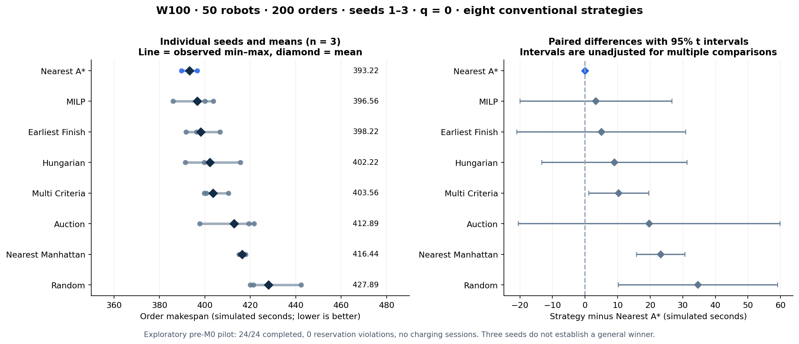
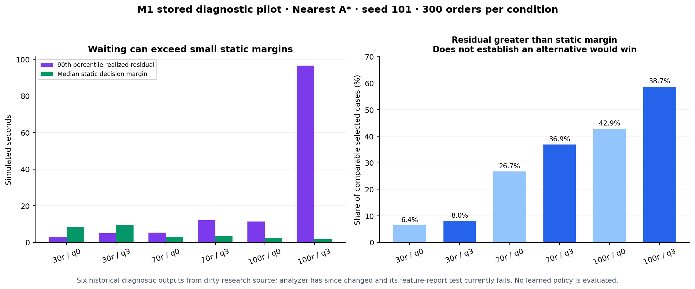
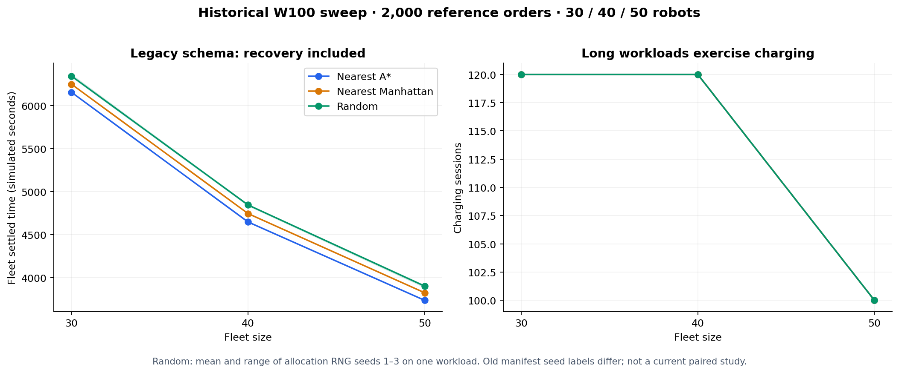

# Outcome-aware ILP research backend — current foundation and status

A deterministic warehouse research platform for **Outcome-Aware Inductive Logic Programming for Explainable Grid-Aware Task Allocation in Multi-Robot Warehouse Systems**.

The simulator, eight conventional baselines, recording/experiment pipeline and GUI are implemented. **The symbolic ILP learner, outcome-aware learned policy and learned-rule explanations are not implemented.** MILP is an existing optimization baseline and is a different method.

Read the **[complete handover and demo guide](docs/PROJECT_HANDOVER.md)** or open the **[single-page offline HTML](docs/PROJECT_HANDOVER.html)**. They cover both worktrees, every demo command, all eight formulations, experiment evidence, file/log locations, limitations and questions for 29 October. The HTML embeds its charts and full source catalogue.

The handover now includes four architecture/flow diagrams and an editable [four-sheet XMind map](docs/PROJECT_HANDOVER.xmind).

## What the system does

```text
XLSX warehouse + YAML config + order CSV
  → free robots / FIFO candidate window / directed A* costs / battery mask
  → allocation strategy chooses robot → order
  → shared traffic, motion, service, battery and charging execution
  → decisions + outcomes + metrics + provenance
  → dashboard / paired analysis / offline graphs
```

Only allocation changes between strategies. Every policy uses the same map, legal routes, traffic, battery, charging, speed and service model. The scientific engine is the source of truth; Gazebo mirrors it. RMF graph/route checks exist, but a native RMF fleet adapter does not control the production allocation loop.

Active scenario: **W100, 40 × 54 cells**, 1 m/cell, up to 100 robots, 552 shelves, 36 dropoffs, 24 chargers and 12 holding cells. Default config is **100 robots, all 2,000 orders, q=0**. Use explicit small limits for demos. V2 is a separate 22-robot test fixture.

Orders use `order_id,item_id,shelf_id,quantity,dropoff_id`; several lines can form one logical order. No release times, deadlines or priorities are part of this model.

## Two worktrees of one repository

| Folder | Branch / audited HEAD | Purpose |
|---|---|---|
| `/home/ibrahim/rnd_mrta_ilp_ws` | `traffic/rmf-integration` · `ae832f5` | Complete GUI, supported visual demo, pre-M0 science, historical runs |
| `/home/ibrahim/rnd_mrta_ilp_research` | `research/outcome-aware-ilp` · `163c6a4` | Committed M0 integrity and uncommitted M1 diagnostics |

The GUI is **not integrated with research M0**. Research adds manifest/strategy identity, seed purpose and matrix quantum/window interfaces; the GUI observer pins the older runner. There is no launcher workspace selector. Source, ignored results and environments remain separate. Both local Pixi environments now exist.

## Current state

| Component | State |
|---|---|
| Directed A*, deterministic execution, one-way local traffic, W100 | Implemented |
| Battery B0–B5 and B6a order/recovery accounting | Implemented; remaining B6 metrics pending |
| Eight conventional allocation strategies | Implemented |
| Decision/outcome tables, raw CSV/Prolog export | Implemented |
| Matrix runner, paired workloads and 95% paired t intervals | Implemented; Holm/Wilcoxon pending |
| GUI Stages 1–6, observation/history/experiments/reports | Delivered in GUI worktree |
| Research M0 | Committed `163c6a4` |
| Research M1 | Local partial diagnostics; **current feature-report test fails** |
| M2 data/bias/predicates, single-/multi-teacher and outcome-aware ILP | Pending |
| Held-out transfer map and G6 end-of-work partial charging | Deferred requirements |

M1 currently fails on duplicate `route_cells` columns during feature association reporting. Latest full research verification: **619 passed, 1 failed**. Existing M1 pilots predate the latest reliability changes and remain exploratory.

## Run headless

Requires the locked Pixi environment (`pixi install` on a fresh checkout). From either repository root:

```bash
export PY="$PWD/.pixi/envs/default/bin/python"
export PYTHONPATH="$PWD/src/mrta_core:$PWD/src/simulation_env:$PWD/src/task_management"
"$PY" src/simulation_env/scripts/run_workload.py \
  --robots 6 --orders 12 --strategy nearest_astar \
  --quantum 0 --seed 42 --quiet --progress 0
```

Verified W100: **12/12 complete, 6/6 parked, 1,402 m, zero waiting/violations**. Printed makespan 212.3333 s is **fleet settled time**, including recovery.

Record a fresh dataset:

```bash
RUN="runs/demo_$(date +%Y%m%d_%H%M%S)"
"$PY" src/simulation_env/scripts/run_workload.py \
  --robots 10 --orders 50 --strategy nearest_astar \
  --quantum 0 --seed 42 --dataset "$RUN" --export --quiet --progress 0
```

Writes `run.json`, `metrics.json`, decision/outcome tables and optional CSV/Prolog exports. `order_makespan_s` is final dropoff; `fleet_recovery_time_s` / legacy `makespan_s` includes recovery. Always use a fresh output directory. `--seed` changes allocation randomness, not the workload file.

## Gazebo and dashboard demo

Run these from the **GUI worktree**. Detailed prerequisites/build/recording/topic/shutdown instructions are in the [handover](docs/PROJECT_HANDOVER.md).

```bash
cd /home/ibrahim/rnd_mrta_ilp_ws
source /opt/ros/jazzy/setup.bash
source install/setup.bash
ros2 launch simulation_env warehouse_sim.launch.py \
  orders:=true robots:=10 order_limit:=50 strategy:=nearest_astar \
  quantum:=0 verbose:=false progress:=10.0
```

`orders:=true` is required. The ROS node remains alive after completion; Ctrl+C stops the launch. Starting Gazebo can close an existing matching world/partition. `headless:=true` means Gazebo server without a GUI; `run_workload.py` is the no-ROS path. The old `real_warehouse_gazebo_demo.py` imports a removed module and is not a supported entry point.

In a separate terminal:

```bash
cd /home/ibrahim/rnd_mrta_ilp_ws
python3 src/dashboard_GUI/scripts/launch_control_center.py check
python3 src/dashboard_GUI/scripts/launch_control_center.py start
```

Open [127.0.0.1:5173](http://127.0.0.1:5173/). Operations launches/previews jobs; History inspects tables; Experiments reads grids and comparisons. Captured-sample playback is separate from scientific re-execution. **Ctrl+C in the launcher terminal stops both services**; there is no `stop` subcommand.

## Eight allocation strategies

Let C be legal whole-order directed route distance, T=C/speed+configured service, and N per-decision min–max normalization. All use shared route/energy eligibility and matching constraints.

| CLI strategy | Actual selection rule |
|---|---|
| `random` | Canonical eligible-edge list, seeded shuffle, greedy matching |
| `nearest_manhattan` | Greedy on minimum Manhattan shelf-chain; still drives legal A* routes |
| `nearest_astar` | Greedy on directed distance C |
| `earliest_finish` | Greedy on estimated mission finish T, without future waiting |
| `multi_criteria` | Greedy on 0.5N(T)+0.2N(FIFO)+0.2N(-energy margin)+0.1N(charger distance) |
| `auction` | FIFO sequential single-item auction, cheapest eligible free robot bids C |
| `hungarian` | Maximum-cardinality matching, then minimum total C |
| `milp` | Maximum-cardinality matching, minimum latest T, then minimum total T |

See [section 9 of the handover](docs/PROJECT_HANDOVER.md#9-eight-strategies-exact-formulation-and-implementation) for constraints, tie-breakers and the two-stage MILP. Optimizers solve each current decision, not the entire future workload. q=0 frequently gives one free robot; q=3 provides richer batches. Research’s primary planned condition is q=3, secondary q=0. The GUI matrix runner uses its config q=0.

## Recent recorded experiments and graphs

### Completed 50-robot pilot — conventional strategies, q=0

W100 · 200 orders · seeds 1–3 · eight strategies · **24/24 complete**, matched workload hashes/settings, zero reservation violations. The two saved pilot repetitions have the same scientific values; they do not provide six independent seeds.

| Strategy | Mean order makespan (simulated s) |
|---|---:|
| nearest_astar | 393.22 |
| milp | 396.56 |
| earliest_finish | 398.22 |
| hungarian | 402.22 |
| multi_criteria | 403.56 |
| auction | 412.89 |
| nearest_manhattan | 416.44 |
| random | 427.89 |



Three seeds do not establish a general winner. These are exploratory pre-M0/dirty-source GUI results. **No charging sessions occurred**; minimum SOC exceeded about 65.8%. Left graph ranges are min–max; right graph intervals are paired 95% t intervals without multiple-comparison correction.

Latest local study: `src/dashboard_GUI/var/runs/experiments/pilot_r50_o200_20261028_123625/`. The [pilot result snapshot](docs/handover/2026-10-28/pilot_summary.csv) is included in the documentation. The full offline pilot report remains in the GUI worktree’s ignored `var/reports/` folder; its exact open command is in the handover.

### Stored M1 diagnostics — exploratory, no learned policy



Six conditions use **Nearest A*, seed 101, 300 orders** (30/70/100 robots × q=0/3). At 100/q3 the realized residual accounts for 23.93% of mission duration; 58.7% of comparable selected cases exceed their static margin. **This does not prove ranking reversal, learnability or policy improvement.** The 70/q3 pooled residual share is 5.60%. No charging occurred. Stored artifacts predate the latest diagnostic fixes, and the current feature reporter fails.

The older hardcoded overview plot is preserved but is superseded for current claims by these CSV-derived figures.

### Historical sustained workload



15 historical runs cover 30/40/50 robots: three A*, three Manhattan and nine Random runs (allocation RNG seeds 1–3), with charging activity. Their version-1 makespan includes recovery; they lack order-makespan accounting and are not a current repeated-workload M0 study. Old manifests also retain seed 42 while summary/directory RNG labels use 1–3; retain this provenance limitation.

Graphs’ input summaries/manifests and SHA256 provenance are retained in [the evidence bundle](docs/handover/2026-10-28/figure_provenance.json), so the README does not depend on ignored local datasets for its numeric overview.

## ILP status and next research work

Popper v4.4.0 (`860cd0de…`), SWI-Prolog, Clingo and Janus are installed and imports were checked. Raw `bk.pl` / `exs.pl` exports exist. They are **teacher-choice facts**, not learned rules or outcome labels. No production Popper training command or learned allocator exists yet.

Next research work: restore the M1 report gate, regenerate valid diagnostics, freeze labels/splits, build run-scoped predicates/bias/sampling (M2), reproduce Nearest A* with Popper (M3), then single-teacher, multi-teacher, outcome-aware learning and explanations. Training seeds 101–110, validation 111–115, evaluation 1–30; preserve reserved final 201–230. The existing plan targets 20 December 2026.

Prior ICAPS ILP charts came from a different workspace and cannot be reproduced as learner results from this repository.

## Files, results and logs

| Location | Contents |
|---|---|
| `src/mrta_core/` | Maps/config/orders, routing, energy and shared models |
| `src/task_management/` | Candidate features and eight allocators |
| `src/simulation_env/` | Execution, traffic/charging, data/metrics, CLI scripts and ROS/Gazebo launch |
| `src/rmf_grid_traffic/`, `src/gazebo_fleet_pose_transport/` | RMF static checks/demos and pose transport |
| `src/dashboard_GUI/` | GUI backend/frontend/launcher/docs on the integration branch |
| `runs/` | CLI scientific datasets/experiments, ignored |
| `src/dashboard_GUI/var/` | App runs/jobs/recordings/logs/reports/SQLite, ignored |
| `log/` | Colcon build logs; live ROS logs are under `~/.ros/log/` |
| `.scratch/` | Research issue/spec/review records |
| `docs/handover/2026-10-28/` | 606-file catalogue, 2,582-output index, 181 manifest records, selected CSV evidence and audit logs |

Git does not transfer ignored datasets/reports/environments. [The full catalogue](docs/handover/2026-10-28/FILE_CATALOG.md) maps each project-owned file to its role and entry points. [The handover](docs/PROJECT_HANDOVER.md) explains each run artifact, exact output paths, failure semantics and troubleshooting.

## Verification and documentation authority

Fresh audit: GUI scientific suite **562 passed**; research **619 passed, 1 failed**; GUI backend **152 passed**; frontend **22 passed**, typecheck/build passed. Small W100/V2 runs, topology, RMF static checks and transport parser were checked. No new live Gazebo/dashboard session or large campaign was launched for this documentation task. No production code changed or commit was made.

Use the current README, [freeze summary](docs/CURRENT_PHASE.md) and [handover](docs/PROJECT_HANDOVER.md) first. Older sections in runbooks/stage diaries are historical and may use superseded defaults/counts.

- [Documentation index](docs/README.md)
- [Frozen decisions](docs/DECISIONS.md) · [Research plan](docs/ROADMAP.md) · [Experimental protocol](docs/EXPERIMENT_PROTOCOL.md)
- [Architecture](docs/ARCHITECTURE.md) · [Map authoring](docs/MAKE_A_MAP.md)
