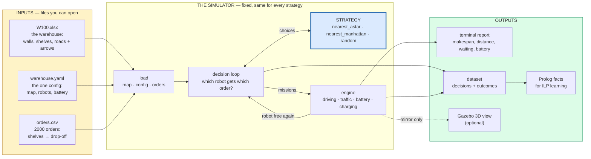
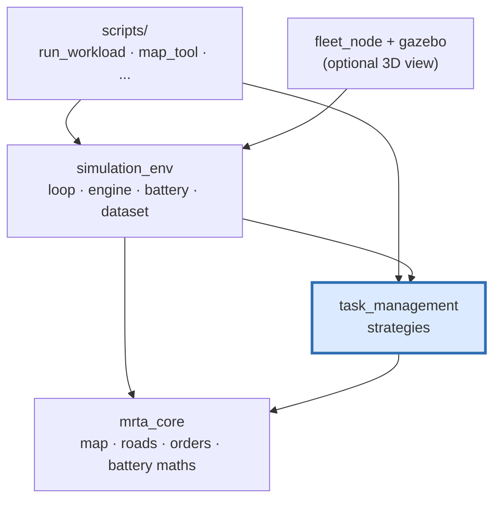
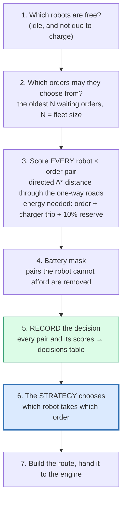
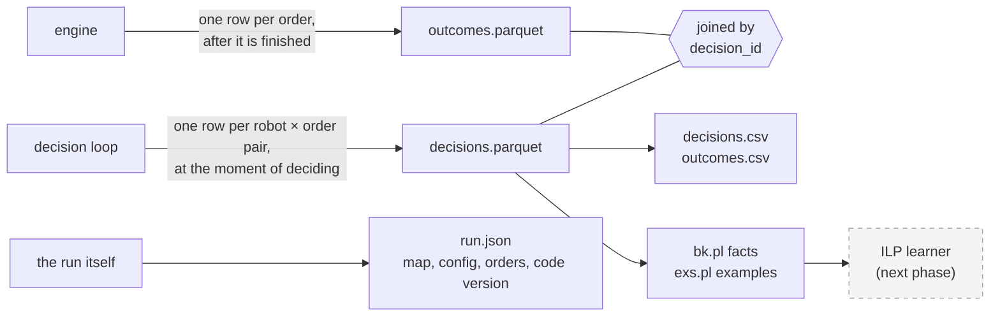

# How it works: the repo map and the data flow

One page that shows where everything is and how data moves through it,
from an Excel map to a learnable dataset.

---

## 1. Which documents to follow

**To run it yourself, you need three. Read them in this order.**

| # | Document | When |
|---|---|---|
| 1 | [START_HERE.md](START_HERE.md) | **follow it step by step**: install, run, compare strategies, record data |
| 2 | `src/simulation_env/config/warehouse.yaml` | the one config; every setting is explained inside it |
| 3 | this page | to understand what happens when you press enter |

Only when you need them:

| Document | When |
|---|---|
| [MAKE_A_MAP.md](MAKE_A_MAP.md) | you want a different warehouse than W100 |
| [../README.md](../README.md) | why it was built this way, with figures |
| [ARCHITECTURE.md](ARCHITECTURE.md) | you are changing the code |
| [DECISIONS.md](DECISIONS.md) | you want the reason behind a rule |
| [CURRENT_PHASE.md](CURRENT_PHASE.md) | you want every measured number |
| [00_RUNBOOK.md](00_RUNBOOK.md) | you want every command, in depth |

Ignore `docs/archive/`: it describes the repo as it was in August.

---

## 2. The whole system in one picture



**The one idea:** only the blue box — the strategy — is the research
variable. Everything else is identical for every strategy, so any
difference in the results is caused by the strategy.

---

## 3. The repo map

```text
rnd_mrta_ilp_ws/
│
├── README.md                 why it was built; results and figures
├── CLAUDE.md                 the project's rules (also for AI assistants)
├── pixi.toml                 the Python environment: `pixi install`
│
├── docs/
│   ├── START_HERE.md         ★ follow this to run it
│   ├── HOW_IT_WORKS.md       ★ this page
│   ├── MAKE_A_MAP.md         drawing your own warehouse
│   ├── CURRENT_PHASE.md      what is done, with measured numbers
│   ├── DECISIONS.md          every frozen rule and why
│   ├── ROADMAP.md            phases: done and to come
│   ├── ARCHITECTURE.md       code-level detail
│   ├── figures/              charts in the README (generated)
│   ├── papers/               the ICAPS'26 paper and slides
│   └── archive/              old docs — ignore
│
└── src/                      six packages (ROS 2 style)
    │
    ├── mrta_core/            THE MAP AND THE ROADS  (pure Python)
    │   ├── warehouse_map_xlsx.py   reads the Excel map, incl. arrows
    │   ├── warehouse_map.py        the map in memory: grid, stations, lanes
    │   ├── warehouse_routing.py    one-way roads + directed A* routes
    │   ├── map_builder.py          makes maps (templates, examples)
    │   ├── map_check.py            finds mistakes in a drawn map
    │   ├── orders.py               reads orders
    │   ├── order_queue.py          the FIFO queue of waiting orders
    │   ├── battery.py              battery maths + "can it afford this?"
    │   └── sim_config.py           reads the config file
    │
    ├── task_management/      THE STRATEGIES  (the research variable)
    │   ├── features.py             scores every robot-order pair:
    │   │                           A* distance, energy, Manhattan
    │   └── allocation_strategy.py  nearest_astar, nearest_manhattan,
    │                               random — and how to add more
    │
    ├── simulation_env/       THE SIMULATOR
    │   ├── simulation_env/
    │   │   ├── workload_executor.py   the decision loop (orchestrator)
    │   │   ├── fleet_engine.py        the clock: moves robots, events
    │   │   ├── reservations.py        who occupies which cell, when
    │   │   ├── local_traffic_controller.py  who waits, who yields
    │   │   ├── battery_ledger.py      every robot's charge, exactly
    │   │   ├── charging.py            charger booking, queue, preemption
    │   │   ├── stage_parking.py       parking at the end of work
    │   │   ├── fleet.py               creates robots at start positions
    │   │   ├── dataset.py             records decisions + outcomes
    │   │   ├── dataset_export.py      CSV and Prolog export
    │   │   └── fleet_node.py          ROS node for live / Gazebo runs
    │   ├── maps/              W100.xlsx (the map; new maps go here)
    │   ├── config/            warehouse.yaml, orders.csv (one of each)
    │   ├── scripts/           everything you run (see its README)
    │   ├── worlds/            warehouse.world (the one world, generated)
    │   ├── launch/            ROS launch file
    │   └── test/              tests; fixtures/ = the V2 map and config the tests use
    │
    ├── rmf_grid_traffic/     road graph for Gazebo / Open-RMF (generated)
    ├── robot_interfaces/     ROS message types (robot state)
    └── gazebo_fleet_pose_transport/   moves robot models in Gazebo
```

How the packages depend on each other — arrows point to what is used:



`mrta_core` knows nothing about the others, so the map and roads can be
tested on their own. The strategies never touch the simulator: they are
only asked questions, and only answer them.

---

## 4. What happens when you run it

Following the command

```bash
PYTHONPATH=$PP $PY src/simulation_env/scripts/run_workload.py \
    --robots 50 --orders 300 --strategy nearest_astar --dataset runs/demo
```

### Step A — load (once)

```text
warehouse.yaml ─────► sim_config.py ───────► SimConfig
                                                 (robots, battery, speed, ...)
W100.xlsx ──────────► warehouse_map_xlsx.py ─► WarehouseMap
                                                 grid of cells, 724 stations,
                                                 every one-way lane from the arrows
orders.csv ─────────► orders.py ─────────────► 300 Order objects
                      order_queue.py ────────► FIFO queue, oldest first
fleet.py ──────────────────────────────────► 50 robots on parking cells,
                                                 spread evenly ("spread")
```

### Step B — the decision loop (repeats until all orders are done)

Every time one or more robots become free, one **decision** happens:



The record (5) is written **before** the strategy chooses and before
anything moves. So the decision data can only contain what was known
at that moment — never the future. That is checked by a test that stops
a run right after a decision and confirms the recorded rows are
identical to the ones in a full run.

The three strategies differ only in step 6:

| Strategy | Picks the pair with the smallest... |
|---|---|
| `nearest_astar` | real driving distance (directed A*) |
| `nearest_manhattan` | straight-line grid distance — ignores walls and one-way roads |
| `random` | random — no ranking at all |

### Step C — the engine (between decisions)

```text
fleet_engine.py        a simulated clock; moves each robot cell by cell
  reservations.py      a robot may only enter a cell nobody else holds
  local_traffic_       if two robots want the same cell, one waits or
    controller.py      steps aside — this is where WAITING comes from
  battery_ledger.py    drains every robot: 1% / 20 m driving,
                       1% / 60 s service, 1% / 300 s standing
  charging.py          at ≤10% a robot finishes its order, books a
                       charger (or a holding cell if all are busy),
                       charges to 100%, then rejoins the fleet
```

When a robot drops off an order, backs out, and is free again, the
engine wakes the decision loop (Step B) and records that order's
**outcome**: real distance, real waiting, energy used, finish time.

### Step D — the end

```text
no orders left ──► stage_parking.py: each robot drives to the
                   nearest FREE parking cell
               ──► the report is printed
               ──► the dataset is written to runs/demo/
```

---

## 5. Where the data ends up



| File | One row is | Key columns |
|---|---|---|
| `decisions.parquet` | one robot-order pair the strategy could choose | `c_static_m` (A* distance), `robot_soc_percent`, `energy_margin_percent`, `eligible`, `selected` |
| `outcomes.parquet` | one finished order | `realized_distance_m`, `realized_waiting_s`, `energy_consumed_percent`, `completed_at` |
| `run.json` | the whole run | content hashes of map, config and orders; git version; `run_id` |
| `exs.pl` | one learning example | `pos(assign(D,R,O))` = chosen, `neg(...)` = could have been chosen but wasn't |

**Why two tables?** The research question is *State → Decision →
Outcome*: what was known, what was chosen, what really happened. Keeping
"known" and "happened" in separate tables makes it impossible to
accidentally learn from the future.

---

## 6. One map, one config, one world, and the 3D view

```text
build_scenario.py --map maps/X.xlsx
    ──► config/warehouse.yaml   map and robot count rewritten
    ──► config/orders.csv       2000 orders from the map's stations
    ──► worlds/warehouse.world  the warehouse only, no robots
    ──► warehouse_nav_graph     road graph from the arrows, checked

ros2 launch ... robots:=30 ──► fleet_node.py
    asks Gazebo which robots exist, creates the missing ones and
    removes extras, so Gazebo shows exactly 30
    runs the SAME decision loop and engine
    publishes robot positions ──► Gazebo moves the models
```

Gazebo only shows what the simulator decided. It never decides anything
itself, so a Gazebo run produces exactly the same data as a headless one
(checked: byte-identical datasets).

How to run it, tested step by step: [START_HERE.md](START_HERE.md),
step 9.

---

## 7. A 10-minute demo

Every command is from [START_HERE.md](START_HERE.md). Set up the
terminal first (step 0), then:

**1. The warehouse** (30 s) — show the map and its one-way roads:

```bash
PYTHONPATH=$PP $PY src/simulation_env/scripts/map_tool.py show \
    --map src/simulation_env/maps/W100.xlsx | head -30
```

Open `W100.xlsx` in Excel too: the arrows *are* the traffic rules.

**2. The map is checked** (10 s):

```bash
PYTHONPATH=$PP $PY src/simulation_env/scripts/map_tool.py check \
    --map src/simulation_env/maps/W100.xlsx --robots 100
```

**3. One run** (a few seconds) — 10 robots, the smart strategy:

```bash
PYTHONPATH=$PP $PY src/simulation_env/scripts/run_workload.py \
    --robots 10 --orders 100 --strategy nearest_astar
```

Without `--quiet` every assignment scrolls past: robot, order, A*
distance, shelves, drop-off.

**4. Strategy comparison** — use the measured table rather than running
it live (100 robots takes ~2 minutes per strategy):

```text
                      10 robots       100 robots
nearest_astar         2860.8 s        416.7 s
nearest_manhattan     2885.4 s        460.7 s
random                2930.9 s        483.3 s
random vs A*          +2.4 %          +16.0 %
```

The point to make: **the busier the warehouse, the more the strategy
matters.**

**5. The data for learning** (a few seconds):

```bash
PYTHONPATH=$PP $PY src/simulation_env/scripts/run_workload.py \
    --robots 10 --orders 50 --quiet --progress 0 \
    --dataset runs/demo --export
head -5 runs/demo/exs.pl
head -12 runs/demo/bk.pl
```

The point to make: every decision becomes positive and negative
examples, with the real driving distance and battery as facts — the
input an ILP learner needs.

**6. Gazebo** (optional, needs ROS) — START_HERE step 9. Do the
build (9.1) the day before. On the day, open Gazebo first (it shows the
robots parked on their Stage Zones), then start a run:

```bash
# terminal 1
source /opt/ros/jazzy/setup.bash && source install/setup.bash
ros2 launch simulation_env gazebo.launch.py robots:=20

# terminal 2
source /opt/ros/jazzy/setup.bash && source install/setup.bash
ros2 launch simulation_env warehouse_sim.launch.py \
    start_gazebo:=false orders:=true robots:=20
```

Re-run terminal 2 with any `robots:=N`; Gazebo stays open and shows
exactly N. A good demo moment: run 30, stop, run 10, and point out that
the same world simply loses 20 robots. Add `speed:=0.4` to make the
one-way roads easy to see.

**What not to promise:** the ILP learner itself is the next phase. The
pipeline produces its input today; it does not learn rules yet.

---

## 8. Where the project stands (2026-10-23)

```mermaid
flowchart LR
    S1["Simulator<br/>roads · traffic · A*"]:::done
    S2["Battery V1<br/>charging · queue"]:::done
    S3["Any map in Excel<br/>W100 for 10–100 robots"]:::review
    S4["Decision window<br/>real choices"]:::review
    S5["Recording<br/>decisions + outcomes"]:::review
    S6["3 strategies<br/>A* · Manhattan · random"]:::review
    S7["5 more strategies<br/>Hungarian, MILP, ..."]:::todo
    S8["Experiment runner<br/>many seeds, tables"]:::todo
    S9["ILP learning<br/>Popper"]:::todo
    S10["Outcome-aware ILP<br/>+ explanations"]:::todo

    S1 --> S2 --> S3 --> S4 --> S5 --> S6 --> S7 --> S8 --> S9 --> S10

    classDef done fill:#dcfce7,stroke:#2f9b6f,stroke-width:2px
    classDef review fill:#fef3c7,stroke:#b4812f,stroke-width:2px
    classDef todo fill:#f3f4f6,stroke:#9ca3af
```



<sub>green = done and committed · amber = built and tested, not yet
committed · grey = not started</sub>

### Runs — working

| What | Status | Evidence |
|---|---|---|
| Headless runs, any fleet 1–100 on W100 | **works** | 10, 20, 30, 50, 70, 100 robots all 300/300, 0 traffic violations |
| Three strategies compared | **works** | A* < Manhattan < random at 10 and 100 robots; gap 2.4% → 16.0% |
| Strategies really differ | **works** | distinctness gate: 72–97.5% of decisions differ |
| Battery and charging | **works** | 139 charges in a 20-robot long run, every robot back to work, none below 0% |
| Deterministic | **works** | same command → identical results and identical data files |
| Gazebo live view | **works** | same data as headless, byte-identical |
| Many seeds, many runs, automatic tables | **not built** | Phase 9, the experiment runner |
| Hungarian, MILP, auction, ... | **not built** | Phase 7, slice 2 |

Known limit: the traffic system cannot *untangle* robots once they are
stuck in a waiting circle. Maps avoid the circle that happens in
practice (the 2 × 2 *rotary*), and W100 has none.

### Recording — working

| What | Status |
|---|---|
| Every decision: every robot-order pair, with A* distance, battery, energy margin, chosen or not | **works** |
| Every order's real outcome: distance, waiting, energy, finish time | **works** |
| No future leaking into decision data | **proven by a test** |
| Recording changes nothing in the simulation | **proven by a test** |
| Export to CSV and to Prolog facts + examples | **works** |
| Figures from recorded runs | **works** (`plot_dataset.py`) |

On the V2 map, 100 orders produce 1,973 decision rows (100 chosen,
1,873 passed over) and 100 outcome rows.

### ILP — not started

| What | Status |
|---|---|
| Input for a learner (`bk.pl` facts, `exs.pl` examples) | **ready** — produced by every recorded run |
| Popper installed and run on that input | **not started** (Prolog is installed; Popper is not) |
| Learner settings: which facts it may use (the *bias*) | **not written** — deliberately, it is the experiment itself |
| Single-teacher ILP (learn to copy one strategy) | not started |
| Multi-teacher ILP | not started |
| Outcome-aware ILP (learn from what really happened) | not started |
| Explanations of each choice | not started |

**What you can say in a demo:** the simulator, the map, the strategies
and the data pipeline are built and tested end to end, and every
decision is already recorded in the exact form an ILP learner reads.
**What not to claim yet:** that the system learns rules, or that it is
outcome-aware. That is the next phase.

### Next, in order

1. Commit the work above (you review it first).
2. Phase 7, slice 2: Hungarian, MILP and the other baselines.
3. Phase 9: the experiment runner — many seeds and fleet sizes in one
   command, with result tables.
4. Phase 10–11: Popper on the recorded data; first reproduce a simple
   rule, then learn from one teacher strategy.
5. Phase 12–14: several teachers, then outcome-aware learning, then
   explanations.
