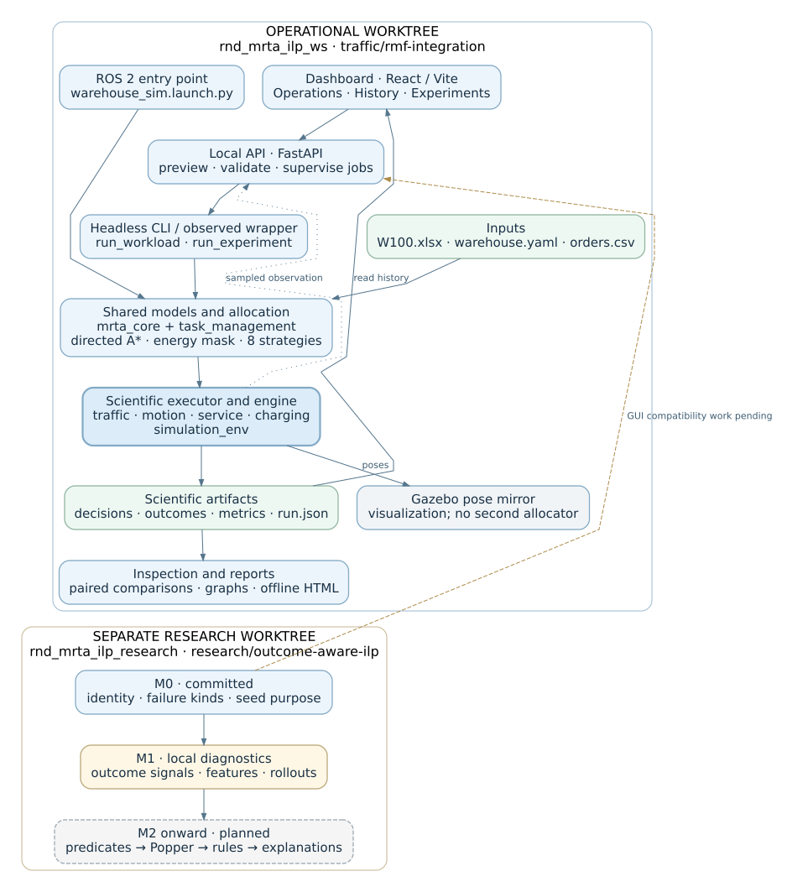
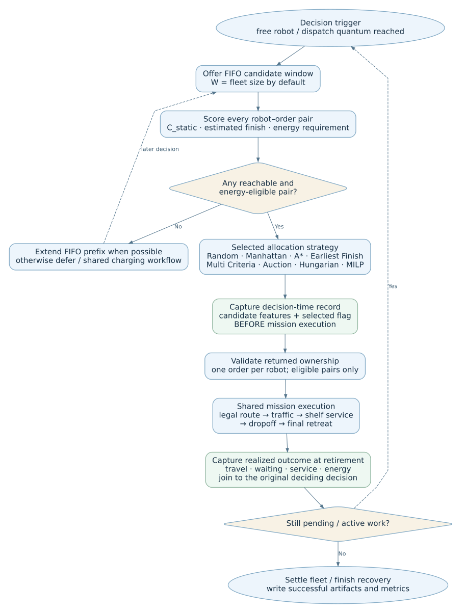
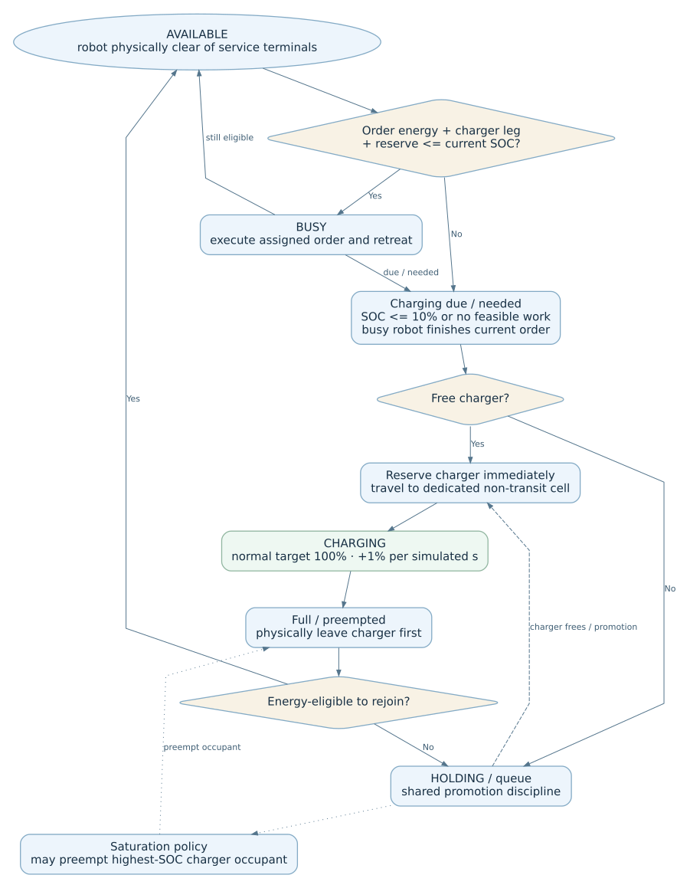
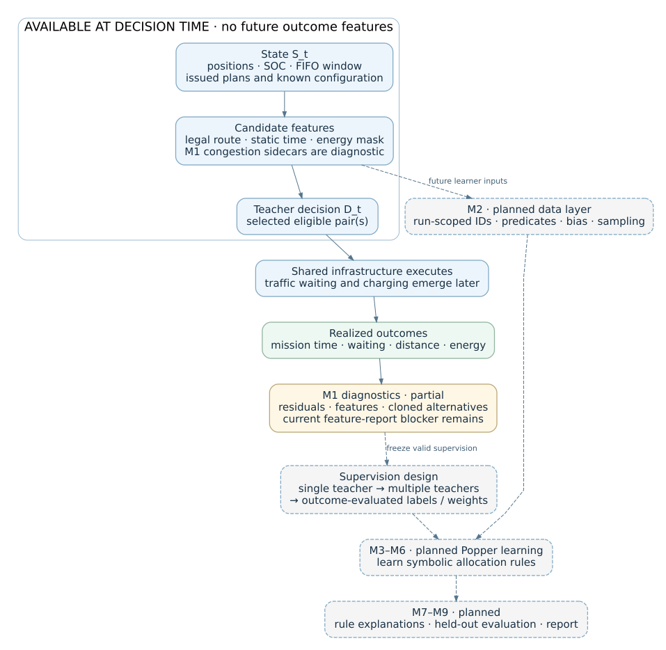
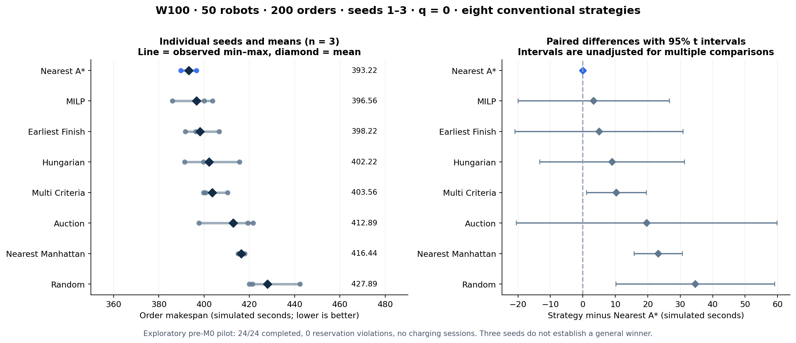
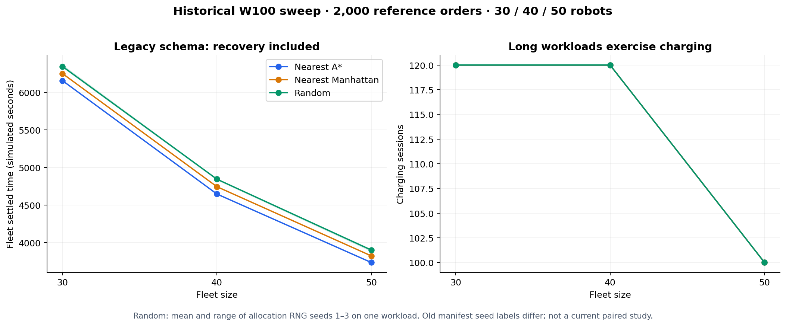
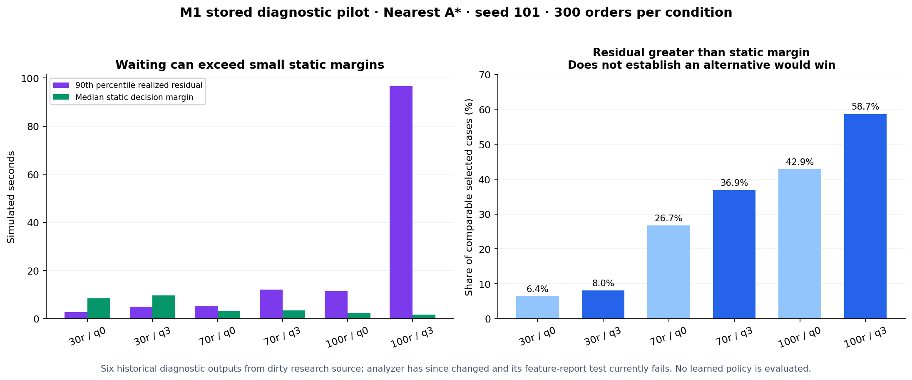

# R&D and dashboard handover — 28 October 2026

This is the consolidated operator and research briefing for demonstrations on 28 October and discussion on **29 October 2026** (Europe/Berlin). It records the checked-out files, existing results, fresh verification, limitations and future work. It does not authorize new development or mark unfinished research as complete.

Read sections 1–3 for the project story, 4–8 to operate it, 9–12 for the algorithms and ILP, and 13–17 for files, logs, limitations and questions. The HTML contains the same guide, embedded graphs, copyable commands, navigation and a searchable full file catalogue. Companion CSV/JSON files retain evidence and exact paths.

## Architecture diagrams, flowcharts and XMind

These diagrams describe the audited system. Solid blue boxes are implemented components, green boxes are evidence/data, amber marks decision points or local diagnostic work, and dashed grey boxes are planned research. Dashed arrows identify pending or future relationships; labels explain feedback paths. No diagram implies that the GUI and research worktrees are already integrated.

**[View the interactive XMind map in this HTML](#xmind-map)** · **[Download / open the four-sheet XMind map](PROJECT_HANDOVER.xmind)** · [Read its text outline](handover/2026-10-28/XMIND_OUTLINE.md)

The XMind sheets cover **System architecture**, **Allocation and execution**, **Battery, data and experiments**, and **ILP research and demo commands**. Topic notes include file paths, formulas, status and commands. Explore all four sheets in the embedded HTML map below. The native `.xmind` download is optional for editing in XMind; the text outline is also available.

### Interactive XMind map — view it here

The HTML includes all four sheets and all 93 topics from the native XMind file. Select a sheet, click a topic to expand its branch, and read its notes below the map. Use **Expand all**, **Collapse all**, **Fit** and zoom controls to explore. Drag the blank canvas or use its scrollbars to move around. No XMind application or internet connection is required for this embedded view.

<!-- EMBED_XMIND_VIEWER -->

### Architecture: interfaces, scientific engine and two worktrees



The browser calls the local API, which supervises the existing scientific CLI. ROS is another entry point into the scientific packages. The engine owns execution; Gazebo mirrors poses, while datasets feed history, comparisons and reports. The separate research branch adds M0/M1 work; the dashed connection marks GUI compatibility work still required.

[Open architecture SVG at full size](figures/handover_architecture.svg) · [Editable Graphviz source](figures/handover_architecture.dot)

### Flowchart: allocation → execution → recorded outcomes



Read from top to bottom. Infrastructure offers the FIFO window and applies the shared feasibility mask. The selected strategy chooses ownership. Decision-time records precede execution; realized outcome records are linked after the mission retires. The no-eligible-pair branch extends or defers instead of inventing an assignment.

[Open allocation flowchart at full size](figures/handover_allocation_flow.svg) · [Editable Graphviz source](figures/handover_allocation_flow.dot)

### Flowchart: battery and charging lifecycle



Charging, holding, promotion, preemption and physical clearance are shared infrastructure. Busy robots finish their current order; rejoining requires leaving the charging cell. These policies do not change between allocation strategies.

[Open battery flowchart at full size](figures/handover_battery_flow.svg) · [Editable Graphviz source](figures/handover_battery_flow.dot)

### Research flow: what exists and what the learner still needs



Decision-time features come from the current state. Future realized outcomes can inform offline supervision, but cannot be used as current decision features. M1 diagnostics do not constitute a trained policy; the dashed learner/data/explanation stages remain future work.

[Open research flowchart at full size](figures/handover_research_flow.svg) · [Editable Graphviz source](figures/handover_research_flow.dot)

### Open or regenerate the diagrams and mind map

```bash
cd /home/ibrahim/rnd_mrta_ilp_ws
xdg-open docs/PROJECT_HANDOVER.xmind
```

The open command requires a local application associated with `.xmind`; otherwise open the file from XMind itself. Its ZIP/JSON structure is validated against the format already used by this repository; native XMind rendering was not exercised during this documentation task.

```bash
# Optional: regenerate SVGs and XMind from the included documentation utility.
# Graphviz (dot) is required and is installed on this workstation.
python3 docs/handover/2026-10-28/generate_diagrams.py
```

The HTML embeds the SVG diagrams so they remain visible offline. The XMind file and editable DOT sources are companion files in the same documentation tree.

## 1. The project in one minute

The research question is: **can realized execution outcomes help inductive logic programming learn effective, explainable, grid-aware robot–order allocation rules?**

We have built the experimental apparatus: a deterministic warehouse simulator, legal directed A* routes, local traffic control, battery and charging infrastructure, eight allocation baselines, decision/outcome datasets and paired experiments. The GUI controls and inspects that apparatus. The symbolic learner and its learned explanations have not yet been integrated.

```text
Map XLSX + configuration YAML + order CSV
                     ↓
Free robots + FIFO candidate window + route/energy features
                     ↓
One of eight allocation strategies chooses robot → order
                     ↓
Shared mission executor → directed routes → traffic → service → battery
                     ↓
Decision table + outcome table + metrics + input/source provenance
                     ↓
Graphs / paired comparisons / dashboard inspection
                     ↓
Future: learner predicates → Popper → learned rules → same allocator boundary
```

The scientific variable is the allocation policy. Map, routing, robot speed, services, traffic arbitration, battery drain and charging policy are fixed within a comparison. An allocator chooses ownership; traffic may delay that ownership but does not reassign it.

**Use this wording tomorrow:** “The simulator, eight conventional baselines, recording pipeline and dashboard are operational. M0 reproducibility fixes are committed in the research branch. M1 outcome diagnostics are local work in progress with a known report-generation failure. We have exploratory conventional-strategy results and outcome-signal measurements; we do not yet have a trained outcome-aware ILP policy.”

## 2. Two folders, one Git repository, different capabilities

| Item | GUI / integration worktree | Research worktree |
|---|---|---|
| Location | `/home/ibrahim/rnd_mrta_ilp_ws` | `/home/ibrahim/rnd_mrta_ilp_research` |
| Branch | `traffic/rmf-integration` | `research/outcome-aware-ilp` |
| Audited HEAD | `ae832f5d445b84683050365b2a239d950ca4111d` | `163c6a473aa1673176243a8a03a3bde5b0b8540b` |
| Main role | Complete dashboard, supported Gazebo demo, pre-M0 simulator and historical results | M0 scientific integrity plus uncommitted M1 diagnostics |
| GUI source | Backend, frontend, launcher, reports, Stages 1–6 | Planning/docs stubs; complete delivered GUI is absent |
| Experiment controls | Original matrix runner; q=0 from config | Adds `--quantum`, `--window`, `--purpose`, strategy identity |
| Primary condition | Saved GUI pilots used q=0 | Research plan uses q=3; q=0 secondary |
| Local environment | `.pixi/envs/default/bin/python` exists | `.pixi/envs/default/bin/python` now exists, created 28 October |
| Results | `runs/` plus dashboard `var/` | `runs/m1_pilot/` |
| Learner | Not implemented | Not implemented |

They share Git objects and history. Their checked-out files, ignored outputs, environments and local changes are separate. A push or commit on one branch does not transfer results or the working dashboard to the other folder. Origin is `git@github.com:ibrahim-1811/rnd_mrta_ilp_ws.git`.

The GUI checkout initially had unrelated untracked `.codex/` and an empty `26.2.2`. Research already had modified docs and `seed_split.py`, plus untracked M1 sources/tests, review notes, a plotting script and a graph. This documentation task preserves that work. No commits, pushes, merges or production-code changes are made by this task.

### Why integration remains pending

Research M0 changes `build_manifest` to require strategy identity, adds identity checks to comparisons, adds quantum/window/purpose to matrix specifications, and changes failure records and decision linkage. The GUI’s observed wrapper also pins the old runner’s bytes. Its forms, validators and wrapper cannot simply point at research without adaptation and a fresh parity proof.

The current launcher has **no research-workspace selector or root flag**. It derives its repository from its own file location. Start it in the GUI worktree and use the research CLI separately. The research Pixi environment now exists; the earlier integration note’s “no environment” observation is historical.

Integration needs a preserved M1 checkpoint, a branch based on research M0, the GUI delivery, interface updates, source-pin/parity verification, then a tiny q=3 campaign.

## 3. Current development stage and discussion record

| Area | Actual status at freeze | Evidence / remaining work |
|---|---|---|
| Deterministic simulator, one-way routing and local traffic | Implemented | GUI scientific suite 562 passed; current nav-graph checks pass |
| W100 main map and V2 reference | Implemented | W100 active; V2 fixture retains old regression numbers |
| Battery B0–B5 | Implemented | SOC, energy mask, charging, holding, promotion and preemption |
| Battery B6a | Implemented | Order makespan separated from fleet recovery |
| Remaining B6 metrics | Partial / pending | Do not describe all battery research measurements as complete |
| G6 end-of-work partial charging | Deferred requirement | Not implemented, not cancelled |
| Held-out transfer warehouse | Deferred requirement | Not built; no cross-layout transfer result |
| Candidate window S0 and dispatch batching | Implemented | Window and batching expose meaningful allocation choices |
| Eight conventional baselines | Implemented | Registry and strategy tests; shared infrastructure |
| Decision/outcome recording and raw Prolog export | Implemented | Prolog facts are inputs, not a trained policy |
| Experiment runner and paired t intervals | Implemented | M0 adds stronger identity, failures and seed controls |
| M0 integrity/reproducibility | Committed | `163c6a4`; 38 targeted tests in original M0 gate |
| M1 diagnostics | Uncommitted, partial and failing one current test | Existing probes/rollouts; current feature-analysis report fails |
| M2 ILP data layer | Not implemented | Run-scoped IDs, predicates, bias, relabelling/sampling required |
| Single-teacher / multi-teacher / outcome-aware ILP | Not implemented | Popper installed; no deployed learned allocator |
| Learned-rule explanations | Not implemented | Baseline `explain()` strings are engineering descriptions |
| GUI Stages 1–6 and readable reports | Delivered on GUI branch | Local operations, observation, history, experiments and reports |
| GUI + M0 research integration | Pending | Different scientific interfaces and observed-runner pin |
| Final scientific evaluation/report | Pending | Small pilots are not the final campaign |

### How we reached this point

| Date / checkpoint | What was established |
|---|---|
| August–September | Simulator cleanup, directed grid routes, RMF static graph checks, traffic baseline freeze |
| 6 October | Battery B0–B4 and fleet rejoin checkpoints |
| 11 October | Holding promotion and charger preemption B5 |
| 23–25 October | W100 superseded W20/W30/W50; one map/config/world and scalable runs |
| 26 October | B6a accounting, paired workloads, Popper environment, remaining five baselines and traffic-liveness work |
| 27 October | `aa77ee0` scientific foundation; `badbc59` GUI plan checkpoint; research M0; q=3 selected as research primary |
| 28 October | GUI delivery `ae832f5`; 24-run 50-robot pilots and clearer offline reports; M1 local diagnostics and follow-up reliability changes |
| This handover | Fresh source/artifact audit, documentation freeze, corrected evidence-derived graphs |

The initial confusing `demo_dashboard` requested 50 orders but generated only 3. Its eight runs are a pipeline check, not a 50-order performance study. The later pilot correctly used 200 generated and 200 executed orders. Earlier discussion proposed fixing five M1 diagnostic issues; the current files contain follow-up changes, but the full test gate now reveals a feature-merge bug. Old review text and old output schemas must be read in that sequence.

The recorded schedule aims at **20 December 2026**. It is a plan, not a completion promise. Sections 11 and 16 distinguish completed foundations from the work that would resume later.

## 4. Before any demo: choose a workspace and interpreter

Use Bash. Open separate terminals for the dashboard and ROS/Gazebo. Commands below explicitly choose fleet/order counts so an accidental default does not start 100 robots and all 2,000 orders.

### Headless / research terminal setup

```bash
cd /home/ibrahim/rnd_mrta_ilp_ws
export PY="$PWD/.pixi/envs/default/bin/python"
export PP="$PWD/src/mrta_core:$PWD/src/simulation_env:$PWD/src/task_management"
export PYTHONPATH="$PP"
export PYTHONDONTWRITEBYTECODE=1
"$PY" --version
git branch --show-current
```

For research, start a separate terminal with:

```bash
cd /home/ibrahim/rnd_mrta_ilp_research
export PY="$PWD/.pixi/envs/default/bin/python"
export PP="$PWD/src/mrta_core:$PWD/src/simulation_env:$PWD/src/task_management"
export PYTHONPATH="$PP"
export PYTHONDONTWRITEBYTECODE=1
"$PY" --version
git branch --show-current
```

A new checkout needs `pixi install` from its root. Existing local environments were used during this audit. Headless science uses Pixi Python with SciPy/PyArrow. ROS 2 Jazzy uses its system Python and `rclpy`. Sourcing ROS does not make Pixi a ROS interpreter. The GUI backend has a third interpreter at `src/dashboard_GUI/backend/.venv/bin/python`; the launcher selects it.

### Read-only checks

```bash
# From the chosen repo root, with PY / PYTHONPATH set above:
"$PY" src/simulation_env/scripts/run_workload.py --help
"$PY" src/simulation_env/scripts/run_experiment.py --help
"$PY" src/simulation_env/scripts/map_tool.py show \
  --map src/simulation_env/maps/W100.xlsx
```

Do not run `build_scenario.py` merely to demonstrate the current scenario. With `--map` or `--orders` it can rewrite configuration/orders; it regenerates the world/nav graph. Without those switches, order regeneration is not automatic. The current W100 scenario is already present. It is the correct tool when deliberately changing maps later.

## 5. Headless demo: short run, recorded run, eight strategies

### A. Small deterministic run

From the GUI root with the headless environment above:

```bash
"$PY" src/simulation_env/scripts/run_workload.py \
  --robots 6 --orders 12 --strategy nearest_astar \
  --quantum 0 --seed 42 --quiet --progress 0
```

Verified during the audit: **12/12 completed, 6/6 parked, 1,402 m, zero traffic waiting and zero reservation violations**. The printed `makespan = 212.3333 s` is fleet settled time, including recovery. This small case is a quick demonstration, not a congestion or charging experiment.

### B. Record decisions, outcomes and metrics

Use a fresh output directory for every run:

```bash
RUN="runs/demo_headless_$(date +%Y%m%d_%H%M%S)"
mkdir -p "$RUN"
set -o pipefail
"$PY" src/simulation_env/scripts/run_workload.py \
  --robots 10 --orders 50 --strategy nearest_astar \
  --quantum 0 --seed 42 --dataset "$RUN" --export \
  --quiet --progress 10 2>&1 | tee "$RUN/console.log"
```

A successful run writes `run.json`, `metrics.json`, `decisions.parquet`, `outcomes.parquet`, plus exported `decisions.csv`, `outcomes.csv`, `bk.pl`, `exs.pl`. The `console.log` is created by `tee`; the standalone workload CLI does not automatically create a `run.log`.

```bash
"$PY" - "$RUN" <<'PY'
import json, sys
from pathlib import Path
p = Path(sys.argv[1])
m = json.loads((p / "metrics.json").read_text())
for k in ("orders_completed", "orders", "order_makespan_s",
          "fleet_recovery_time_s", "productive_distance_m",
          "total_distance_m", "productive_waiting_s",
          "reservation_violations", "charge_sessions"):
    print(k, m.get(k))
PY
```

Expected: all requested orders complete, reservation violations zero, and all requested files present. Do not compare the terminal’s legacy makespan label with order makespan as though they were the same metric.

### C. Run each of the eight existing strategies

```bash
for STRATEGY in random nearest_manhattan nearest_astar earliest_finish \
  multi_criteria auction hungarian milp; do
  "$PY" src/simulation_env/scripts/run_workload.py \
    --robots 10 --orders 50 --strategy "$STRATEGY" \
    --quantum 0 --seed 42 --quiet --progress 0
done
```

This uses the first 50 logical orders of the committed workload, whose generation seed is 42. `--seed` controls allocation randomness; it does **not** generate a new order file. To vary workload seeds fairly, use `run_experiment.py --workloads seeded`.

For a batched demonstration change `--quantum 0` to `--quantum 3` for every strategy. Keep the two conditions separate. q=3 makes optimizers more distinguishable but deliberately delays dispatch and can increase waiting.

### D. Reproduce the older V2 baseline explicitly

```bash
"$PY" src/simulation_env/scripts/run_workload.py \
  --config src/simulation_env/test/fixtures/v2_reference.yaml \
  --robots 22 --orders 100 --strategy nearest_astar \
  --quantum 0 --seed 42 --quiet --progress 0
```

Verified: **100/100, 22/22 parked, 268.6667 s fleet settled, 5,798 m, 305.3333 robot-s waiting, zero violations**. These are V2 results. They are not the no-argument W100 defaults.

## 6. Gazebo demo: supported live mirror

Use `/home/ibrahim/rnd_mrta_ilp_ws` for tomorrow’s supported demo. The research checkout does not have its own colcon build/install artifacts. Sourcing the GUI worktree’s install from research would still run the GUI-installed packages; it would not demonstrate research M0 merely because the terminal’s current directory changed.

### A. ROS environment and build

Use a new terminal with system ROS, outside `pixi shell`:

```bash
cd /home/ibrahim/rnd_mrta_ilp_ws
source /opt/ros/jazzy/setup.bash
source install/setup.bash
ros2 launch simulation_env warehouse_sim.launch.py --show-args
```

If packages need rebuilding on a fresh checkout or after an intentional source change:

```bash
cd /home/ibrahim/rnd_mrta_ilp_ws
source /opt/ros/jazzy/setup.bash
colcon build --packages-select \
  mrta_core task_management simulation_env rmf_grid_traffic \
  robot_interfaces gazebo_fleet_pose_transport \
  --cmake-args -DPython3_EXECUTABLE=/usr/bin/python3
source install/setup.bash
```

Use the normal copied install layout here; the existing runbook explicitly avoids `--symlink-install`. The CMake Python override prevents selection of an unrelated local interpreter lacking ROS build tools. A fresh machine also needs system-Python `openpyxl`, YAML and SciPy; Pixi packages alone do not satisfy ROS imports. The installed engine, YAML, world and RMF graph matched source in the audit. Always inspect build errors in `log/latest_build/` rather than assuming an old installation reflects edited source.

### B. Launch 10 robots and 50 orders

```bash
cd /home/ibrahim/rnd_mrta_ilp_ws
source /opt/ros/jazzy/setup.bash
source install/setup.bash
GZRUN="$PWD/runs/demo_gazebo_$(date +%Y%m%d_%H%M%S)"
ros2 launch simulation_env warehouse_sim.launch.py \
  orders:=true robots:=10 order_limit:=50 strategy:=nearest_astar \
  quantum:=0 verbose:=false progress:=10.0 dataset:="$GZRUN"
```

The engine starts from the same XLSX/config/orders and adds the requested robots to the warehouse-only world. It drives the scientific execution; Gazebo mirrors poses and shows motion. This is not Nav2 planning, an independent Gazebo allocator, or a native RMF fleet adapter controlling allocation.

The `orders:=true` switch is essential: naming a strategy alone does not load or execute orders. Robots initially appear parked. Let the launch finish its startup; the clock advances when the scientific node runs. Scientific time is deterministic. The YAML setting `visualization.time_scale` changes wall-time presentation, not route costs or scientific service durations; this launch has no `time_scale` override. `headless:=true` starts Gazebo without its GUI; the no-ROS scientific path is `run_workload.py`. Press **Ctrl+C in this launch terminal** to stop its processes when done. The ROS node writes the completed artifacts and prints `RUN COMPLETE`, then keeps spinning/publishing; scientific completion does not automatically close the launch. Confirm the summary and files before stopping it.

The launch enforces one Gazebo for its world/partition and can terminate an existing matching Gazebo instance. Finish an existing Gazebo demo before starting another. This audit did not open a new live Gazebo session.

### C. Inspect the live ROS state

In another ROS-sourced terminal:

```bash
ros2 topic list | rg '/mrta/'
ros2 topic echo /mrta/robot_states --once
ros2 topic echo /mrta/fleet_status --once
```

Use `ros2 topic list` as the authoritative list of active topics. `/mrta/events` is also available for event messages. The configured `/mrta/order_states` has no publisher in the current source, and `RobotState.current_target` is not populated; do not wait for those as demo evidence. Dataset output is under the chosen `GZRUN`; the ROS interpreter may use CSV if PyArrow is unavailable. This is a supported fallback recorded in `run.json`, not missing evidence. This launch exposes `dataset:=DIR` but no dataset-export flag; for CSV/Prolog extras use the headless CLI `--export` path or the existing exporter. ROS launch logs live under `~/.ros/log/`; colcon build logs are under repository `log/`.

### D. Small traffic/RMF demonstrations

```bash
cd /home/ibrahim/rnd_mrta_ilp_ws
export PY="$PWD/.pixi/envs/default/bin/python"
export PYTHONPATH="$PWD/src/mrta_core:$PWD/src/simulation_env:$PWD/src/task_management"
"$PY" src/rmf_grid_traffic/scripts/real_warehouse_traffic_demo.py --delay 0
```

Verified W100 intersection contention: loser waits about 0.667 s; completion 39.333 s. This is a local traffic demonstration. Static RMF graph and route checks are real, but production ownership/traffic remains the scientific local controller.

Do **not** use `src/rmf_grid_traffic/scripts/real_warehouse_gazebo_demo.py` for the live demo: it imports the removed `simulation_env.fleet_playback` and fails even on `--help`. Use `warehouse_sim.launch.py` above.

## 7. Dashboard walkthrough

### A. Check and start

```bash
cd /home/ibrahim/rnd_mrta_ilp_ws
python3 src/dashboard_GUI/scripts/launch_control_center.py check
python3 src/dashboard_GUI/scripts/launch_control_center.py start
```

Wait for “Dashboard ready”. Open [the dashboard](http://127.0.0.1:5173/) in your browser. The local backend uses port 8000; the UI uses 5173. `check` expects those ports to be free, so a running dashboard can make that check fail normally.

`start` stays in the foreground. **Ctrl+C in that terminal stops both services** and cleans up launcher-owned child processes. There is no `stop` subcommand. The launcher does not install dependencies or kill an unrelated process occupying a port.

For a fresh machine, dependency setup is documented in `src/dashboard_GUI/README.md` and the backend/frontend READMEs. The backend `.venv` and frontend `node_modules` are already available locally. The audit verified `check`, tests and production build without starting services.

### B. Demonstrate the screens

| Screen / action | What to show | What it means |
|---|---|---|
| System / readiness | Capabilities, scenario settings/source hashes and health | Confirms which local source/environment the backend sees |
| Operations / run setup | Strategy, robots, order limit, seed, mode and command preview | Makes a concrete CLI job reviewable before launch |
| Launch an observed short run | Example: 10 robots, 50 orders, nearest A*, q=0 | Actual engine observer samples, not a separate simulator |
| Live map and progress | Positions, order progress, SOC, latest samples | Samples are lossy visual telemetry; they are not the scientific dataset |
| Cancel | Cancel the owned job | Cancellation yields cancelled/partial evidence; backend restart interruption is a distinct status |
| Run history | Choose a completed run, inspect manifest/metrics | Provenance plus the final scientific outputs |
| Decisions / Outcomes | View candidates/selection then realized execution | Shows the decision-time versus future-outcome separation |
| Recordings / playback | Play stored captured samples | Sampled display playback, not deterministic scientific re-execution |
| Experiments | Select App history, refresh, choose a study | Reads the experiment grid, completeness, runs and paired comparison |

The API capabilities response still has a broad `replay=false` field from an earlier stage even though the UI supports captured-sample playback. Describe the demonstrated feature precisely as recording playback.

### C. Show the completed 50-robot pilot without running it again

In **Experiments → App → Refresh studies**, choose:

```text
pilot_r50_o200_20261028_123625
```

Inspect 24/24 cells and select **Compare paired runs**. Use Run history to inspect an individual strategy/seed dataset. The separate HTML report is already available:

```bash
xdg-open "/home/ibrahim/rnd_mrta_ilp_ws/src/dashboard_GUI/var/reports/pilot_r50_o200_20261028_123625/20261028T115307Z-a889c3/index.html"
```

The earlier matching pilot `pilot_r50_o200_s1-3_20261028` is also complete. They are two executions of the same 24 scientific conditions, not six independent workload seeds.

Graphs are separate offline reports. Dashboard tables and maps do not imply every report figure is embedded in the web application.


### If something does not look right during the demo

| Symptom | Check / action |
|---|---|
| Import error in headless run | Use the chosen repo’s Pixi Python and its three source package paths; run from that root |
| ROS cannot find a package | Source Jazzy and that worktree’s `install/setup.bash`; rebuild using the documented system-Python override if needed |
| Gazebo shows parked robots only | Confirm `orders:=true`; naming a strategy does not enable work |
| Science finishes but Gazebo never moved | Check set-pose provider readiness and bridge messages; visual transport can disable itself while science continues |
| Completed ROS process stays alive | Expected: inspect `RUN COMPLETE`, then Ctrl+C in the launch terminal |
| Dashboard port busy | Use the already-running instance or stop it in its owning terminal; launcher refuses to take it over |
| Dashboard map seems to skip movement | Headless run may finish quickly; play the recording; check dropped/stale samples separately from final metrics |
| Study missing from list | Choose the correct App/Repository scope and Refresh; CLI output root matters |
| Comparison refuses results | Inspect grid completeness, settings/workload and identity metadata (strategy hashes additionally in research M0); do not silently omit failures |
| M1 analysis raises route_cells KeyError | Known current failure; use saved summaries for briefing and wait for an authorized implementation fix |

### D. Optional full launcher verification, separate from the live demo

```bash
cd /home/ibrahim/rnd_mrta_ilp_ws
python3 src/dashboard_GUI/scripts/launch_control_center.py verify
```

This runs tests/build plus tiny parity/HTTP integration checks and creates new verification artifacts; it is not needed to open existing reports. Run it while the dashboard is stopped and ports are free. Historical Stage 6 evidence is retained under dashboard `var/launcher/`.

## 8. Run and inspect a controlled experiment yourself

These commands describe new optional runs. The audit did **not** rerun the 24-run pilots or launch a new campaign. Start with existing evidence if you only need a demonstration today.

### A. Repeat the GUI-branch q=0 pilot

```bash
cd /home/ibrahim/rnd_mrta_ilp_ws
PY="$PWD/.pixi/envs/default/bin/python"
export PYTHONPATH="$PWD/src/mrta_core:$PWD/src/simulation_env:$PWD/src/task_management"
STUDY="pilot_r50_o200_$(date +%Y%m%d_%H%M%S)"
STRATEGIES=(auction earliest_finish hungarian milp multi_criteria \
  nearest_astar nearest_manhattan random)
"$PY" src/simulation_env/scripts/run_experiment.py \
  --out src/dashboard_GUI/var/runs/experiments --name "$STUDY" \
  --strategies "${STRATEGIES[@]}" --robots 50 --seeds 1 2 3 \
  --orders 200 --workloads seeded --workload-orders 200 --jobs 1
"$PY" src/simulation_env/scripts/compare_paired.py \
  --out src/dashboard_GUI/var/runs/experiments --name "$STUDY" \
  --baseline nearest_astar
src/dashboard_GUI/backend/.venv/bin/python \
  src/dashboard_GUI/scripts/render_experiment.py --name "$STUDY"
REPORTS=(src/dashboard_GUI/var/reports/"$STUDY"/*/index.html)
xdg-open "${REPORTS[-1]}"
```

Both order counts are 200. `--workload-orders` controls how many logical orders are generated; `--orders` controls how many the run selects. If a generated file contains only 3, `--orders 50` still executes only those 3. Preview and final manifests reveal the actual count.

One campaign at a time is the practical demo setting. A terminal-launched campaign is owned by the terminal, not the dashboard job manager. Its finished files appear after refresh, but use that terminal to stop it. A GUI-launched campaign has app job logs and cancellation controls.

### B. Research M0/q=3 training-role smoke campaign

Use the research root and a fresh name. This tests conventional baselines and research integrity; it does not train ILP:

```bash
cd /home/ibrahim/rnd_mrta_ilp_research
PY="$PWD/.pixi/envs/default/bin/python"
export PYTHONPATH="$PWD/src/mrta_core:$PWD/src/simulation_env:$PWD/src/task_management"
STUDY="research_q3_smoke_$(date +%Y%m%d_%H%M%S)"
"$PY" src/simulation_env/scripts/run_experiment.py \
  --name "$STUDY" --quantum 3 --window fleet_size --purpose training \
  --strategies nearest_astar hungarian milp --robots 10 \
  --seeds 101 102 --orders 50 --workloads seeded --workload-orders 50 \
  --jobs 1
"$PY" src/simulation_env/scripts/compare_paired.py \
  --name "$STUDY" --baseline nearest_astar
"$PY" src/simulation_env/scripts/plot_experiment.py --name "$STUDY"
```

Expected grid: 3 strategies × 1 fleet × 2 seeds = 6 runs. It produces `runs/$STUDY/experiment.json`, `workloads/`, `summary.csv`, per-run data, paired outputs, and `figures/`. The scientific plotter supports multiple fleets; for eight strategies at a single fleet the GUI branch’s offline report is easier to read, but its direct use on M0 is not yet an accepted integration path.

`--purpose training` permits seeds 101–110. Validation uses 111–115; evaluation uses 1–30. Final seeds 201–230 are adopted reserved sealed final evaluation; the continuing role of inspected seeds 1–30 remains an open research choice. Avoid using reserved final seeds for demonstrations, diagnostics or learner tuning. Purpose checks apply to matrix experiments; a plain `run_workload.py --seed` is not a complete data-split guard.

### C. Resume, incomplete experiments and plots

Use `--resume` with exactly the same campaign specification to retry missing/failed runs. A fresh `--name` is easiest for demos. Existing directories are refused; `--force` renames the old directory to a timestamped `.replaced-*` backup rather than overwriting it. Do not use force as a routine demo step.

A strict paired comparison must pass completeness, shared workload and settings checks. Research M0 additionally checks strategy identity. `--allow-incomplete` is diagnostic and explicitly labels the result incomplete; it does not make missing cells acceptable final evidence.

The research comparator refuses pre-M0 summaries lacking `strategy_sha256`. Compare GUI pilots with the GUI branch’s comparator. Do not blend old q=0 GUI results and new q=3 research results in one paired table.

## 9. Eight strategies: exact formulation and implementation

All eight are in `src/task_management/task_management/allocation_strategy.py`; prediction-time routes and timing are in `features.py`. They are **eight conventional MRTA baselines**, not eight ILP learners.

### Shared problem and notation

At one decision instant, let R be free robots and O the FIFO candidate orders. The default order-window width is fleet size, even if only one robot is free. A FIFO liveness extension searches farther when the prefix contains no assignable pair.

For robot r and order o:

```text
C(r,o) = minimum directed route distance over shelf visit permutations
         from robot's current cell through order shelves and dropoff,
         including legal service entry/retreat, including final retreat
v(r)   = robot speed in metres/second
n(o)   = number of distinct shelf visits
S(o)   = n(o) × configured shelf service + configured dropoff service
T(r,o) = C(r,o) / v(r) + S(o)
```

With 1–3 shelf visits, the route feature tries at most 3! = 6 shelf permutations and chooses the shortest legal static plan, breaking route ties by shelf sequence. Quantities are part of the input order data; the current fixed service model is per shelf visit, not a quantity-proportional pick-time model.

An eligible pair has a reachable route and satisfies the shared energy mask:

```text
predicted travel drain
+ known service drain
+ directed travel drain from final retreat to nearest charger
+ reserve (10%) <= robot's decision-time SOC
```

Future waiting is excluded because it is unknown at decision time. Energy eligibility constrains every strategy; battery behavior is not separately optimized by an allocator.

Every returned matching obeys:

```text
x(r,o) ∈ {0,1} only for eligible pairs
Σ_o x(r,o) <= 1 for every robot
Σ_r x(r,o) <= 1 for every order
```

The five greedy strategies and FIFO auction produce a maximal feasible matching by their procedure; they do not guarantee maximum cardinality for arbitrary masked graphs. Hungarian and MILP explicitly prioritize maximum feasible cardinality K. All execute through the same engine afterward.

### 9.1 Random — `random`

Sort eligible candidates canonically by `(robot_id, order_id)`, shuffle them with a seeded Python random stream, then scan them, accepting a pair only if neither robot nor order is already used. Reset restores the seed stream. This is seeded random-priority greedy matching; do not claim a uniform distribution over all feasible matchings.

Purpose: a baseline with no cost preference. It still has legal directed routes and the same battery feasibility mask. Random is not mathematically guaranteed to lose every finite run.

### 9.2 Nearest Manhattan — `nearest_manhattan`

```text
M(r,o) = min over shelf permutations of
         Manhattan(robot, shelf1) + ... + Manhattan(last shelf, dropoff)
```

Rank eligible pairs by `(M, C, FIFO position, robot_id)`, then apply greedy pairing. The Manhattan key uses grid steps and ignores obstacles/one-way detours; its chain does not account for service retreat the same way C does. It chooses **who**, while execution still follows the recorded directed A* route. Battery feasibility also uses A*, never Manhattan.

### 9.3 Nearest Directed A* — `nearest_astar`

Rank pairs by `(C, FIFO position, robot_id)` and apply greedy pairing. Choose the cheapest remaining pair, remove its robot and order, repeat. It is a grid-aware greedy baseline, not a global minimum-sum optimizer.

### 9.4 Earliest Finish — `earliest_finish`

Rank by `(T, C, FIFO position, robot_id)` and apply greedy pairing. T contains legal travel plus configured service, no predicted or realized traffic waiting. All offered robots are free now. Because C includes the final retreat, T estimates the mission interval through retreat rather than exactly the last dropoff fulfillment instant.

This differs from nearest A* when speeds or shelf-visit service counts differ. With equal speed and similar services, rankings often coincide.

### 9.5 Multi-Criteria Grid-Aware — `multi_criteria`

For each criterion, min–max normalize across **eligible pairs in the current decision**; if all values are equal, contribute zero:

```text
N(a) = (a - min(a)) / (max(a) - min(a))
score(r,o) = 0.5 N(T)
           + 0.2 N(FIFO position)
           + 0.2 N(-energy margin)
           + 0.1 N(post-mission charger distance)
```

Lower is better. Rank by `(score, T, C, FIFO position, robot_id)`, then apply greedy pairing. Older orders have smaller FIFO indices. Greater energy margin is favored by negating it before normalization. Without battery features the two energy criteria drop out and remaining weights are rescaled.

Weights are fixed, untuned heuristics. Normalization trades relative ranks/spreads within one decision, not physical units: a 1 m criterion spread can have the same normalized span as a 100 m spread. These are not learned weights or a measured congestion predictor.

### 9.6 Auction / Marginal Cost — `auction`

Announce orders in FIFO order. Each currently unassigned eligible robot bids its C(r,o), which is the additional route of an idle robot holding no other order. Award to minimum `(C, robot_id)` and continue to the next order.

This is a sequential single-item auction, not repeated bundle optimization or re-auctioning. FIFO announcement makes it distinct from nearest A*: it can allocate the oldest order before a cheaper younger order. A global cheapest-bid-per-round version would collapse to nearest A* in this model.

### 9.7 Hungarian — `hungarian`

First find maximum feasible matching size K, then minimize total directed distance:

```text
minimize Σ_(r,o) C(r,o) x(r,o)
subject to shared matching constraints and Σ_(r,o) x(r,o) = K
```

Implementation uses a canonical matrix and SciPy `linear_sum_assignment` with a sufficiently large blocked-pair cost; blocked selections are excluded. It optimizes the current decision window, not the entire future workload, traffic schedule or fleet makespan.

### 9.8 MILP — `milp`

MILP means **mixed-integer linear programming**. It is an optimization baseline and is separate from **inductive logic programming**.

Let K be maximum matching cardinality. Let z be a continuous bound on the latest estimated finish. The actual two-stage formulation is:

```text
Stage 1: minimize z

Σ_o x(r,o) <= 1                         each robot at most once
Σ_r x(r,o) <= 1                         each order at most once
Σ_(r,o) x(r,o) = K                      maximum feasible assignments
Σ_o T(r,o) x(r,o) <= z                  each robot's chosen finish <= z
Σ_r T(r,o) x(r,o) <= z                  each order's chosen finish <= z
x binary, z >= 0

Stage 2: minimize Σ_(r,o) T(r,o) x(r,o)
         subject to the same constraints and z <= z* + tolerance
```

The implementation gets a feasible K-matching by minimum-total T assignment and prunes pairs beyond that matching’s latest finish, an exact upper-bound prune. It solves both stages through `scipy.optimize.milp` / HiGHS. Stage-2 tolerance is `1e-6 × max(1,z*)`.

The bottleneck objective differs from Hungarian’s minimum distance sum. It can accept more total travel to lower the slowest estimated finish in a batch. It does not include future waiting, congestion constraints, battery scheduling or the full-workload makespan objective. Solver failures are classified in research M0.

HiGHS resolves equally optimal matchings. Pixi SciPy and system ROS SciPy have different versions, so exact ties can produce different equally optimal assignments. Research M0 records solver-build identity; use consistent environments when claiming cross-mode identity.

### Distinctness depends on decision shape

At q=0 most decisions have one free robot. Then Hungarian approaches nearest A*, and bottleneck MILP approaches Earliest Finish. W100 30-robot/300-order evidence recorded 0.4–0.8% Hungarian/A* divergence and 2.3–4.9% MILP/Earliest-Finish divergence, below the 5% gate.

At q=3 all strategy pairs passed 5% in that controlled scenario; the lowest recorded pair was Earliest Finish versus A* at 8.1/10.4%. This motivates separate dispatch conditions. It does not establish distinctness on every workload or that q=3 universally improves performance.

```bash
# Default distinctness check can be substantial: it asks rivals at every decision.
"$PY" src/simulation_env/scripts/check_strategy_distinctness.py --help
```

## 10. Data, metrics and how to interpret results

### Decision versus outcome boundary

A decision row is captured before mission execution. It contains candidate IDs, positions, static route cost, reachability, SOC/energy eligibility, candidate-window/queue state and whether the candidate was selected. The outcome row is written when the order mission retires, after final retreat.

Join selected decisions to outcomes using `(run_id, decision_id, robot_id, order_id)`. Research M0 repairs deferred-launch decision linkage. Identifiers are traceability/join keys; robot/order IDs must not be learned scientific priorities. Multiple runs restart local decision IDs; M2 must make training identifiers run-scoped.

An unselected eligible pair is a teacher-choice negative for imitation. It is **not an observed bad outcome**: that pair was not executed. Outcome-aware supervision needs evaluated alternatives or an explicitly justified label design.

### Metrics that answer different questions

| Metric | Meaning / caution |
|---|---|
| `order_makespan_s` | Last fulfilled order/dropoff time; headline completion metric |
| `order_throughput_per_h` | Completed orders per hour of order makespan |
| `makespan_s`, `fleet_recovery_time_s` | Fleet settled timestamp; includes final retreat/parking/charging recovery |
| `recovery_tail_s` | Fleet settled minus order makespan |
| `productive_distance_m` | Travel attributed to orders, including retreat |
| `support_distance_m` | During-work charging/support travel |
| `recovery_distance_m` | End-of-work recovery/parking travel |
| `total_distance_m` | Whole-fleet distance; equals phase distances summed |
| `total_waiting_s` | Sum of robot waiting seconds; not elapsed wall time |
| `productive_waiting_s` | Waiting attributed to order missions |
| `allocator_cpu_s`, `wall_clock_s` | Computational/wall-time costs, not simulated time |
| `energy_consumed_percent` | Sum of SOC percentage points over robots; can exceed 100% |
| `min_soc_percent` | Lowest observed fleet SOC; not an initial configuration |
| `charge_sessions`, `charger_wait_time_s`, `preemptions` | Charging behavior; zero means it was not exercised by that run |
| `reservation_violations` | Engine audit counter; zero is required but not a proof for all future scenarios |

Order `completed_at` is the dropoff fulfillment time, while `retreat_finished_at` is later. The mission estimate and realized mission duration include retreat. Do not mix that duration with fulfillment latency or add final parking to every order.

Old version-1 metrics lack order/recovery separation. Missing fields should stay missing; they are not zero and cannot be reconstructed just by relabeling fleet makespan.

### Actual saved experiment inventory

| Location | What is there |
|---|---|
| GUI `runs/astar`, `legacy`, `batched` | Three older V2 decision/outcome datasets; some predate `metrics.json` |
| GUI `runs/fleet_sweep` | 15 runs at 30/40/50 robots: A* 3 + Manhattan 3 + Random 9 (RNG seeds 1–3); 2,000-order reference workload, legacy schema |
| GUI `runs/learn_astar_30r_300o` | One conventional teacher dataset; its name does not mean learning happened |
| GUI `runs/gazebo_10_50` | One recorded Gazebo result, CSV tables and report text |
| GUI dashboard `var/runs/experiments` | Five complete studies totaling 76 run cells |
| GUI dashboard `var/runs/singles` | Additional single-run GUI artifacts; app runs total 81 run manifests |
| GUI dashboard `var/verification` | 47 tiny verification datasets; exclude from research sample counts |
| Research `runs/m1_pilot` | 72 files, 8 run manifests/metrics: six main diagnostic probes, one rollout run, one `.interrupted` duplicate |

The eight research manifests are not eight independent completed experiments: the interrupted duplicate has no finished probe record and must be excluded from aggregate claims. No M1 matrix `experiment.json` exists locally. The broad 144-run/24-probe plan has not been completed.

### Latest 50-robot pilot

W100, 50 robots, 200 orders, seeds 1,2,3, eight strategies, q=0, pre-M0 GUI scientific source. Every run completed 200/200 with zero reservation violations; all share one settings signature `716179a809aa95a5`, and each seed’s workload SHA256 matches across strategies.

| Strategy | Mean order makespan (simulated s) | Mean difference from A* (s) |
|---|---:|---:|
| nearest_astar | 393.22 | 0.00 |
| milp | 396.56 | +3.33 |
| earliest_finish | 398.22 | +5.00 |
| hungarian | 402.22 | +9.00 |
| multi_criteria | 403.56 | +10.33 |
| auction | 412.89 | +19.67 |
| nearest_manhattan | 416.44 | +23.22 |
| random | 427.89 | +34.67 |



Nearest A* has the lowest observed mean here. Three seeds and unadjusted intervals do not establish a general winner. All 24 have zero charging sessions; minimum SOC remains above approximately 65.8%. This pilot cannot validate charging congestion/preemption under sustained energy demand. Its manifest records a dirty `badbc59` tree at execution time, before the GUI delivery commit; preserve that provenance.

Dots are seeds, diamonds means, and the left-panel lines are observed min–max ranges. Right-panel intervals are the actual paired 95% t intervals read from `paired.csv`. Holm correction and Wilcoxon sensitivity are not implemented.

### Historical longer fleet sweep



This older campaign has charging sessions and helps explain the infrastructure. It uses one reference workload, deterministic strategies once per fleet and Random with three allocation RNG seeds, and version-1 accounting. Its old manifests retain seed 42 while directory/summary seed labels use 1–3; that provenance mismatch prevents treating it as a current paired study. It is not a repeated-seed primary M0/q=3 study. Interpret its makespan as fleet settled time; it has no order-makespan column.

### M1 outcome-signal pilot

Six stored Nearest-A* probes, seed 101, 300 orders each:

| Fleet / quantum | Mean residual (s) | p90 residual (s) | Median static margin (s) | Residual share of mission | Residual greater than margin |
|---|---:|---:|---:|---:|---:|
| 30 / 0 | 0.687 | 2.67 | 8.50 | 0.83% | 6.4% |
| 30 / 3 | 1.629 | 5.03 | 9.67 | 1.98% | 8.0% |
| 70 / 0 | 2.043 | 5.33 | 3.00 | 2.51% | 26.7% |
| 70 / 3 | 4.666 | 12.00 | 3.33 | 5.60% | 36.9% |
| 100 / 0 | 4.648 | 11.40 | 2.33 | 5.62% | 42.9% |
| 100 / 3 | 24.483 | 96.63 | 1.67 | 23.93% | 58.7% |



Residual here is realized mission duration minus static travel/service estimate, attributable to waiting in these samples. Increasing fleet size and batching can make that residual large relative to static margins. **Residual exceeding a margin does not demonstrate an unexecuted alternative would win.** The alternative may also wait. The exceedance denominator excludes selected cases with no alternative or a negative static margin; it is not every decision.

The 100/q3 example has order makespan 391.6667 s, fleet settled 461.3333 s, productive distance 33,669 m, total 38,300 m, productive waiting 7,345 robot-s, total waiting 7,404.3333 robot-s, and zero charging sessions.

Stored 70/q3 rollout evidence has 8 sampled decisions × 4 branches = 32 rows and one identical clone check. A **window-flow** “flip” appears in 6/8 decisions, but gain >1 s appears in only 1/8, none exceeds 5 s, and mean window-flow gain is about 0.438 s. The old 75% flip statistic is not a 75% improvement. It does not establish useful learned performance.

These files predate the newest diagnostic reliability changes. Recomputed reports are currently blocked by the feature-merge test failure. The existing figures above read saved numeric outputs and label them historical diagnostics; they are not a new acceptance of M1.

The old `scripts/generate_overview_plots.py` hardcodes arrays and labels fleet-settled data “Order Makespan” and residual>margin “ranking inversion”. Its old PNG is preserved as a historical artifact and is not used as current evidence in these READMEs. New figures are generated from the saved CSVs, with source hashes in the evidence bundle.

## 11. ILP specifically: installed tools, missing work and intended formulation

### What ILP means here

**Inductive Logic Programming** learns a logical program from background knowledge and examples. It is not the MILP allocator. Popper is available as the planned learner; the target is interpretable symbolic allocation preferences that can run through the existing allocation interface.

The intended learning problem is:

```text
Given background knowledge B, positive examples E+ and negative examples E-,
find a hypothesis H in a declared hypothesis space such that
B ∪ H entails wanted examples, rejects unwanted examples,
and balances coverage/errors with rule complexity.
```

For noisy or outcome-weighted labels, the coverage/error objective must be explicitly designed and frozen. Installing a learner or exporting selected/not-selected facts does not solve that design.

### Available now

`pixi.toml` pins Popper Git tag **v4.4.0**, commit `860cd0de…`; upstream package metadata says 4.2.0. The recorded toolchain uses SWI-Prolog 10.0.0, Clingo 5.8.2, Janus SWI 1.5.3 and setuptools 80.10.2 (`<81` because Popper imports `pkg_resources`). Python is 3.12. The environment has previously reproduced grandparent and assign-shaped toy rules.

```bash
# Clean standalone process in the chosen repository:
env -u PYTHONPATH .pixi/envs/default/bin/python -c \
  'import popper, janus_swi, clingo; print("Popper, Janus and Clingo import")'
.pixi/envs/default/bin/swipl --version
```

Use one learning problem per Python process: earlier smoke tests found a second `learn_solution` invocation in the same process could fail in Popper state. This is an environment limitation to account for in future integration, not an implemented training runner.

Raw `bk.pl` contains recorded facts; `exs.pl` contains `pos(assign(...)).` for selected pairs and `neg(assign(...)).` for eligible unselected pairs. Ineligible pairs are excluded. They do not include the finished learner-side predicate/bias design. Raw identifiers can collide when naïvely concatenating runs; M2 must solve that before multi-run training.

### Not available now

There is no complete domain-specific Popper bias, predicate discretization pipeline, multi-run training dataset, trained symbolic allocator, single-/multi-teacher training/evaluation pipeline, outcome-aware supervision implementation, rule explanation UI or final scientific result. A module named `symbolic.py` or a file named `learn_astar_30r_300o` is not evidence otherwise.

### Planned learning stages

| Stage | Supervision | What must be demonstrated |
|---|---|---|
| Reproduce simple teacher / M3 | Nearest-A* choices using learner-side features | Nontrivial learned rule, held-out fidelity and successful execution through existing allocator |
| Single-teacher ILP / M4 | One strong conventional teacher | Coverage, fidelity, rule size, runtime and allocation outcomes |
| Multi-teacher ILP / M5 | Several teachers with an explicit conflict/relabelling policy | Robustness and quality beyond simply pooling conflicting selected labels |
| Outcome-aware ILP / M6 | Outcome-derived labels/weights based on evaluated alternatives | Better outcomes or useful tradeoffs, controlled leakage/splits and interpretable rules |
| Explanations / M7 | Rule trace and satisfied/rejected predicates | Decision-level explanations attributable to the actual executed rule |

An illustrative future rule shape is:

```prolog
% Illustration only; these predicates/rules are not a deployed learner.
assign(D,R,O) :- eligible(D,R,O), preferred_route(D,R,O), safe_margin(D,R,O).
```

`eligible` remains the infrastructure mask, not the scientific contribution. Actual threshold predicates, comparison relations, conflict resolution and selection semantics still need M2 design. Do not present this illustrative rule as learned.

### Outcome supervision design under discussion

The diagnostic proposal evaluates alternatives by cloning a pre-decision state, forcing a different assignment, resuming the same infrastructure, and measuring a bounded horizon. The proposal includes `J = pivot realized mission time + lambda × fleet waiting over horizon H`; window-flow and availability measures are additional diagnostics. Horizon H, weight lambda, improvement threshold delta, acceptable noise/coverage, and the final objective J are not frozen.

Current M1 additions include decision-time route overlap, occupied route cells, estimated spatiotemporal conflicts, shelf/dropoff load and local density. They inspect current positions and already-issued plans; they do not legitimately use later realized waits as decision features. Association is not predictive validity. Ratio normalization alone does not establish independent signal; current code adds partial-Spearman machinery but its feature report currently fails.

Use training seeds for development, validation seeds for thresholds/label design, and preserve evaluation/final data. No learned improvement can be claimed until the policy is trained and evaluated with this separation.

### Inspect M1 without claiming it is accepted

```bash
cd /home/ibrahim/rnd_mrta_ilp_research
export PYTHONPATH="$PWD/src/mrta_core:$PWD/src/simulation_env:$PWD/src/task_management"
.pixi/envs/default/bin/python src/simulation_env/scripts/m1_probe.py --help
.pixi/envs/default/bin/python src/simulation_env/scripts/outcome_signal.py --help
cat runs/m1_pilot/rollout_r70_q3/probe.json
cat runs/m1_pilot/signal/summary.md
```

The following reproduces the current acceptance failure; it is a diagnostic command, not a required successful demo step:

```bash
.pixi/envs/default/bin/python -m pytest -q \
  src/simulation_env/test/test_m1_diagnostics.py::test_the_probe_records_what_run_workload_records
```

No implemented ILP training command is available yet.

## 12. Simulator assumptions and boundaries you may be asked about

| Topic | Current model |
|---|---|
| Active W100 | 40 × 54 cells; 1 m/cell; 100 staging cells, 552 shelves, 36 dropoffs, 24 chargers, 12 holding cells |
| Directed graph | 1,424 transit cells, 724 terminal cells, 2,148 total usable vertices, 4,244 graph lanes; checked connected/legal |
| V2 | 17 × 35 reference fixture; 22 staging cells, 72 shelves, 36 dropoffs, 8 chargers, 14 holding cells |
| Motion | Deterministic grid execution; default 1.5 m/s; exact rational time/accounting |
| Service | 1 s per shelf visit and 1 s per dropoff in active W100 YAML |
| Orders | `order_id,item_id,shelf_id,quantity,dropoff_id`; logical order may have several CSV lines |
| Schema scope | No priority, release-time or deadline fields in the active order model |
| Window | FIFO prefix, default fleet-size width, shared liveness extension |
| Traffic | Local reactive cell/edge contention, batch movement, yielding and rotation right-of-way; no strategy ownership changes |
| Terminal semantics | Shelf/dropoff/staging/charger/holding are service endpoints, not transit shortcuts |
| Battery | 100% initial; 1%/20 m travel; 1%/60 s service; 1%/300 s idle/wait; +1%/s charging |
| Charging | Due at SOC<=10%; finish active order; reserve charger; hold/promote/preempt by fixed policy; rejoin only after leaving charger |
| Recovery | Per robot: begins at workload exhaustion (last allocation) once it owes no order; may overlap other deliveries; schema-2 separates recovery |
| Gazebo | Visualization/execution mirror of one scientific engine; no separate routing or policy |
| RMF | Real graph/route verification and demos; no native RMF adapter in the production allocation loop |

One-way lanes remove ordinary head-on transit structure but do not prove global liveness: shared terminals/merges and occupied-cell cycles still matter. Rotation right-of-way addressed a recorded 100-robot waiting circle; arbitrary new maps/workloads still need checks. Zero violations in a run is measured evidence, not a universal theorem.

The active model is a controlled simulator, not a claim of physical mobile-robot dynamics, real sensor localization, Nav2 navigation or industrial deployment. Its scientific purpose is policy comparison under a common apparatus.

## 13. Where each kind of file belongs

| Path within a repository | Owner / meaning / what goes there |
|---|---|
| `src/mrta_core/mrta_core/` | Shared models, configuration, maps, orders, directed routing, kinematics and energy requirements |
| `src/task_management/task_management/` | Candidate feature construction, strategy registry and eight allocation algorithms |
| `src/simulation_env/simulation_env/` | Fleet engine/executor, traffic/reservations, charging, staging, metrics, dataset recorders, ROS/Gazebo adapters |
| `src/simulation_env/scripts/` | Scientific CLI entry points: workloads, experiments, comparisons, plots, map/scenario and regression checks |
| `src/simulation_env/config/warehouse.yaml` | Active W100 settings; a bare relative map/order name is resolved by the configuration loader |
| `src/simulation_env/config/orders.csv` | Committed reference workload, 2,000 logical orders; multiple line items per order |
| `src/simulation_env/maps/W100.xlsx` | Current main warehouse, semantic cells and drawn lanes |
| `src/simulation_env/test/fixtures/` | V2 reference config/map/order cases and battery scenarios |
| `src/simulation_env/worlds/warehouse.world` | Generated warehouse-only Gazebo scene |
| `src/simulation_env/launch/` | ROS launch orchestration for the supported mirror |
| `src/robot_interfaces/msg/` | ROS robot/fleet message definitions |
| `src/gazebo_fleet_pose_transport/` | C++ batched pose transport, parser and its test |
| `src/rmf_grid_traffic/` | Nav graph YAML, C++ RMF checks and local traffic demos; one legacy Gazebo script is broken |
| `src/dashboard_GUI/backend/control_center/` | API, schemas, adapters, job gate/processes, observation, report generation and storage |
| `src/dashboard_GUI/frontend/src/` | React views, run/experiment input, map/inspection, history, sampled playback, typed API |
| `src/dashboard_GUI/scripts/` | Launcher, report renderer and stage integration checks |
| `src/dashboard_GUI/docs/control_center/` | Stage plans/results, operating guide and scientific-parity/integration records |
| `docs/CURRENT_PHASE.md` | Current summary first, historical acceptance diary after it |
| `docs/DECISIONS.md` | Frozen decisions; dated changes can supersede older paragraphs |
| `docs/ROADMAP.md` | Planned phases and research milestone schedule |
| `docs/EXPERIMENT_PROTOCOL.md` | Comparison, recording, split and statistical rules |
| `docs/ARCHITECTURE.md`, `HOW_IT_WORKS.md` | Deeper architecture and flow explanation |
| `docs/archive/` | Historical docs, not current feature claims |
| `docs/papers/` | Prior talk/papers; old ILP results came from another workspace |
| `.scratch/<feature>/` | Local issue/review/spec records, not a scientific dataset |
| `runs/` | CLI scientific results; ignored by Git |
| `src/dashboard_GUI/var/` | App-owned jobs, runs, reports, logs, input copies, validation and SQLite; ignored |
| `build/`, `install/`, `log/` | Colcon generated build/install/build-log trees; not source/results |
| `.pixi/`, backend `.venv/`, frontend `node_modules/`, `dist/` | Dependencies and built UI; regenerate from manifests, not research evidence |

### Key engine files to open when explaining a decision

`features.py` builds the legal route and energy features. `allocation_strategy.py` selects ownership. `order_queue.py` manages logical pending work. `workload_executor.py` orchestrates decisions, dispatch, charging and recovery. `fleet_engine.py` executes motion/service under `local_traffic_controller.py`, `reservations.py` and `local_yield_selector.py`. `charging.py`, `battery_ledger.py`, `stage_parking.py` and `work_accounting.py` keep shared energy and phase semantics. `dataset.py`, `dataset_export.py`, `run_metrics.py` and `paired.py` produce/read evidence.

Research adds `failures.py`, `seed_split.py`, `congestion.py`, `outcome_signal.py`, `rollout.py`, plus probe/analysis CLIs. GUI adds the complete `backend/`, `frontend/`, `scripts/` implementation. The full source catalogue enumerates every project-owned file in both locations, its role, hash and top-level Python entry points.

## 14. Every run, log and generated output location

### One successful scientific run

```text
<output-directory>/
  run.json              inputs, hashes, run_id, effective settings, Git state
  metrics.json          aggregate metrics; schema 1 or 2 must be checked
  decisions.parquet     every scored candidate, selected flag (or CSV fallback)
  outcomes.parquet      completed order outcomes (or CSV fallback)
  decisions.csv         optional --export text view
  outcomes.csv          optional --export text view
  bk.pl                 optional raw Prolog background facts
  exs.pl                optional raw pos/neg teacher examples
  run.log               campaign child's stdout/stderr, if run by experiment runner
  console.log           only if you explicitly redirected/teed a standalone CLI
  failure.json          research M0 failure classification when recorded
```

Fresh-directory failed research runs do not emit successful datasets; `failure.json` records kind/exception/message and order counts. Failure capture covers the execution section, not every setup/serialization error. A source-level edge case remains: reusing an old successful dataset directory can leave stale success files beside a new failure file. **Use fresh run directories and treat any failure as invalid**, even if old metrics exist. This reuse scenario was found by inspection and was not newly reproduced as a dedicated test.

### One matrix campaign

```text
runs/<study>/                       # or --out <root>/<study>
  experiment.json                   declared grid, spec, source/identity metadata
  workloads/orders_s101.csv          one workload per seed, shared across strategies
  summary.csv                       one row per successful run
  summary.md                        generated by plotter
  paired.csv, paired.md              strict paired comparisons
  figures/                          scientific plotter output
  <strategy>/r<robots>_s<seed>/       individual run artifacts plus run.log
```

The GUI’s campaign root is `src/dashboard_GUI/var/runs/experiments/`. CLI default is repository `runs/`. Different roots explain why a terminal-created study may appear under a different dashboard history source.

### App-owned output and logs

```text
src/dashboard_GUI/var/
  jobs.sqlite                       durable job requests/state/events
  index.sqlite                      repository-history index/cache
  app-index/index.sqlite            app-run artifact index/cache
  jobs/<job_id>/                    process.log, optional telemetry.ndjson, process identity/gate and retry evidence
  runs/singles/                     scientific datasets from app single runs
  runs/experiments/<study>/          scientific matrices from app jobs or explicit CLI --out
  experiment_owners/                app resume/ownership records
  inputs/<sha256>.csv               validated immutable uploaded order CSV copies
  validation/                       validation/parity audit artifacts
  verification/                     tiny stage/integration datasets; not research samples
  launcher/<timestamp-id>/           start/build/service or verify/shutdown logs; check creates no log directory
  reports/<study>/<timestamp-id>/    immutable offline report, PNGs, report metadata
  report-audit/, stage*-audit/       saved checks of UI/report behavior
```

Exact filenames inside jobs/launcher vary with mode. The complete output inventory lists them individually with absolute path, byte size and modification time.

Repository `log/build_<timestamp>/` contains colcon `events.log`, `logger_all.log`, and per-package `command.log`, `stdout.log`, `stderr.log`, `stdout_stderr.log`, `streams.log`. Symlinks such as `latest_build` are convenience pointers. `~/.ros/log/` contains live ROS launch/node logs and is outside the repository inventory. Gazebo user cache/logs may also live outside the repo.

### Useful inspection commands

```bash
cd /home/ibrahim/rnd_mrta_ilp_ws
rg --files -uuu runs src/dashboard_GUI/var log \
  -g 'run.json' -g 'metrics.json' -g 'failure.json' -g 'experiment.json'
rg --files -uuu src/dashboard_GUI/var/reports -g 'index.html'
rg --files -uuu src/dashboard_GUI/var/jobs src/dashboard_GUI/var/launcher \
  -g '*.log' -g '*.json' -g '*.jsonl'
git status --short
```

Generated runs/reports/logs are ignored. A Git push does not back them up. Preserve an experiment directory together with its workloads, manifest, tables, metrics and logs if handing it to another machine. Do not submit only a PNG and call it reproducible evidence.

## 15. Verification performed during this documentation audit

| Check | Fresh result | Practical implication |
|---|---|---|
| GUI-branch scientific suite | **562 passed in 58.82 s** | Shared scientific baseline passes its existing tests |
| Research full scientific suite | **619 passed, 1 failed in 81.87 s** | Current M1 is not a green research checkpoint |
| Research focused M0/M1 suite | **57 passed, 1 failed** | Same feature-analysis failure isolated |
| GUI backend suite | **152 passed** | Current API/jobs/reports checks pass |
| Frontend suite | **22 passed** | Existing UI tests pass |
| Frontend typecheck / production build | **Passed** | Current UI builds; no live browser session claimed |
| Launcher preflight | **Passed**, ports free | Local dependencies/map are usable; services were not launched |
| Small W100 headless | **12/12, 6/6 parked, zero violations** | A quick supported CLI path executes |
| V2 explicit reference | **100/100, 22/22 parked, expected metrics** | Historical baseline is reproducible with explicit config |
| W100 topology/nav graph | **Passed** | 2,148 vertices / 4,244 lanes, no reported mismatch |
| RMF installed graph/route checks | **Passed** | Static graph and example route validate |
| Pose transport parser | **8/8 passed** | Parser unit cases pass; not a new live Gazebo test |
| Dashboard studies | **Five complete grids** | 76 declared run cells validated; pilots each 24/24 |

The failed research case is:

```text
src/simulation_env/test/test_m1_diagnostics.py::
  test_the_probe_records_what_run_workload_records

KeyError: "['route_cells'] not in index"
```

`outcome_signal.feature_associations()` merges a per-order frame and feature frame that both contain `route_cells`. Pandas produces `route_cells_x` and `route_cells_y`; partial-correlation selection still asks for unsuffixed `route_cells`. Probes can finish, but the subsequent feature association report fails. This documentation update does not modify the implementation.

Full scientific test logs and audit notes are saved in the evidence folder. Commands/outputs distinguish fresh checks from historical acceptance. No live dashboard/Gazebo browser session or full M1 campaign was launched by this audit. A production build and command inspection do not prove a live 3D session was visually inspected today.

Audit scope: both Git states, project-owned file inventory, key runtime/allocation/GUI/research paths, existing datasets and reports, current contracts, targeted source/test inspection and fresh verification. Binary archives, every historical log line, external ROS caches and all dependency internals were not semantically reviewed. The complete inventory is a traceability aid, not a claim of exhaustive formal verification.

## 16. Known limitations and work to resume later

| Priority / area | Current limitation | Consequence / next gate |
|---|---|---|
| Immediate M1 correctness | Feature association `route_cells` merge failure | Fix/report regression before accepting recomputed M1 reports |
| M1 evidence freshness | Saved pilot/rollout files predate diagnostic fixes | Rerun a bounded permitted-seed pilot before comparing new columns |
| Clone evidence | New code requires actual successful clone verification; older artifacts have older schema | Inspect `probe.json`/checks; do not accept empty/vacuous evidence |
| Seed provenance | Effective-seed checks improved; workload seed may depend on declared filename/origin | Arbitrary renamed CSVs are not proven safe by allocation seed alone |
| Outcome attribution | Waiting intervals/proxies changed; charging-between-orders is an SOC-rise proxy | Do not describe proxy as observed charging ground truth |
| F9 statistics | Paired t intervals exist; Holm/Wilcoxon not implemented | Freeze/apply statistical plan before final multi-comparison claims |
| F10 attribution | Per-order energy/waiting exists; full charging/availability causal attribution remains incomplete | Validate outcome labels against actual event records |
| F12 workloads | Balanced seeded generator; explicit hotspot/spatial variants absent | Generalization across demand scenarios not established |
| M2 learner interface | Predicate/bias/data namespace absent | Build only after M1 label design and leakage checks |
| GUI/research integration | Old GUI interfaces versus M0 identity/purpose/runner | Adapt and re-prove parity before controlling research through GUI |
| Direct dataset reuse | Stale success files can survive a failed rerun | Always fresh directories; inspect failures alongside metrics |
| Solver environments | Different SciPy/HiGHS versions may resolve ties differently | Compare identities and pin environments |
| Resolution / speeds | Only shipped 1 m cells and homogeneous speed are verified; loader/timing resolution can diverge, and batch movement requires a common move duration | Do not claim arbitrary cell resolutions or heterogeneous-speed fleets are supported |
| ROS telemetry | Configured order-state topic has no publisher; current target is empty | Use actual robot/fleet/event topics and recorded outcome tables |
| Gazebo demo script | Legacy `real_warehouse_gazebo_demo.py` imports removed module | Use supported launch path |
| Live/full RMF | Static checks and demos, no native production fleet adapter | Do not claim integrated RMF scheduling or Nav2 execution |
| G6 / held-out map | Deferred, not built | State missing scope explicitly in final report |
| Historical docs | Older append-only passages contain superseded approval/default/test claims | Current README and top freeze summary take precedence |

Recorded milestone plan:

```text
M0  Oct 27–30      integrity / reproducibility                 committed
M1  Oct 30–Nov 2   outcome-signal diagnostics                   partial, failing report
M2  Nov 2–7       learner predicates / bias / data layer        pending
M3  Nov 7–12      reproduce nearest-A* with Popper              pending
M4  Nov 12–17     Single-Teacher ILP                           pending
M5  Nov 17–22     Multi-Teacher ILP                            pending
M6  Nov 22–Dec 2  Outcome-Aware ILP                            pending
M7  Dec 1–4       explanations                                pending
M8  Dec 4–10      final campaign                               pending
M9  Dec 8–20      report                                       pending
```

These are the existing research planning dates, not new work scheduled by this documentation task. No automation or background development was created.

## 17. Questions for tomorrow, with defensible answers

**What is complete?** The controlled simulator, directed routes, local traffic and battery infrastructure, eight conventional allocators, data recording/experiments, and the GUI on its branch. Research M0 is committed; M1 is partial.

**Where is the novelty?** The intended contribution is learning symbolic allocation rules with realized-outcome supervision under directed warehouse geometry. The simulator and conventional baselines provide the apparatus and comparisons. The learner result is still to be produced.

**What does ILP mean, and why is MILP already available?** ILP here is inductive logic programming, which learns logical rules. MILP is a mixed-integer optimization baseline that directly solves a batch assignment problem. They are different methods.

**Why eight strategies if some look similar?** Their objectives/procedures differ, but q=0 often gives only one free robot and makes batch optimizers nearly equivalent to greedy methods. q=3 produces richer batches, which is why research evaluates that condition separately.

**Why did A* beat Hungarian/MILP in the pilot?** Those optimizers solve a local batch objective with static estimates. They do not optimize future congestion or the full workload. Three q=0 seeds are insufficient to establish a universal ranking.

**Does greater waiting prove outcome-aware ILP will work?** It provides a reason to investigate. Residuals or weak correlations do not show an alternative assignment would improve outcomes or that symbolic predicates can predict it. Counterfactual diagnostics, valid labels and held-out policy evaluation remain necessary.

**Is the system already explainable?** Conventional strategies have human-readable descriptions. Learned-rule explanations tied to an actual learned decision are pending.

**Is Gazebo the simulator?** The scientific engine is the source of truth; Gazebo mirrors it. This keeps allocation experiments consistent across headless and visual modes.

**Does RMF allocate or resolve production traffic?** No native production RMF adapter is wired into the executor. There are real RMF graph/route checks and demos. The production scientific traffic controller is local.

**Is the dashboard integrated with the latest research branch?** No. It is operational on the GUI branch. M0 interfaces, identities, seed purpose and observed-runner parity must be adapted before integration.

**What do the latest numbers establish?** The 24-run conventional pilot is complete with matched inputs and no safety-counter violations. A* has the lowest observed mean order makespan in that pilot. There is traffic waiting but no charging. M1 stored diagnostics suggest higher residuals at 100 robots/q3; they are exploratory and predate the current analyzer failure.

**Can old ICAPS ILP charts be reproduced here?** No. Those results came from an earlier workspace. Papers/talks are retained for context; this repo currently lacks that learner pipeline.

**What is the next research step?** Restore the M1 report gate, regenerate valid bounded diagnostic evidence, freeze supervision/splits, then build M2’s learner data layer and reproduce a simple teacher with Popper. GUI–M0 integration is a separate compatibility task.

## 18. Evidence bundle and full source catalogue

The bundle is `docs/handover/2026-10-28/` in both worktrees. File/hash inventories were captured **before this documentation refresh**; new handover files and refreshed README contents are intentional documentation changes. Production sources retain their captured hashes:

| File | Contents |
|---|---|
| `FILE_CATALOG.md` | All project-owned source/config/test/doc paths, roles and top-level Python entry points |
| `source_inventory.csv`, `source_catalog.json` | Paths, byte sizes, SHA256 and symbol metadata |
| `output_inventory.csv` | Every file under repository runs/, colcon log/, dashboard var/ at snapshot; 2,582 entries |
| `run_index.json` | Full structured run/failure/experiment/probe manifests plus available metrics; 181 records |
| `workspace_snapshot.json` | Branches, full HEADs and pre-documentation dirty state |
| `pilot_summary.csv`, `pilot_paired.csv`, `pilot_experiment.json` | Durable copies of latest 50-robot result inputs |
| `m1_signal.csv`, `m1_rollout_signal.csv` | Historical diagnostic numeric summaries used here |
| `legacy_fleet_sweep.csv` | Historical version-1 fleet-sweep values |
| `figure_provenance.json` | Source paths and hashes for the new graphs |
| `verification_*.log`, `*_audit.md` | Fresh check output and detailed supporting audit notes |
| `regenerate_figures.py` | Recreates the three current README charts from the included CSV snapshots |
| `README_gui_before_freeze.md`, `README_research_before_freeze.md` | Preserved pre-refresh READMEs; historical claims, not current authority |

Runtime inventory covers about 1.24 GB across the two locations; the bundle stores the index and selected summaries, **not duplicate copies of 1.24 GB of data**. It excludes external `~/.ros/log`, dependency directories and built binary internals. New demo runs after the snapshot will naturally not be in this frozen index.

[Open the full source catalogue](handover/2026-10-28/FILE_CATALOG.md). Existing architecture atlases remain available, but their autogenerated symbols may predate recent GUI/M1 changes; the dated catalogue reflects this freeze.

### Regenerate the current README charts from the included evidence

```bash
# From either repository root; uses included CSVs, not ignored historical run files:
MPLBACKEND=Agg .pixi/envs/default/bin/python \
  docs/handover/2026-10-28/regenerate_figures.py
```

This writes only `docs/figures/handover_*.png` in the chosen repository. It does not run simulations, change source or generate new scientific evidence.

## 19. Campaign: 100 robots, 2,000 orders, eight strategies, three seeds

This recipe uses the current **GUI worktree**, q=0 and workload seeds **101, 102, 103**. It produces 24 headless runs, followed by 24 corresponding ROS/Gazebo runs, stored as two separate experiments. No large campaign was launched while preparing these commands.

A seed is the deterministic input to order generation. Each seed produces a different 2,000-order CSV, shared by all eight strategies. The Random strategy also uses that seed for its own shuffle. Changing only `run_workload --seed` would not regenerate orders. These seeds are in the development/training set; evaluation seeds 1–30 and sealed final seeds 201–230 are not used here.

Quantum 0 dispatches immediately; quantum 3 holds free robots for batching. It is simulated time, not robot speed or a wall-clock delay added to every movement. The candidate order window still defaults to fleet size. q=0 often presents one free robot, making Hungarian close to Nearest A* and MILP close to Earliest Finish. q=3 provides more meaningful multi-robot batches, but is a separate experimental condition and may increase delays. The current GUI matrix uses config q=0; the research plan selects q=3 as primary. This cross-interface recipe uses q=0 so all three interfaces agree. It is not the final q=3 research campaign.

### Headless: prepare and run 24 conditions

```bash
cd /home/ibrahim/rnd_mrta_ilp_ws
export PY="$PWD/.pixi/envs/default/bin/python"
export PYTHONPATH="$PWD/src/mrta_core:$PWD/src/simulation_env:$PWD/src/task_management"
export PYTHONDONTWRITEBYTECODE=1

"$PY" - <<'PY'
from mrta_core.sim_config import load_sim_config
c = load_sim_config('src/simulation_env/config/warehouse.yaml')
assert c.map_path.name == 'W100.xlsx', 'Use the W100 scenario'
assert c.dispatch_quantum_s == 0, 'This cross-interface recipe requires q=0'
print('W100, q=0 confirmed')
PY

STUDY="r100_o2000_q0_s101_103_$(date +%Y%m%d_%H%M%S)"
printf '%s\n' "$STUDY" > src/dashboard_GUI/var/last_r100_o2000_study.txt
mkdir -p src/dashboard_GUI/var/campaign_logs

STRATEGIES=(auction earliest_finish hungarian milp multi_criteria nearest_astar nearest_manhattan random)
set -o pipefail
"$PY" src/simulation_env/scripts/run_experiment.py \
  --out src/dashboard_GUI/var/runs/experiments --name "$STUDY" \
  --strategies "${STRATEGIES[@]}" --robots 100 --seeds 101 102 103 \
  --orders 2000 --workloads seeded --workload-orders 2000 --jobs 1 \
  2>&1 | tee "src/dashboard_GUI/var/campaign_logs/${STUDY}_headless.log"
```

Wait for 24 successful runs. `--jobs 1` runs one child at a time. Both order counts are 2,000. Parquet datasets are recorded by the experiment runner; CSV/Prolog `--export` is deliberately omitted to avoid redundant large exports.

### Plot the headless results and open the HTML report

```bash
cd /home/ibrahim/rnd_mrta_ilp_ws
STUDY=$(cat src/dashboard_GUI/var/last_r100_o2000_study.txt)

.pixi/envs/default/bin/python src/simulation_env/scripts/compare_paired.py \
  --out src/dashboard_GUI/var/runs/experiments --name "$STUDY" \
  --baseline nearest_astar

src/dashboard_GUI/backend/.venv/bin/python \
  src/dashboard_GUI/scripts/render_experiment.py --name "$STUDY"

REPORTS=(src/dashboard_GUI/var/reports/"$STUDY"/*/index.html)
xdg-open "${REPORTS[-1]}"
```

The report validates the grid before plotting. It provides seed observations, means/ranges, paired confidence intervals, waiting/distance/energy/charging metrics and completion curves. Three workload seeds remain exploratory, not a definitive ranking.

### Gazebo terminal A: keep the warehouse open

```bash
cd /home/ibrahim/rnd_mrta_ilp_ws
source /opt/ros/jazzy/setup.bash
source install/setup.bash
ros2 launch simulation_env gazebo.launch.py robots:=100
```

Wait for the world and 100 robots. The launch may close a matching previous Gazebo world. Keep this terminal open while the campaign runs.

### Gazebo terminal B: run all 24 matching conditions

```bash
cd /home/ibrahim/rnd_mrta_ilp_ws
source /opt/ros/jazzy/setup.bash
source install/setup.bash
export PYTHONDONTWRITEBYTECODE=1

STUDY=$(cat src/dashboard_GUI/var/last_r100_o2000_study.txt)
GAZEBO_STUDY="${STUDY}_gazebo"
set -o pipefail
/usr/bin/python3 docs/handover/2026-10-28/gazebo_seeded_campaign.py \
  --source "$PWD/src/dashboard_GUI/var/runs/experiments/$STUDY" \
  --name "$GAZEBO_STUDY" \
  2>&1 | tee "src/dashboard_GUI/var/campaign_logs/${GAZEBO_STUDY}.log"
```

This new documentation adapter selects the exact recorded workload and seed for each condition, invokes the existing ROS FleetNode, and closes the node after its synchronous workload finishes. The original launch enters a final idle spin and has no batch/workload-file arguments; the adapter avoids manual Ctrl+C between 24 runs. It does not introduce another allocator, traffic controller or battery policy. Original scientific sources are unchanged.

The adapter checks source config/map/orders hashes and source commit, copies seed workloads into the new experiment, records `visual_status.json` and its own file hash, and refuses a missing Gazebo mirror. Its six small ROS validation runs matched headless non-computational metrics and passed paired/report validation. Those tests used `--no-gazebo`; a live 100-robot visual campaign was not newly exercised in preparation. System ROS SciPy differs from Pixi SciPy, so tied optimizer solutions can differ. Keep mode results separate.

The 24 Gazebo runs are sequential and paced for viewing; they can take hours. The default uses the YAML display rate. Optional `--display-scale 20` accelerates display pacing only. If a run fails, inspect its `run.log`; the adapter stops instead of silently accepting a nonvisual fallback. `--resume` retries missing work with the same adapter/settings; it refuses stale successful files from a visually failed attempt. A fresh experiment name is required in that case.

### Plot the Gazebo results

```bash
cd /home/ibrahim/rnd_mrta_ilp_ws
STUDY=$(cat src/dashboard_GUI/var/last_r100_o2000_study.txt)
GAZEBO_STUDY="${STUDY}_gazebo"

.pixi/envs/default/bin/python src/simulation_env/scripts/compare_paired.py \
  --out src/dashboard_GUI/var/runs/experiments --name "$GAZEBO_STUDY" \
  --baseline nearest_astar

src/dashboard_GUI/backend/.venv/bin/python \
  src/dashboard_GUI/scripts/render_experiment.py --name "$GAZEBO_STUDY"

REPORTS=(src/dashboard_GUI/var/reports/"$GAZEBO_STUDY"/*/index.html)
xdg-open "${REPORTS[-1]}"
```

Only stop the warehouse terminal with Ctrl+C after the campaign finishes. Compare the two reports side by side. Their simulated metrics answer the scientific questions; Gazebo wall time includes presentation pacing and is not an allocator performance result.

### Dashboard controls

Start with `python3 src/dashboard_GUI/scripts/launch_control_center.py check`, then `start`. In **Experiments → App → Refresh studies**, both completed campaigns appear. The terminal owns their processes; do not use the GUI Resume action for the Gazebo adapter.

To launch an independent headless campaign from the dashboard instead: give it a new name, choose all eight strategies, robots `100`, seeds `101,102,103`, order limit `2000`, generated workload orders `2000`, seeded workloads and one child. Preview must show **24 runs**, **2,000 effective orders per run** and **q=0**. Launch once; do not simultaneously launch the same study through the terminal. The dashboard does not launch Gazebo or expose matrix quantum/purpose fields.

### Optional q=3 primary-condition research campaign — headless only

```bash
cd /home/ibrahim/rnd_mrta_ilp_research
export PYTHONPATH="$PWD/src/mrta_core:$PWD/src/simulation_env:$PWD/src/task_management"
R3="research_r100_o2000_q3_$(date +%Y%m%d_%H%M%S)"
.pixi/envs/default/bin/python src/simulation_env/scripts/run_experiment.py \
  --name "$R3" --quantum 3 --window fleet_size --purpose training \
  --strategies auction earliest_finish hungarian milp multi_criteria nearest_astar nearest_manhattan random \
  --robots 100 --seeds 101 102 103 --orders 2000 \
  --workloads seeded --workload-orders 2000 --jobs 1
.pixi/envs/default/bin/python src/simulation_env/scripts/compare_paired.py --name "$R3"
.pixi/envs/default/bin/python src/simulation_env/scripts/plot_experiment.py --name "$R3"
xdg-open "runs/$R3/figures"
```

This is another branch and condition; do not combine its rows with the GUI q=0 study. The dashboard and Gazebo adapter above remain scoped to the GUI worktree.
