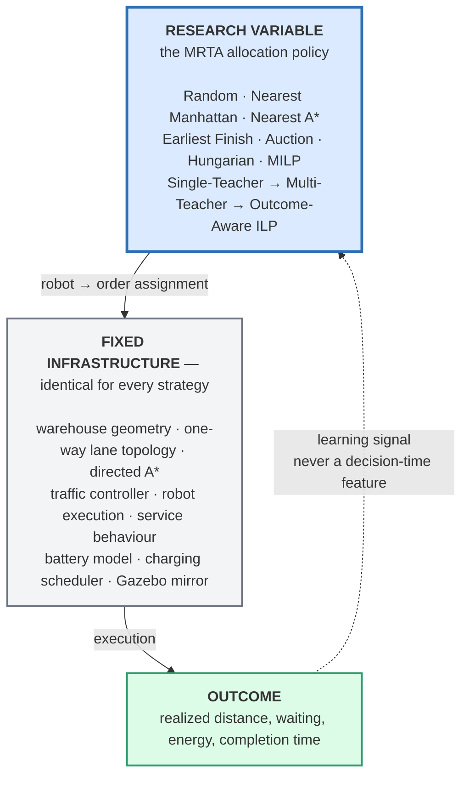
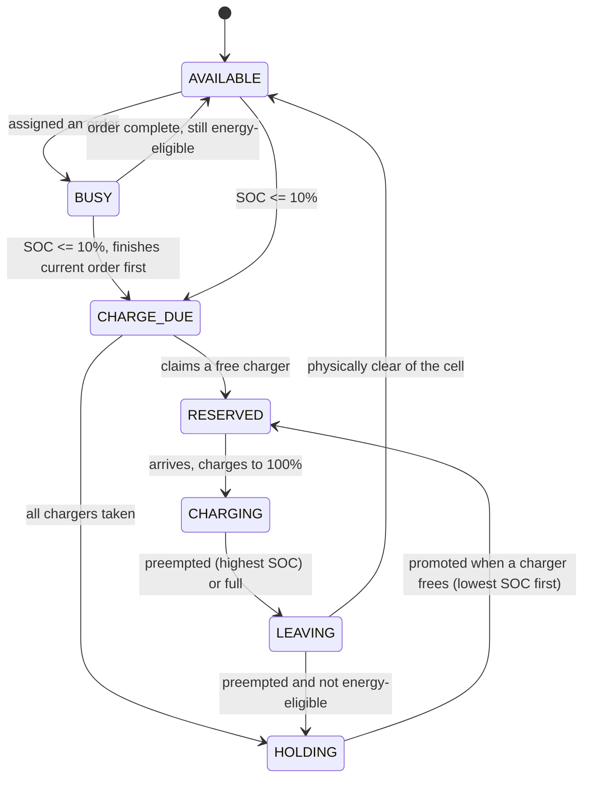
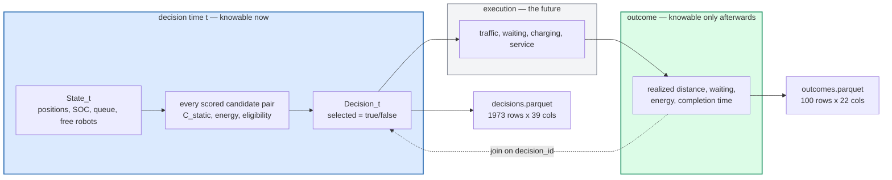
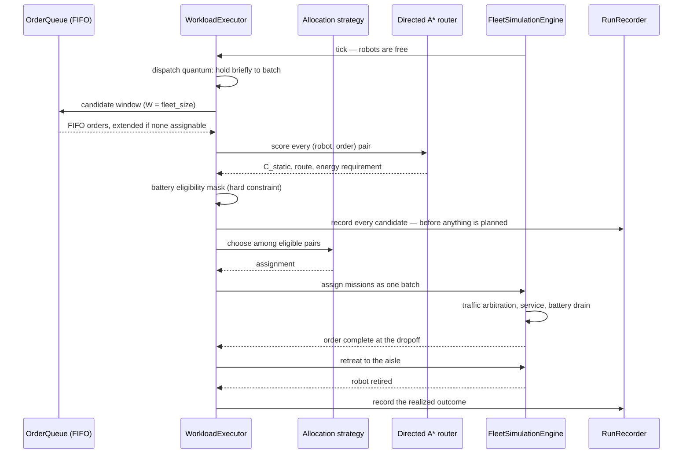

# Outcome-Aware ILP for Explainable Grid-Aware Task Allocation in Multi-Robot Warehouse Systems

A deterministic warehouse simulator built to answer one question:

> Can a multi-robot task allocation policy use **real warehouse geometry**
> and **realized execution outcomes** to learn symbolic allocation rules
> that are both effective and explainable?

Everything in this repository exists to make that question answerable.
The simulator is not the contribution — it is the controlled apparatus
that makes a claim about allocation policy defensible.

> **New here?** Go to **[docs/START_HERE.md](docs/START_HERE.md)** —
> from an empty computer to running all three strategies on the research
> map **W100**, with 10 to 100 robots. To draw a warehouse of your own in
> Excel, see [docs/MAKE_A_MAP.md](docs/MAKE_A_MAP.md).
>
> **What is where?** Open [docs/REPO_ATLAS.html](docs/REPO_ATLAS.html) in a browser:
> every package, module, data flow and state machine on one page, kept up to date.
> For the interactive 18-module presentation dashboard, open **[docs/RND_SYSTEM_EXPLORER.html](docs/RND_SYSTEM_EXPLORER.html)**.
> The same code map as text, every file, class and function linked to its
> source line, is [docs/CODE_MAP.md](docs/CODE_MAP.md).
>
> Want to understand what was built and why? Read on.

---

## The one idea that shapes the whole repo

Everything is split in two. One half is held fixed so that the other
half can be measured.



A strategy may **choose**. It may not change routing, traffic
arbitration, battery drain, charger policy, speed, or service duration.
If two strategies produce different makespans, that difference has
exactly one cause.

This is enforced in code, not by convention: every strategy runs through
the same `WorkloadExecutor`, the same router, and the same engine.

---

## What we built, and why

### 1. A warehouse where direction matters

Straight-line and Manhattan distance are not costs in a one-way
warehouse. The map is a real 17 × 35 grid with semantic cells, loaded
from XLSX:

```text
       01234567890123456          # wall / blocked
    0  #################          . open transit floor
    1  #################          S shelf       (service terminal)
    2  ####ChhChhChhCh##          D dropoff     (service terminal)
    3  ##D............D#          P stage zone  (shared parking)
    4  ##D............D#          C charging    (service terminal)
    5  ##D............D#          h holding     (charge queue)
    6  ##D.S..S..S..S.D#
    7  ##D.S..S..S..S.D#          72 shelf cells
    8  ##D.S..S..S..S.D#          36 dropoff cells
    9  ##D.S..S..S..S.D#          22 stage zone cells
   10  ##D.S..S..S..S.D#           8 charging cells
   11  ##D.S..S..S..S.D#          14 holding cells
   12  P...S..S..S..S..P
   13  P...S..S..S..S..P         309 transit core cells
   14  P...S..S..S..S..P         152 terminal cells
   15  P...............P         485 directed core edges
   16  P...............P           0 two-way core edges
   17  P...............P
   18  P...............P
   19  P...............P
   20  P...S..S..S..S..P
   21  P...S..S..S..S..P
   22  P...S..S..S..S..P
   23  ##D.S..S..S..S.D#
   24  ##D.S..S..S..S.D#
   25  ##D.S..S..S..S.D#
   26  ##D.S..S..S..S.D#
   27  ##D.S..S..S..S.D#
   28  ##D.S..S..S..S.D#
   29  ##D............D#
   30  ##D............D#
   31  ##D............D#
   32  ####ChhChhChhCh##
   33  #################
   34  #################
```

Every transit aisle is **one-way**. Rendered from the production edge
set — the same edges the router and the RMF graph use:

```text
       01234567890123456
    2  ####ChhChhChhCh##     > east    < west
    3  ##Dv<<<<<<<<<<<D#     v south   ^ north
    4  ##D>>>>>>>>>>>^D#
    5  ##Dv<<<<<<<<<<<D#     Alternating one-way rows, with
    6  ##DvS^<S^<S^<S^D#     columns lifting traffic between
    7  ##DvS^<S^<S^<S^D#     bands. Shelf columns are fed from
    8  ##DvS^<S^<S^<S^D#     the row, never from a neighbour.
    9  ##DvS^<S^<S^<S^D#
   10  ##DvS^<S^<S^<S^D#     Structural head-on deadlock is
   11  ##DvS^<S^<S^<S^D#     impossible by construction, not by
   12  Pv+vS^<S^<S^<S>vP     arbitration.
   13  Pv<vS^<S^<S^<S>vP
   14  Pv<vS^<S^<S^<S>vP     Waiting, queueing, merge and
   15  Pv<>>>>>>>>>>>>vP     vertex contention remain, and are
   16  Pv<v<<<<<<<<<<^vP     valid realized outcomes.
   17  Pv<>>>>>>>>>>>>vP
   18  Pv<v<<<<<<<<<<^vP
   19  Pv<>>>>>>>>>>>>vP
   20  Pv<vS^<S^<S^<S>vP
   21  Pv<vS^<S^<S^<S>vP
   22  P>^<S^<S^<S^<S^<P
   23  ##DvS^<S^<S^<S^D#
   ...
   29  ##D>>>>>>>>>>>^D#
   30  ##Dv<<<<<<<<<<<D#
   31  ##D>>>>>>>>>>>^D#
   32  ####ChhChhChhCh##
```

The consequence that matters scientifically:

```text
d(A, B) != d(B, A)      for 90.9% of shelf pairs
```

So Manhattan distance is permitted **only** as an A* heuristic or as a
deliberately naive experimental baseline. Allocation cost is the legal
directed route, `C_static`, in metres.

**Terminals are not shortcuts.** Shelves, dropoffs, stage zones,
chargers and holding cells are leg endpoints only. A robot drives in to
be served and retreats to the aisle; it never cuts through a shelf
column. Regenerate either diagram yourself — both are derived from the
map, so neither can drift:

```bash
PYTHONPATH=$PP $PY src/simulation_env/scripts/check_map_topology.py \
    --config src/simulation_env/test/fixtures/v2_reference.yaml
```

### 2. One routing implementation for both prediction and execution

The allocator predicts with the same router the engine executes with.
That is what makes "predicted vs realized" a meaningful comparison
rather than two unrelated numbers — and it is measurable:


Predicted distance lies exactly on the realized diagonal for all 100
orders. Waiting is where the two legitimately diverge: it is an
uncertain outcome of traffic, and is never a decision-time feature.

### 3. A battery model that constrains every strategy equally

Battery V1 is deterministic and frozen. State of charge is an exact
rational ledger, not a float.

```text
initial SOC          100%          charge rate   +1% per simulated s
travel drain         1% per 20 m   reserve       10%
service drain        1% per 60 s   charge due    SOC <= 10%
waiting/idle drain   1% per 300 s
```

Energy eligibility is a **hard mask applied before the strategy runs**,
so no strategy can win by taking a job it cannot finish:

```text
order travel energy + service energy + A* energy to a charger + reserve
```

Realized future waiting is deliberately excluded from that test —
waiting is an outcome, and putting it in a decision-time condition would
be leakage.



### 4. S0: making the decision *have* a decision in it

This one is subtle and it was blocking the entire research programme.

The allocator was handed a FIFO window sized by the number of free
robots. Under continuous dispatch robots come free one at a time, so
**62 of 71 allocation calls were 1 robot × 1 order**. Every strategy
returns the same answer on a 1×1 decision. Hungarian, MILP and a greedy
nearest rule would have produced *identical* output, and any comparison
between them would have been meaningless.

```text
BEFORE (legacy)                      AFTER (S0)
window = free robots                 window = fleet size

  free: [r7]                           free: [r7]
  window: [o12]                        window: [o12 o13 o14 ... o33]
     |                                    |
     v                                    v
  only one pairing exists              22 pairings exist
  -> every strategy agrees             -> strategies can disagree
```

Two fixes, both strategy-independent infrastructure:

- **Candidate window `W = fleet_size`** — the order side of the decision
- **Dispatch quantum** — briefly holds freed robots so several are
  allocated together, fixing the robot side


Forced decisions fall from **87.3% to 1.6%**, and with a measured 3.0 s
quantum to **zero**, at no makespan cost. On 500 orders: 343/411 forced
becomes 1/409.

A liveness rule comes with it: if the FIFO prefix contains no assignable
pair at all — say the head order is one no free robot can afford — the
window extends down the queue until it finds one. Without it an
unaffordable head order hides every feasible order behind it and the run
stalls. No strategy ever chooses to skip an order; the infrastructure
decides what is offered.

### 5. Phase 8: the dataset that makes any of this evidence

A simulator that prints a makespan is not a research platform. Every
scored candidate pair is now recorded at decision time, and every order's
realized outcome is recorded after execution, joined by `decision_id`.



**The no-leakage boundary is proven, not documented.** A decision row is
built before any mission is planned and is never touched again. The
truncation test aborts a run immediately after a decision and asserts its
decision rows are byte-identical to the same run carried through to
completion. A leaked realized value could not survive that comparison.

The dataset is deliberately **raw**: every feature is a number in its
natural unit, never a discretized predicate like `battery_high`. Where a
threshold goes is the learner's experiment, and freezing one into the
dataset would mean re-running every experiment whenever it moved.

Because the clock and the SOC ledger are exact rationals and Parquet has
no rational type, exact values are stored twice — a `float64` column for
analysis and a `"numerator/denominator"` string beside it. That is the
difference between a run that is reproducible and one that is merely
plottable.

---

## Where the project actually stands

Honest status. Nothing below claims a capability the repo does not have.

```mermaid
flowchart LR
    P1["1-4 Simulator<br/>traffic, A*, Gazebo"]:::done
    P6["6 Battery V1<br/>B0-B5 + B6a"]:::done
    P6b["6b S0<br/>window + quantum"]:::done
    P8["8 Dataset<br/>decisions + outcomes"]:::done
    P7["7 MRTA baselines<br/>8 strategies (all done)"]:::done
    P9["9 Experiment runner<br/>paired seeds + E1"]:::done
    M0["M0 Integrity<br/>163c6a4"]:::done
    M1["M1 Outcome signal<br/>diagnostics + pilot"]:::review
    M2["M2 ILP data layer<br/>design"]:::review
    P10["M3-M6 ILP<br/>Popper, outcome-aware"]:::todo
    P14["M7-M9 Explanations<br/>evaluation, report"]:::todo

    P1 --> P6 --> P6b --> P8 --> P7 --> P9 --> M0 --> M1 --> M2 --> P10 --> P14

    classDef done fill:#dcfce7,stroke:#2f9b6f,stroke-width:2px
    classDef review fill:#fef3c7,stroke:#b4812f,stroke-width:2px
    classDef next fill:#dbeafe,stroke:#2f6fb4,stroke-width:2px
    classDef todo fill:#f3f4f6,stroke:#9ca3af
```



<sub>green = done and committed · amber = implemented / in review ·
blue = next · grey = planned</sub>

| Component | Status |
|---|---|
| Deterministic simulator, directed A*, one-way traffic | **done**, verified |
| Gazebo / RMF mirror | **done**, verified |
| Battery V1 (B0–B5: SOC, eligibility, charging, holding, preemption) | **done**, committed |
| Battery V1 B6a (`order_makespan` vs `fleet_recovery_time` split) | **done**, committed |
| Battery V1 B6 rest (battery decision/outcome metrics) | not started |
| G6 end-of-work partial charging; held-out transfer map | deferred requirements |
| S0 candidate window (`W = fleet_size`) + dispatch quantum | **done**, committed |
| Decision/outcome dataset (Phase 8, no-leakage proven) | **done**, committed |
| MRTA strategies, slice 1 (`random`, `nearest_manhattan`, `nearest_astar`) | **done**, committed |
| MRTA strategies, slice 2 (`earliest_finish`, `multi_criteria`, `auction`, `hungarian`, `milp`) | **done**, committed; distinct at q=3s |
| Experiment runner (paired seeds, E1 integrity, resume, signatures) | **done**, committed |
| M0 integrity (decision linkage F5, failure classes F6, experiment quantum F7, strategy identity F8, seed split) | **done**, verified & committed (`163c6a4`) |
| M1 outcome signal & congestion analysis | **diagnostics implemented**, pilot evaluated on seed 101, experiment matrix commands ready |
| Traffic liveness & circular wait breaking | **done**, rotation right-of-way committed (`aa77ee0`) |
| Any map in Excel with drawn lanes + W100 research map | **done**, committed (`503ca90`) — see [MAKE_A_MAP.md](docs/MAKE_A_MAP.md) |
| Popper / ILP environment | **installed & smoke-tested** (Popper v4.4.0) |
| M2 ILP data layer (run-scoped atoms, predicates, bias, rollout labels) | **designed** |
| Outcome-aware ILP & Explanations (M3–M9) | planned |

> **About the ICAPS'26 talk.** The ILP results presented there
> (makespan tables for fleet sizes 5/10/15/20) came from an **earlier,
> different workspace**. They are **not reproducible from this
> repository**, which does not yet contain an ILP implementation. This
> repo is the grid-aware, outcome-aware successor being built to make
> such results reproducible.

### The strategies that exist

Eight conventional allocation strategies are implemented (Phase 7):

| Strategy | Ranks pairs by | Role |
|---|---|---|
| `nearest_astar` | `C_static`, the legal directed route | Reference grid-aware baseline |
| `nearest_manhattan` | Manhattan distance chain, ignoring walls and lanes | Deliberately naive baseline |
| `random` | Seeded random shuffle | Stochastic lower bound |
| `earliest_finish` | Estimated earliest order completion time | Time-oriented greedy baseline |
| `multi_criteria` | Weighted combination of distance, queue delay & SOC | Multi-attribute heuristic |
| `auction` | Marginal insertion cost bidding | Distributed auction baseline |
| `hungarian` | Min-sum total route distance (Jonker-Volgenant) | Global sum-optimal batch matching |
| `milp` | Min-max bottleneck completion time (HiGHS solver) | Global bottleneck-optimal batch matching |

Every strategy obeys the same contract: identical candidate window ($W = \text{fleet\_size}$), identical directed A* router, identical battery eligibility hard mask, and identical deterministic traffic execution.

On the distinctness gate at dispatch quantum $T = 3.0\text{ s}$ (`scripts/check_strategy_distinctness.py`), every pair diverges on >5% of choice-bearing decisions (8.1% to 100.0% divergence), proving they represent meaningfully distinct allocation policies.

### Measured baselines

All three are the same orders, same map, same fleet, same strategy
(`nearest_astar`). Only the decision shape differs:


| Configuration | Makespan | Distance | Waiting | Forced 1×1 |
|---|---|---|---|---|
| `legacy` (pre-S0 window) | 282.0000 s | 6430.0 m | 264.6667 s | 62/71 (87.3%) |
| `fleet_size`, continuous | 268.6667 s | 5798.0 m | 305.3333 s | 1/64 (1.6%) |
| `fleet_size`, 3.0 s quantum | 264.6667 s | 5716.0 m | 376.3333 s | 0/33 (0%) |

Batching buys decision quality and costs waiting time — robots stand
still on purpose while the window fills. Continuous dispatch stays the
default and the headline configuration; the batched scenario is a
separate config, not a new default.

Every figure above is generated from recorded datasets by
`scripts/plot_dataset.py`, so no number in this README is hand-typed.

### Recent Experiments: Scalability, Congestion & Outcome Signals

To discover what realized execution outcomes teach an allocator beyond static route costs, we ran extensive fleet scaling sweeps (10 to 100 robots) on the **W100** map (40 × 54 grid, 552 shelves, 36 drop-offs) and conducted the **M1 Outcome Signal & Rollout Analysis**:


#### 1. Scalability & Traffic Waiting (Panel A)
On W100 (300 orders), scaling the fleet from 10 to 100 robots accelerates order completion (makespan drops from 2860.8 s to 416.7 s), but non-linear traffic contention causes realized waiting to surge from **105.9 s to 3399.3 s** (a 32× increase). At high density, congestion becomes the dominant physical phenomenon in the warehouse.

#### 2. Directed Route Distance: Grid-Aware Advantage (Panel B)
Comparing allocation policies on the one-way layout demonstrates that physical routing awareness matters:
- `nearest_astar` consistently minimizes driven distance (36.4 km at 10 robots, 37.4 km at 100 robots).
- `nearest_manhattan` (naive straight-line pairing) incurs **+1.6% to +4.5%** additional driving due to one-way aisle detours.
- `random` allocation incurs **+3.4% to +10.7%** more distance, scattering robots across the facility and amplifying aisle contention.

#### 3. The Outcome Signal Breakthrough (Panels C & D)
Why do we need Outcome-Aware ILP? The M1 diagnostic suite revealed a fundamental phase transition:
- **At low density (30 robots)**: Traffic waiting is negligible (0.8% of mission time). The static teacher's estimate is reliable, and the realized residual exceeds the decision margin in only 6.4% of decisions. Outcome-aware learning here simply reproduces the teacher.
- **At high density (70–100 robots, quantum 3 s)**: Traffic waiting surges to **23.9%–42.0% of mission time**. The realized waiting residual exceeds the static decision margin in **36.9% to 58.7% of all decisions**!
- **Core Scientific Finding**: In dense warehouses, **the conventional static teacher's cost ranking is inverted more than half the time** by dynamic traffic delays it cannot predict.

#### 4. Counterfactual Rollout Verification
Using exact simulator state cloning (`rollout.py`), we evaluated alternative assignments from the same decision states at 70 robots ($T = 3.0\text{ s}$):
- In **75% of probed decisions**, an alternative assignment outperformed the teacher's static pick on realized pivot mission time or fleet waiting.
- Alternatives reduced fleet waiting by an average of **68 seconds** over the downstream horizon.
- This proves that realized outcomes provide **genuine, learnable supervision** rather than random noise, laying the empirical foundation for **Outcome-Aware ILP (M2–M6)**.

---

## Run it in five minutes

### Prerequisites

- [pixi](https://pixi.sh) for the headless science environment
- ROS 2 Jazzy + Gazebo for the live visualization (optional)

Two interpreters are in play and **mixing them is the most common
mistake**:

| Interpreter | Use for | Why |
|---|---|---|
| `.pixi/envs/default/bin/python` | headless science, every `scripts/*.py` | has numpy / scipy / pyarrow |
| ROS 2 Jazzy python | anything started with `ros2` | needs `rclpy` |

```bash
cd ~/rnd_mrta_ilp_ws

export PY=.pixi/envs/default/bin/python
export PP=src/mrta_core:src/simulation_env:src/task_management
```

### 1. Does it work?

```bash
pixi run test      # 317 tests
pixi run lint      # ruff
```

### 2. Run a workload headless

No ROS, no Gazebo — the execution path on its own:

```bash
PYTHONPATH=$PP $PY src/simulation_env/scripts/run_workload.py
```

22 robots, 100 orders. Expect `makespan 268.6667 s`, `5798.0 m`, 100/100
completed. It is deterministic: the same command always prints the same
numbers.

Useful variations:

```bash
# smaller and faster
PYTHONPATH=$PP $PY src/simulation_env/scripts/run_workload.py --orders 12 --robots 6

# reproduce the pre-S0 baseline exactly
PYTHONPATH=$PP $PY src/simulation_env/scripts/run_workload.py --window legacy

# batched dispatch: every decision becomes choice-bearing
PYTHONPATH=$PP $PY src/simulation_env/scripts/run_workload.py --quantum 3.0
```

### 3. Record a dataset

```bash
PYTHONPATH=$PP $PY src/simulation_env/scripts/run_workload.py \
    --quiet --progress 0 --dataset runs/astar --export
```

Writes `runs/astar/`:

```text
decisions.parquet   one row per scored (robot, order) candidate pair
outcomes.parquet    one row per order
run.json            provenance; run_id, input hashes, git state
decisions.csv       --export: the same tables as text
outcomes.csv
bk.pl               --export: ground facts for an ILP learner
exs.pl              --export: pos/neg examples
```

Recording is observation only — the makespan must be identical to a run
without `--dataset`. Check the ILP input:

```bash
grep -c '^pos(' runs/astar/exs.pl    # 100, one per order
grep -c '^neg(' runs/astar/exs.pl    # 1873 eligible pairs passed over
head -20 runs/astar/bk.pl
```

### 4. Regenerate the figures in this README

The committed figures compare three configurations, so all three have to
be recorded first — pass fewer and you will overwrite them with a
narrower picture:

```bash
PYTHONPATH=$PP $PY src/simulation_env/scripts/run_workload.py \
    --quiet --progress 0 --window legacy --dataset runs/legacy
PYTHONPATH=$PP $PY src/simulation_env/scripts/run_workload.py \
    --quiet --progress 0 --dataset runs/astar
PYTHONPATH=$PP $PY src/simulation_env/scripts/run_workload.py \
    --quiet --progress 0 \
    --quantum 3.0 \
    --dataset runs/batched

MPLBACKEND=Agg PYTHONPATH=$PP $PY src/simulation_env/scripts/plot_dataset.py \
    --run legacy=runs/legacy \
    --run continuous=runs/astar \
    --run batched=runs/batched \
    --totals legacy=282.0,6430.0,264.6667 \
    --totals continuous=268.6667,5798.0,305.3333 \
    --totals batched=264.6667,5716.0,376.3333 \
    --out docs/figures
```

Totals are passed on the command line because makespan, distance and
waiting are properties of the *run*, not of a decision or an order, so
they are not dataset columns. They come from each run's own `RESULT`
block.

### 5. Watch it in Gazebo

```bash
source /opt/ros/jazzy/setup.bash
colcon build --packages-select \
    mrta_core task_management simulation_env rmf_grid_traffic \
    robot_interfaces gazebo_fleet_pose_transport
source install/setup.bash

ros2 launch simulation_env warehouse_sim.launch.py orders:=true

# only the first 50 logical orders, as headless --orders 50
ros2 launch simulation_env warehouse_sim.launch.py orders:=true order_limit:=50
```

Gazebo is a **mirror**, never a second planner. The scientific engine
remains the source of truth, and the live path records the same dataset:

```bash
ros2 launch simulation_env warehouse_sim.launch.py \
    orders:=true dataset:=runs/live

cmp runs/live/decisions.csv runs/astar/decisions.csv   # identical
```

The node runs on the system interpreter where pyarrow is usually absent,
so a live run writes CSV instead of Parquet. That is expected; the
manifest records which format was used and both are lossless.

### 6. Run the verification gates

```bash
for f in src/simulation_env/scripts/check_*.py; do
    PYTHONPATH=$PP $PY "$f" || echo "FAILED: $f"
done

PYTHONPATH=$PP $PY src/simulation_env/scripts/check_map_topology.py \
    --config src/simulation_env/test/fixtures/v2_reference.yaml
```

`check_map_topology.py` needs `--config`;
`verify_nav_graph.py` needs `--config` and `--graph`.

> One known pre-existing failure:
> `rmf_grid_traffic/scripts/real_warehouse_traffic_demo.py` aborts with
> "No synchronous conflict found". Its premise is stale — one-way aisles
> removed the head-on conflicts it searches for. The behaviour it
> visualises is still covered by three passing validators. Tracked in
> `.scratch/traffic-demos/issues/01-...md`.

---

## How a run actually works



Two details that are easy to get wrong, and that the tests pin:

**Why the outcome is recorded at retirement, not at the dropoff.**
`C_static` includes the post-dropoff retreat because the energy equation
requires it. Recording the outcome at the dropoff made every order read
exactly 1 m short of its prediction — a constant bias on every
predicted-vs-realized comparison. `completed_at` is still the dropoff
instant, because that is when the order is fulfilled;
`retreat_finished_at` records the rest.

**Why per-order distances sum to less than the fleet total.** 5269.0 m
of 5798.0 m. The difference is travel between orders — end-of-run
parking trips and charger trips — which belongs to no order and is
correctly excluded.

---

## Repository layout

```text
src/
  mrta_core/            the science, no ROS
    warehouse_map*.py     Excel map loading: zones, walls, drawn lanes
    map_builder.py        make maps: blank, example, export with arrows
    map_check.py          the drawing checker (dead ends, rotaries, ...)
    warehouse_routing.py  one-way lane policy, directed A*, missions
    order_queue.py        FIFO queue and the candidate window
    orders.py             order schema and lifecycle
    sim_config.py         one config object drives everything
  simulation_env/       simulation and execution
    workload_executor.py  orchestration: window, quantum, dispatch
    fleet_engine.py       the clock, events, booking
    battery_ledger.py     the one SOC record
    dataset.py            Phase 8 schemas, RunRecorder, manifest
    dataset_export.py     CSV and ground Prolog facts
    fleet_node.py         the ROS node (mirror, not a planner)
    scripts/              everything you run; see scripts/README.md
    maps/                 the Excel map (W100); new maps go here too
    config/               scenario configs and order lists
  task_management/      allocation_strategy.py — the registry
  rmf_grid_traffic/     RMF nav graph generated from the lane rules
  robot_interfaces/     ROS messages
  gazebo_fleet_pose_transport/

docs/                   START_HERE, MAKE_A_MAP, the contract; old docs in archive/
.scratch/               local issue tracker
```

### Adding a strategy

```python
from task_management.allocation_strategy import (
    BatchAllocationStrategy,
    OrderAssignment,
    register_batch,
)


@register_batch
class MyStrategy(BatchAllocationStrategy):
    name = "my_strategy"

    def assign(self, warehouse, robots, orders, fifo_position,
               cache=None, battery=None):
        # score() is shared by every strategy: one routing
        # implementation, so costs are comparable across strategies.
        candidates = [
            c
            for c in self.score(
                warehouse, robots, orders, fifo_position, cache, battery
            )
            if c.eligible          # the battery mask is not negotiable
        ]

        # ... choose among them, at most one order per robot ...
        return [OrderAssignment(...)]
```

Then `--strategy my_strategy`. Three rules the executor enforces rather
than trusts:

- **Never re-score the route.** Use the shared `score()`, or costs stop
  being comparable between strategies.
- **Only `eligible` pairs.** The executor re-checks every returned pair
  and raises rather than execute an ineligible one.
- **Be deterministic.** Break ties on `(cost, fifo_position, robot_id)`,
  never on dict iteration order.

A new strategy must also produce behaviour **meaningfully distinct**
from the existing ones on at least one controlled scenario — two names
for the same behaviour is not a comparison.

---

## Documentation: what to read, in what order

To use it: [docs/START_HERE.md](docs/START_HERE.md), then
[docs/MAKE_A_MAP.md](docs/MAKE_A_MAP.md).

The development contract — treat these as authoritative:

| Document | What it is |
|---|---|
| [docs/CURRENT_PHASE.md](docs/CURRENT_PHASE.md) | **the exact implementation state** and the current acceptance report |
| [docs/DECISIONS.md](docs/DECISIONS.md) | frozen research and engineering choices, with the reasoning |
| [docs/ROADMAP.md](docs/ROADMAP.md) | phase plan and gates |
| [docs/EXPERIMENT_PROTOCOL.md](docs/EXPERIMENT_PROTOCOL.md) | fair experimental methodology |
| [CLAUDE.md](CLAUDE.md) | agent development rules; also the clearest statement of the project's boundaries |

Going deeper:

| Document | What it is |
|---|---|
| [docs/00_RUNBOOK.md](docs/00_RUNBOOK.md) | **every command**, executed and verified |
| [docs/ARCHITECTURE.md](docs/ARCHITECTURE.md) | how the code is wired: execution path, component map, invariants, file index |
| [docs/18_TRAFFIC_TOPOLOGY.md](docs/18_TRAFFIC_TOPOLOGY.md) | the one-way lane policy: why, and what it costs |
| [docs/19_MAP_V2_MIGRATION.md](docs/19_MAP_V2_MIGRATION.md) | how the V2 map was built |
| [docs/README.md](docs/README.md) | index of all documents |

The older documents `01`–`17` and the 2026-08-29 audit are in
`docs/archive/`. They describe the repository as it was then and
several of their claims are now wrong; [docs/README.md](docs/README.md)
lists which. **Do not learn the system from them.**

---

## What comes next

Following [docs/ROADMAP.md](docs/ROADMAP.md) (schedule to 20 December 2026):

1. **M1 Matrix Execution** — Execute the planned 72-run matrix per condition across development seeds 101–103 (30, 50, 70, 100 robots at quantum 0 and 3).
2. **Milestone M2 (ILP Data Layer)** — Multi-run training export with run-scoped atoms, discretized learner predicates, bias declarations for Popper v4.4.0, and counterfactual rollout supervision.
3. **Milestone M3 (Teacher Rule Replay)** — Learn and execute a baseline symbolic rule reproducing `nearest_astar` via Popper v4.4.0 through the allocator boundary.
4. **Milestones M4–M6 (ILP Policies)** — Single-Teacher ILP $\to$ Multi-Teacher ILP $\to$ Outcome-Aware ILP (supervised by realized policy improvement).
5. **Milestones M7–M9 (Explanations & Final Evaluation)** — First-Order Logic explanations for dispatch decisions, sealed evaluation on seeds 201–230, and final R&D report.

The project will not claim to be outcome-aware until outcome-derived
labels or weighting are actually implemented and evaluated.

---

## Conventions worth knowing

- **Scientific time is simulated time.** Never wall-clock. Planning CPU
  time is reported separately and never enters a result.
- **`robot_id` is traceability only.** It may break a tie when every
  meaningful value is equal. It is never a scientific predicate or a
  learned feature.
- **Order schema is frozen**: `order_id,item_id,shelf_id,quantity,dropoff_id`.
  No priority, release time, deadline or battery fields without an
  approved scope change.
- **Determinism is a property, not a hope.** The same command produces
  byte-identical datasets. Two runs of the same configuration were
  compared with `cmp` to confirm it.
