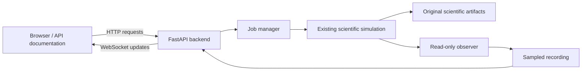

# Stage 3 usage: backend and genuine observed state

Stages 1–3 are backend services. The React dashboard is Stage 4 and has not
been built. You can use the backend now through its local API documentation.

## Think of it as a robotics control station

Your existing scientific simulator is still the robot/world authority. We built
a separate local control station around it:

| Component | Robotics analogy | Actual responsibility |
|---|---|---|
| FastAPI backend | A station's service interface | Accept validated requests and return data |
| HTTP API | Similar interaction style to ROS services | GET reads; POST previews, starts or cancels |
| Job manager | A process supervisor | Own one top-level run, retain logs/status, manage cancellation/recovery |
| Original CLI runner | Your existing executable | Construct and run the existing scientific simulation |
| Observed runner | An explicitly selected instrumented execution wrapper | Same public scientific components/setup, with a post-tick observer |
| Observer | A read-only state publisher | Copy actual cells, SOC, counters, order counts and charger state |
| WebSocket | A topic-like subscription | Push sequenced status, log and sampled-state messages to a client |
| NDJSON trace | A small sampled recording, conceptually like a bag | Retain genuine observation samples for later inspection/display |
| SQLite | A local operations ledger/index | Store job state and metadata; never replace original scientific metrics |
| React frontend, later | The control-station screen | Render and interact with this backend |

These are analogies; no ROS node or topic integration was added. ROS/Gazebo
remains deferred. The observation code never controls routing, allocation,
traffic, battery policy or simulated time.



## Start the local backend

In a terminal, copy these commands:

```bash
cd /home/ibrahim/rnd_mrta_ilp_ws
export PYTHONPATH="$PWD/src/dashboard_GUI/backend:$PWD/src/mrta_core:$PWD/src/simulation_env:$PWD/src/task_management"
PYTHONDONTWRITEBYTECODE=1 src/dashboard_GUI/backend/.venv/bin/python -m control_center.app
```

Leave that terminal running. Stop your own server with Ctrl+C. If an earlier
backend already occupies port 8000, stop it from its original terminal before
starting the updated service; do not kill an unrelated process.

Open <http://127.0.0.1:8000/docs>. This is the interactive API documentation,
not the warehouse dashboard. `/openapi.json` gives the machine-readable API.
The standard Swagger documentation uses CDN assets, while the API itself and
its data are local. No dependency installation is needed in this checkout.

The supported launcher binds 127.0.0.1 and disables proxy headers. The HTTP and
WebSocket interfaces retain the Stage 2 loopback-peer, Host/Origin, token and
cookie protections. Do not expose this service through a public proxy.

## First observed run, step by step

1. In `/docs`, expand **GET `/api/v1/health`**, click **Try it out**, then
   **Execute**. A response proves the service is running. GET reads information.
2. Execute **GET `/api/v1/session`**. Copy `data.csrf_token`. Click Swagger's
   **Authorize** button and paste that value for `X-Control-Center-Token`.
   This local session token protects actions. It changes when the backend restarts.
3. Execute **POST `/api/v1/jobs/preview`** with the JSON below. Preview checks
   settings and shows the command/effective inputs. It does not start a run.
4. Review the response. Copy `data.preview_id`. Execute **POST `/api/v1/runs`**
   with `{"preview_id":"<the actual preview ID>"}`. This deliberately starts
   a small headless simulation. No ROS or hardware is involved.
5. Copy the launch response's `data.id`: this is the **job ID**. Use it in
   **GET `/api/v1/jobs/{job_id}`** to inspect running/completed/failed status,
   exit evidence, argv, artifact state and observation availability.
6. Read **GET `/api/v1/jobs/{job_id}/snapshot`**. In observed mode,
   `data.snapshot.payload.robots` contains actual copied robot cells/SOC/state,
   and `data.snapshot.payload.orders` contains aggregate counts. The exact
   timestamp is `data.snapshot.sim_time_exact`, e.g. `"674/3"` simulated seconds.
7. Read **GET `/api/v1/jobs/{job_id}/logs`** for text output, and
   **GET `/api/v1/jobs/{job_id}/telemetry`** for a page of recorded samples.
   To request cancellation, POST `/api/v1/jobs/{job_id}/cancel` with `{}` and the
   same token. A tiny run can finish before that request arrives.

Preview body:

```json
{
  "kind": "run",
  "scenario_id": "W100",
  "strategy": "nearest_astar",
  "robots": 2,
  "orders": 3,
  "seed": 7,
  "progress_interval_s": 0,
  "execution_mode": "observed",
  "observation_sample_s": 1
}
```

`execution_mode` defaults to `cli`: the original runner, status/logs/artifacts
only. `observed` is an explicit separate wrapper, source-gated against the
verified original runner. `observation_sample_s` applies only to observed mode;
it must be 0.001–3600, defaults to 1, and controls selection from existing ticks.
It never creates simulator timers or changes speed. Experiments reject observation
fields and retain original CLI execution with logs/artifacts only.

## Results, IDs and storage

Job IDs control operational jobs. For scientific artifacts, GET
`/api/v1/runs?scope=app`, then use a returned **app run ID** with
`/api/v1/runs/{run_id}/metrics?scope=app`, `/decisions`, `/outcomes` or `/artifacts`.
Do not substitute a job ID for this run ID. The original manifest's scientific
`run_id` is a separate input-derived research identifier.

Default `scope=history` browses the original repository `runs/` read-only.
Old runs without an actual trace return observation unavailable. A matching
observed app run supports `/api/v1/runs/{run_id}/telemetry?scope=app`.

All new writable state is in the ignored `src/dashboard_GUI/var/` directory:

```text
jobs.sqlite                            operational status/events/latest snapshot/cursor
jobs/<job_id>/process.log               text logs
jobs/<job_id>/telemetry.ndjson           sampled state, separate from science tables
runs/singles/<job_id>/                  original decisions/outcomes/manifest/metrics
app-index/index.sqlite                 disposable index of app-run artifacts
```

Read scientific metrics from their original files/API. SQLite is a catalogue
and operations ledger, not another scientific model or metric calculation.
Original decisions/outcomes, metrics, and optional CSV/Prolog exports are unchanged.

## Understanding the live data

An observed runner copies after existing executor ticks. Copies contain
primitives; a bounded queue passes them to a separate writer. Callback work has
no file/network I/O, waiting, sleeping, RNG calls or scheduling. Observation
errors disable/mark observation and do not stop the scientific process.

- `snapshot` is the latest copied frame, not a continuously interpolated path.
- `sim_time_exact` comes from the Fraction simulation clock. `sim_time_s` is its
  display float. Observation age is wall time and is never a scientific duration.
- `active_order_id` and `assigned_order_id` stay separate for deferred work.
- Disabled battery state is null, never an invented SOC estimate.
- `telemetry.live`, `age_wall_s`, `stale`, `availability` and
  `recording_complete` distinguish current, old, partial and unavailable data.
- A fast headless run can finish in a fraction of a real second. Its latest frame
  may already be final when you inspect it. The recorded samples support later
  display/playback; the rendered player is part of the future frontend.
- Queue or writer drops create explicit gaps and a partial recording. A valid
  scientific job can still be completed. No positions are invented to fill gaps.

Recorded pages use a byte `cursor` and `limit` (default/max 100). Responses contain
`records`, `next_cursor`, `has_more`, `trailing_partial` and file metadata.
Records include header, fleet snapshots and end marker. Trace `sample_sequence`
and `stream_generation` differ from the global WebSocket event `sequence`.

The existing authenticated same-origin WebSocket
`/api/v1/ws/jobs/{job_id}?after_sequence=0` carries status/logs plus genuine
`fleet_snapshot`, `telemetry_gap` and recording-availability messages. Use the
session cookie set by `/session`. After a retention gap, recover from the supplied
snapshot and byte-cursor endpoints. Restart preserves committed sequence/cursor
state and does not regenerate or rerun missing history.

## Limits and scientific guard

Queue: 128 samples plus one final-state slot. Trace: 64 MiB, record: 256 KiB,
read page: 1 MiB/100 records. The writer waits at most five seconds after the run;
failed or cancelled recording can remain partial with no end marker. The final
slot preserves the final state after queue saturation if file writing/quota permits.

Typed readers validate exact times, identity, schema, finite counters and source
fingerprint. Data after an end marker, a replaced/truncated trace or a failed
relay commit cannot masquerade as a complete current observation. Relay cursor
and events commit together; transient failures retry uncommitted samples.

The standalone wrapper reproduces original setup/results through public scientific
functions, but orchestration duplication is a maintenance cost. A fingerprint
gate disables observed mode if the original runner changes. Original CLI mode
remains available; rerun the reviewed tiny parity gate before updating that pin.
Input/source checkpoints are not an immutable archive of dirty source bytes.

Verification results and remaining limits are in `STAGE_3_REPORT.md`.
